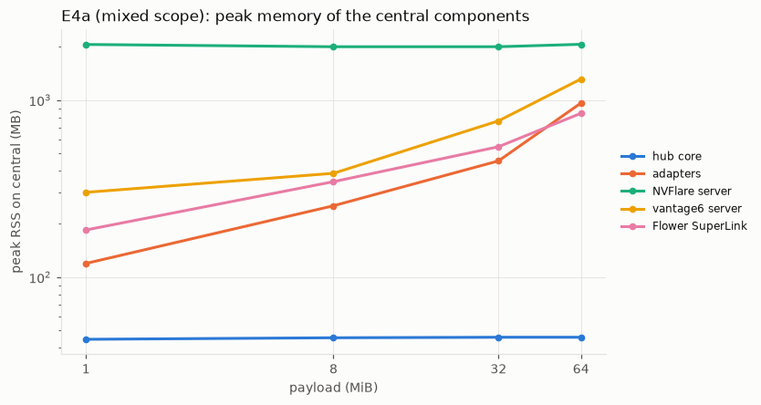
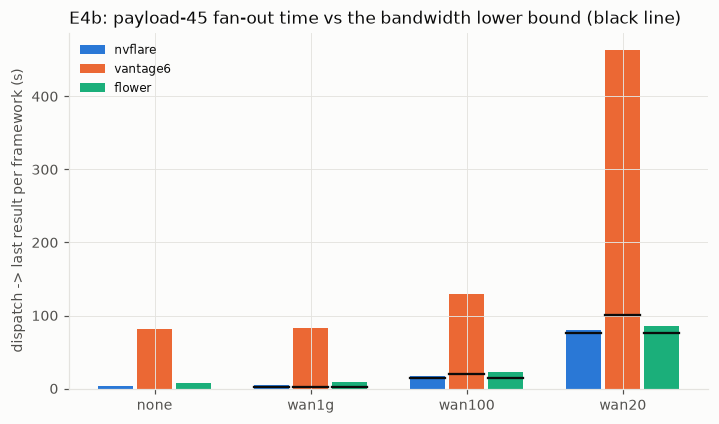

# AgnosticFL — Stage 2 report: full system and performance test

Stage 2 tests the stage-1 system (`REPORT.md`, tag `stage1-final`) under realistic and demanding conditions: non-IID and uneven data, six server aggregators, larger models, payloads up to 512 MB, more sites, dropouts, stragglers, partial participation, hub crashes and framework-server restarts. It also measures where the time goes. The same four autonomous agents ran it (central, nvflare, vantage6, flower), one per VM, coordinating over the agent bus and one GitHub repository.

> All numbers come from the final runs in `docs/report/stage2/runs.md` (W&B project `AgnosticFL-stage2`) and the generated tables in `docs/report/stage2/` (`tables.md`, `e6.md`, `e4_bytes.md`, `cost_model.md`, made by `scripts/stage2/*.py`). The framework agents' sections are `docs/report/stage2/{central,nvflare,vantage6,flower}.md`.

## 1. Executive summary

**Headline claim: confirmed.** Changing the aggregation algorithm (six of them), the data distribution (eight partitions), the model (52 k to 11 M parameters) and the participation policy were hub-side changes. The hospitals kept running the same standard client glue in NVFlare, vantage6 and Flower (0 changed lines in hospital code), and every real run produced the same weights as the framework-free simulation, bit for bit.

- **RQ1, correctness.** All **69 final real runs** equal `hub.sim` with difference **0.0 in every round**: global weights and float64 server-optimizer state (62 by full simulation, 4 with the recorded participants, 2 by replay, 1 by bit-exact resume). Two configurations re-run hours later reproduced all 50 rounds exactly (INV-4).
- **RQ2, hospital cost.** The only hospital-side change was one `flhub_core` 0.1 → 0.2 rollout through each framework's own channel: NVFlare job custom code (3 one-time steps, 50 s downtime per site), a new vantage6 algorithm image tag plus one labelled database per data variant (14.7 s downtime), and the Flower FAB (0 steps, 0 downtime). Every later change (aggregators, FedProx μ, partitions, models, participation, resume) needed nothing at the hospitals.
- **RQ3, learning.** Site-level label skew costs FedAvg 6–9 pp of test accuracy and 25–30 pp on the worst site; quantity skew costs nothing; skew that follows framework boundaries costs about 1 pp. Server momentum (FedAvgM) and FedYogi recover 2–4 pp under label skew. FedAdam diverged in one of three seeds and FedAdagrad was weakest. The wider `cnn-medium` reaches 81.5 %, the target, on `dir0.3`. Server learning rates tuned for one setting diverged with a larger model and with 50 % participation.
- **RQ4, performance.** Per site and round, transport, framework and adapter together cost 1.6–2.7 s with NVFlare, 5.6–10.9 s with Flower and 7.2–42 s with vantage6 (E3), and the hub's own aggregation stays below 0.15 s up to 11 M parameters. NVFlare and Flower carried 512 MB updates (15.5 and 45.8 s per round) with 1.002–1.06× bytes on wire and 89–94 % of the link at 20 Mbit/s. vantage6 moves 5–9× the payload, its server is CPU-bound and superlinear, and it dominates every mixed round. Twelve sites instead of six cost 14 % more round time. Against each framework's own FedAvg the hub path is between 20 % faster and 10 % (0.7 s) slower per round, with bit-identical weights for vantage6 and Flower and a 3e-8 float32 difference for NVFlare. A simple per-framework cost model (fixed cost plus cost per MiB, fitted on the payload sweep, plus the slowest site's training and the link transfer) predicts the E3 and E4b round times within ±10 % for NVFlare and Flower, and within ±13 % for vantage6 at 6 MiB and more.
- **RQ5, robustness.** Every injected fault recovered without manual action: client kills (detected in 2–34 s depending on the framework), stragglers (dropped at the deadline through partial collect and per-site cancel), a SIGKILL of the hub and all adapters (resumed bit-exactly, including the FedAvgM state), and restarts of all three framework servers between and during rounds.

**Campaign:** 2026-10-13 13:47 UTC to 2026-10-14 about 09:00 UTC for S0–S4 (about 19 h; S4 alone 17 h). **122 final runs** were finalized and uploaded (69 real, 44 simulated extra seeds, 3 references, 6 native baselines), plus INV-4 re-runs and diagnostics that were not uploaded.

**Most important limits found:**
1. **vantage6 4.15.2 cannot deliver 256 MB results** with its default SQLite server: the server rewrites near-GB run rows while the node's websocket times out, and the node then drops the result and trains again (§6.1). Its by-design five copies of every update per site and round also make it the bottleneck under limited bandwidth (§6.2).
2. **NVFlare re-admits a restarted client only by restarting the relay job.** With `min_sites` the hub keeps the round going without the client, so it stays out until the hub pauses (§7).
3. **The testbed itself:** the 19 GB central disk stopped the payload sweep above 512 MB for two-site scopes and above 128 MB for six sites. CPU-only training limited `resnet18-gn` to 20 rounds, too few to converge (42.7 % with FedAvg, 50.7 % with FedAvgM).

## 2. Setup

### 2.1 What was reused and what is new

Reused from stage 1 without rebuilding: the four VMs, the hub core, the three framework servers on central (NVFlare 2.9.0, vantage6 4.15.2, Flower 1.39.0), the three adapters, the six hospitals (`nvf-h1`, `nvf-h2`, `v6-h3`, `v6-h4`, `flw-h5`, `flw-h6`) with their standard clients, the agent bus and the git workflow.

New in stage 2:

| Component | Change | Where |
|---|---|---|
| Protocol | flhub/0.2: per-site progress, partial collect, per-site cancel, per-run readiness, payload cap ≥ 1024 MB; a 0.2 adapter still serves 0.1 callers | `docs/agents/PROTOCOL.md` §7, ADR-008, `adapters/common` |
| Shared training library | `flhub_core` 0.2: OrganAMNIST, partitions, lazy data variants, model zoo, FedProx μ, weight decay, timing metrics, selfcheck v2 | `flhub_core/`, ADR-009, ADR-010 |
| Aggregators | stateful plugins fedavg (stage-1 code path), fedavgm, fedadam, fedyogi, fedadagrad, fedprox; float64 state, checkpointed every round | `hub/aggregators/` |
| Orchestrator and sim | config schema 2, seeded participation, `min_sites` through partial collect, strict retries with online wait, bit-exact `--resume`, per-round hashes of weights and aggregator state, timing breakdown, multi-class and site-shaped evaluation, no live W&B; sim `--workers`, `--replay`, `--participants-from`, `--compare` | `hub/orchestrator/`, `hub/sim/` |
| Campaign tooling | config generator, tuner, run driver, post-processing worker, finalize gate, E4a sweep, central E6 injector, sysmon, netem | `scripts/stage2/`, `scripts/sysmon.py`, `deploy/central/netem.sh` |
| Framework side | flhub/0.2 adapters, rollout of `flhub_core` 0.2 through each framework's own channel, E6 tools, E5 extra sites, E7 native FedAvg, purge scripts | `adapters/<fw>/`, `deploy/<fw>-vm/`, `deploy/central/<fw>/` |

### 2.2 Versions and machines

Versions are those of stage 1 (`deploy/versions.env`, ADR-002): Python 3.11.17, torch 2.14.1+cpu, numpy 2.4.4, safetensors 0.8.0, NVFlare 2.9.0, vantage6 4.15.2, flwr 1.39.0, wandb 0.30.0. `flhub_core` 0.2 has the content-hash code_version **`0.2.0+fe357a1dbec1`**; its selfcheck v2 digest is `sha256:ac074a0b79a2d3c6782765480164c0465ac598359dfe91695e893e208f4e5034` on central, in the NVFlare hospital runtime (job custom code), inside the vantage6 algorithm image `v6-train:a43cef3f75c0` and in the Flower SuperNode runtime (FAB). All four VMs: 4 vCPU AMD EPYC-Rome (AVX2), 31 GiB RAM, 19 GB disk. Training uses one CPU thread per site.

Frozen SHA for every final run: **`96c44c957d6ca5d3b9cc8af93dd227c62a9323d6`** (S3-frozen, bus #210). Frozen paths: `flhub_core adapters clients hub configs/stage2 deploy/central`.

### 2.3 Dataset (ADR-009)

**OrganAMNIST** (MedMNIST v2, 28 × 28 grayscale abdominal CT, 11 organ classes; CC BY 4.0). File `organamnist.npz` from Zenodo record 10519652: 38,247,708 bytes, md5 `68e3f8846a6bd62f0c9bf841c0d9eacc` (= MedMNIST's), sha256 `7c8c8b0753e2c0d7f70928817eac02be7cbb09f6beff4346e9d0ea79ecb598bd`. Official splits: train 34,561 (site partitions), validation 6,491 (S3 tuning, central only), test 17,778 (final evaluation, central only). Class counts in train: bladder 1,956, femur-L 1,390, femur-R 1,357, heart 1,474, kidney-L 3,963, kidney-R 3,817, liver 6,164, lung-L 3,919, lung-R 3,929, pancreas 3,031, spleen 3,561. The stage-1 PneumoniaMNIST partitions stay available as variant `pneumoniamnist-iid` (byte-identical to stage 1) for the regression test and the payload runs.

### 2.4 Partitions (ADR-009, `flhub_core/partition.py`)

All partitions are deterministic in `partition_seed` 2026 (numpy's frozen legacy RandomState, seeded from sha256(seed, purpose)); the training seeds 2026/2027/2028 never change them. Manifests with sizes, label histograms, CSV sha256 and data fingerprints are committed in `configs/stage2/partitions/`; every envelope reports `data_fp`, which the hub checks against the manifest.


| pid | definition | site sizes |
|---|---|---|
| `iid` | stratified, equal sizes | 5,761 / 5,760 × 5 |
| `dir1.0`, `dir0.3`, `dir0.1` | label skew, q_k ~ Dirichlet(α p), equal sizes; sites in order take round(q_k n_k) per class, an exhausted class passes its shortfall on in proportion to q_k | 5,761 / 5,760 × 5 |
| `qty` | IID labels (stratified), sizes ∝ 1:32:2:16:4:8 | 549, 17,555, 1,097, 8,777, 2,194, 4,389 |
| `fwcorr` | per class, framework shares ~ Dirichlet(0.3·1₃); IID halves inside a framework | NVFlare 3,219/3,218, vantage6 9,076/9,075, Flower 4,985/4,988 |
| `mix` | dir0.3 proportions with the qty sizes | as qty |
| `iid12` | stratified over 12 sites (E5) | 2,881 / 2,880 × 11 |

With equal site sizes and a small α the class pools run out, so the last sites in the order take the leftovers and `dir0.1` is only slightly more skewed than `dir0.3`; the realized histograms (figure) are what the experiments use.

### 2.5 Model zoo (ADR-010)

| id | architecture | parameters (11 classes) | payload (float32) | selfcheck v2 result |
|---|---|---|---|---|
| `cnn-small` | stage-1 CNN: conv8-pool-conv16-pool-fc64-fc | 52,203 | 0.2 MB | `sha256:d28ac252…` |
| `cnn-medium` | 2×conv32-pool-2×conv64-pool-fc512-fc | 1,676,779 | 6.4 MB | `sha256:e2a59ca5…` |
| `resnet18-gn` | ResNet-18, CIFAR stem, GroupNorm(32) | 11,173,323 | 42.6 MiB | `sha256:19e6b79b…` |
| `payload-<MB>` | synthetic float32 tensors of 4 MiB; "training" = w + 1e-3·c(seed, round, data fingerprint, tensor) | <MB> MiB / 4 | <MB> MiB | `sha256:f4cb4e9d…` (payload-8) |

Local training cost per site and round on 5,761 images with one thread: cnn-small 1.6 s, cnn-medium 11.4 s, resnet18-gn about 3.6 min.

### 2.6 Aggregators and tuned values

With p_k = n_k / Σ n_j over the participating sites and Δ = Σ_k p_k (w_k − x), all in float64 with one float32 cast of the new global model per round (PLAN.md §4.1): fedavg x ← Σ p_k w_k (the stage-1 code path); fedavgm m ← βm + Δ, x ← x + ηm; fedadam m ← β1 m + (1−β1)Δ, v ← β2 v + (1−β2)Δ², x ← x + η m/(√v + τ); fedyogi as fedadam with v ← v − (1−β2)Δ² sign(v − Δ²); fedadagrad v ← v + Δ², x ← x + ηΔ/(√v + τ); fedprox = fedavg at the server and μ(w − x) added to the client gradient (μ = 0 skips it). Defaults β 0.9, β1 0.9, β2 0.99, τ 1e-3, v₀ = τ².

S3 tuning (sim, validation split, dir0.3, 30 rounds; `docs/report/stage2/tuning.md`): client lr **0.1**; fedavgm η **1.0**, fedadam η **0.03**, fedyogi η **0.03**, fedadagrad η **0.03**, fedprox μ **0.01**. **A\* = fedavgm** (final validation accuracy 0.914). Four optima lie on the edge of the plan's grid.

## 3. RQ1 — Correctness (INV-1)

**Every final real run equals `hub.sim` for the same config, seed and participants.** `metrics.jsonl` and the round records hold the sha256 of the global weights (`global_ref`) and of the aggregator state (`agg_state_ref`) after every round; `scripts/stage2/finalize_run.py` refuses to upload a real run unless its INV-1 check passed. Methods (PLAN.md §2):

| method | real runs | which | how |
|---|---|---|---|
| full-sim | 62 | E1 (7), E2 (15), E3 CNN (2), E4a (24), E4b (4), E5 (2), E6a strict, E6e, E7 hub (6) | `hub.sim --compare <real run>`: the whole run again in-process (same `flhub_core.train`, same aggregator), participants taken from the real run, global hash compared per round |
| participants-sim | 4 | E6a `min_sites`, E6b, E6c (2) | the same, for runs with dropped or sampled sites (`--participants-from`) |
| replay | 2 | E3 `resnet18-gn` | `hub.sim --replay <run> --rounds 1,2,3,last`: recompute those rounds from the real run's own previous weights and aggregator state |
| resume-equal | 1 | E6d | final weights and aggregator state hash-equal to the uninterrupted `s2-e2-dir0.3-fedavgm` |

**69 of 69 final real runs passed, all with difference 0.0** (`docs/report/stage2/runs.md`, `tables.md` §RQ1). No run needed the tolerance and there was no exception. The 44 extra-seed runs are `hub.sim` runs, and their gate is the real seed-2026 run of the same config (`sim-counterpart`). The 3 reference runs (centralized, local-only) have no federated counterpart. The 6 native E7 runs are compared with the hub instead (§6.5).

**INV-4 (reproducibility).** One E1 and one E2 configuration were run a second time on the real system from the frozen code, 3–5 hours later and after dozens of other runs on the same deployment (`scripts/stage2/inv4_check.py`). In `s2-e1-dir0.3-fedavg` and `s2-e2-dir0.3-fedavgm` all 50 rounds are identical in global weights and aggregator state (`docs/report/stage2/evidence/inv4-*.json`). E6 shows the same from another side: strict runs with 2 and 3 retried rounds (E6a, E6e) and a resumed run after SIGKILL (E6d) end with the same weights as their undisturbed counterparts.

The result is stronger than the 1e-5 tolerance of INV-1: in every round of every compared run the hashes were equal, i.e. the real cross-framework system produced byte-identical weights to the framework-free simulation, including the float64 server-optimizer states.

## 4. RQ2 — Hospital-side cost

**Code a hospital executes did not change.** `git diff --stat stage1-final..HEAD -- clients/` (the full output is in `docs/report/stage2/ledger.md`):

| path | lines | runs where | why |
|---|---|---|---|
| `clients/nvflare/` | 0 | hospital | — |
| `clients/vantage6/` | 0 | hospital (algorithm image) | — |
| `clients/flower/flhub_flower/client_app.py`, `records.py` | 0 | hospital (ClientApp in the FAB) | — |
| `clients/flower/flhub_flower/server_app.py` | 313 | central only (relay ServerApp in the same FAB) | flhub/0.2 per-site posts and cancel, relay timings, stale-relay fix |
| `clients/flower/pyproject.toml` | 4 | FAB metadata | version 0.2.0, `fab-id` run config |

So switching the aggregator (E2), the data (E1), the model (E3), partial participation and resume (E6) needed **0 changed lines** in the hospital glue of all three frameworks (INV-2). FedProx's μ lives in `flhub_core` and reaches the sites inside `train_config`. What did reach the hospitals is one library update, `flhub_core` 0.1 → 0.2, plus data provisioning and, for vantage6, one node-config change.

**Rollout of `flhub_core` 0.2 per framework** (ledger rows; bus #151, #161, #172, #187):

| | NVFlare | vantage6 | Flower |
|---|---|---|---|
| channel | job custom code (`custom/flhub_core` in the relay job) | new algorithm image tag `v6-train:a43cef3f75c0` in the operator's registry | FAB (`flhub_core` packed next to the ClientApp) |
| central side | rebuild + resubmit relay job (`install.sh`, `start.sh`) | build + push image (98 s), adapter restart (2 s) | `restart.sh adapter`: new FAB + relay run (29.6 s) |
| one-time hospital steps | 3: data provisioning; remove the venv's `flhub_core` (NVFlare appends `custom/` to `sys.path`, so a venv copy would shadow the job's); 1 client restart | 2: data provisioning; node config with one CSV database per data variant + 1 node restart (14.7 s) | 1: data provisioning |
| hospital downtime | 50.3 s per site (82.6 s switch) | 14.7 s (config switch, both nodes together) | 0 |
| client restarts | 1 | 1 (config, not code) | 0 |
| later `flhub_core` updates | 0 hospital steps (next job) | 0 (next image tag; nodes pull on the first task) | 0 (next FAB) |
| lines changed in hospital code | 0 | 0 | 0 |

Data provisioning (all frameworks) is a data-only step: `python -m flhub_core.data materialize --variants all --sites <sites> --manifests configs/stage2/partitions` writes nine sha256-verified CSV files per base site (about 110–150 MB); the E5 extra sites get `organamnist-iid12` only. NVFlare and Flower keep their stage-1 data path (`<dir>/<site>.csv`); `load_site()` finds the variant files next to it. vantage6 receives a DataFrame from the node, so each variant is a labelled node database chosen per task by the dispatch hint `data_variant`.

**E5 extra sites** (two more hospitals per framework, used only for E5) were added with each framework's normal onboarding, prepared once in S2 and started on request: NVFlare startup kits from the same root CA (`extra.sh install`), vantage6 node configs with the operator-issued API keys, and two more Flower SuperNodes with their own supervisor and watchdog line. They were online 16–62 s after the request and stopped again right after the run (§6.4); registered but offline, they never blocked another run.

**The ledger** (`docs/report/stage2/ledger.md`) has 23 rows: 9 vantage6, 7 NVFlare, 7 Flower. By type: 1 code (the Flower FAB with `flhub_core` 0.2), 1 config (vantage6 node databases), 3 data (provisioning), 18 ops (watchdogs, E5 sites, E6 tools and their reverts, clean-up). None changed hospital glue code: `git diff --stat stage1-final..HEAD -- clients/` touches only the Flower FAB's central relay ServerApp and its metadata (justified in the ledger).

## 5. RQ3 — Learning under heterogeneity (E1, E2, E3)

All learning results use OrganAMNIST, `cnn-small`, 1 local epoch, batch 64, client lr 0.1, 50 rounds, and the official test split (17,778 images). Seed 2026 runs on the real system; seeds 2027 and 2028 run in `hub.sim` only, which is valid because every real seed-2026 run is hash-identical to its simulation (§3). "Worst-site" is the site-shaped accuracy: the per-class test accuracies weighted by each site's training label histogram; rounds-to-target is the first round with test accuracy ≥ 0.95 × the centralized accuracy (0.95 × 84.7 % = 80.5 %).

### 5.1 E1 — data heterogeneity (FedAvg)


| partition | final test acc % | mean of last 5 rounds % | balanced acc % | macro AUC % | worst-site acc % | rounds to target |
|---|---|---|---|---|---|---|
| iid | 83.8 ± 0.4 | 83.5 ± 0.5 | 82.8 ± 0.5 | 98.2 ± 0.1 | 84.2 ± 0.4 | 16 |
| qty | 84.3 ± 0.9 | 83.4 ± 0.6 | 83.1 ± 0.8 | 98.2 ± 0.3 | 84.7 ± 0.9 | 12 |
| fwcorr | 82.9 ± 0.5 | 83.3 ± 0.7 | 81.7 ± 0.8 | 98.0 ± 0.1 | 78.5 ± 0.4 | 20 |
| dir1.0 | 76.7 ± 4.7 | 78.9 ± 0.4 | 75.7 ± 5.3 | 96.7 ± 1.0 | 63.8 ± 12.5 | not reached |
| dir0.3 | 78.0 ± 0.9 | 77.6 ± 0.5 | 77.4 ± 1.0 | 96.8 ± 0.3 | 57.2 ± 2.7 | not reached |
| dir0.1 | 74.7 ± 2.0 | 74.2 ± 2.4 | 73.3 ± 2.5 | 96.0 ± 0.6 | 60.5 ± 3.8 | not reached |
| mix | 75.4 ± 2.4 | 73.4 ± 0.8 | 72.6 ± 3.4 | 96.1 ± 1.0 | 63.6 ± 7.4 | not reached |

References: centralized training on the pooled split reaches 84.7 % (balanced 83.0 %, AUC 98.1 %); each site alone for 50 epochs reaches on average 69.2 % on `iid` and 26.3 % on `dir0.1`.

- **Label skew is what hurts.** Site-level label skew costs FedAvg 6–9 pp of test accuracy and 25–30 pp on the worst site, and none of these partitions reaches the target within 50 rounds. The final-round accuracy also swings between seeds (dir1.0: ± 4.7 pp) and over rounds: single-round drops reach 46.7 pp (dir1.0, round 39) and 37.2 pp even on `iid` (round 13) at client lr 0.1, recovered within one (iid) to three (dir1.0) rounds; the mean of the last five rounds is the steadier summary.
- **Quantity skew alone costs nothing.** With IID labels, sizes 1:32:2:16:4:8 reach the same accuracy as `iid` and the target 4 rounds earlier: the largest site (17,555 images, 51 % of the FedAvg weight) takes 274 local steps per round.
- **Framework-correlated skew is mild here.** When the class mix differs between frameworks but the two sites of a framework are IID halves (`fwcorr`), FedAvg loses about 1 pp overall and 6 pp on the worst site. Every site still sees most classes (figure in §2.4), unlike the Dirichlet partitions, where a site holds 2–4 classes. So skew that follows framework boundaries is not worse than skew between sites.
- Federating pays: even the worst skew (`dir0.1`, 74.7 %) is far above training alone on the same data (26.3 %).

### 5.2 E2 — aggregation algorithms


Final test accuracy % (mean ± sd over 3 seeds; in brackets the worst-site accuracy %). The `fedavg` column is E1.

| partition | fedavg | fedavgm | fedadam | fedyogi | fedadagrad | fedprox |
|---|---|---|---|---|---|---|
| iid | 83.8 ± 0.4 (84.2) | 82.9 ± 0.3 (83.3) | 83.4 ± 0.1 (83.8) | 83.8 ± 1.1 (84.2) | 82.5 ± 1.7 (82.9) | 84.2 ± 0.5 (84.6) |
| dir0.3 | 78.0 ± 0.9 (57.2) | **80.2 ± 1.6 (62.3)** | 57.7 ± 36.1 (41.8) | 80.1 ± 1.4 (61.9) | 75.3 ± 2.5 (50.6) | 77.8 ± 1.3 (56.4) |
| dir0.1 | 74.7 ± 2.0 (60.5) | 78.3 ± 3.1 (59.3) | 77.0 ± 2.7 (62.8) | **78.4 ± 1.2 (65.3)** | 68.9 ± 7.7 (41.8) | 74.9 ± 1.1 (61.3) |
| rounds to target, `iid` (seed 2026) | 16 | 27 | 24 | 19 | 36 | 16 |

Hyperparameters from S3 (tuned on `dir0.3`, validation split): fedavgm η 1.0 (β 0.9), fedadam η 0.03, fedyogi η 0.03, fedadagrad η 0.03, fedprox μ 0.01; the client lr 0.1 is shared.


- **Server momentum and Yogi help under label skew.** On `dir0.3` and `dir0.1`, fedavgm and fedyogi gain 2–4 pp of test accuracy over FedAvg (and up to 5 pp on the worst site on `dir0.3`). With IID data they gain nothing and reach the target later (27 and 19 rounds against 16), because their server learning rates were tuned for the skewed case.
- **FedAdam can diverge.** One of three `dir0.3` seeds (2027, a `hub.sim` run) holds 81 % until round 45 and then collapses to 16.2 % at round 50 (test loss 8.65). Its test loss had been rising since round 39 (1.34, then 1.59 at round 45). This is the known instability of Adam-type server steps when the second-moment estimate becomes small (τ = 1e-3, β2 = 0.99). FedYogi updates the second moment additively, which limits its decay; it stays stable on the same partition and seeds. FedAdagrad, whose accumulated second moment only grows, is the weakest server optimizer here; its `dir0.1` final-round value (68.9 ± 7.7) comes from a single-round dip, and the mean of its last five rounds is 73.2 ± 0.4.
- **FedProx with μ = 0.01 behaves like FedAvg.** S3 chose μ = 0.01 by validation accuracy (90.3 %, against 90.2 % at μ = 0.001 and 88.9 % at μ = 0.1). At this strength the proximal term changes little: the test results are within 0.4 pp of FedAvg on every partition.
- **No aggregator reaches 80.5 % on `dir0.1` within 50 rounds**, and only fedavgm and fedyogi come close on `dir0.3` (the target is 95 % of centralized accuracy). Label skew remains the dominant effect; the choice of server optimizer recovers part of it.
- **Changing the aggregator is a hub-only change.** All 15 E2 configurations ran on the same hospital deployment as E1, with no restart, no data change and 0 changed lines in `clients/` between them. FedProx's μ reaches the clients inside the opaque `train_config`, and every adapter forwards it unchanged (§4).

### 5.3 E3 — model scale (accuracy)

`dir0.3`, seed 2026, real system. INV-1: full simulation for the CNNs, replay of rounds 1, 2, 3 and the last round for `resnet18-gn`, all hash-equal.

| model | parameters | MiB per update | rounds | FedAvg final acc % (worst site) | FedAvgM (A*) final acc % (worst site) | test acc at round 20, FedAvg |
|---|---|---|---|---|---|---|
| `cnn-small` (E1/E2) | 52,203 | 0.2 | 50 | 77.0 (54.3) | 78.3 (63.8) | 70.0 |
| `cnn-medium` | 1,676,779 | 6.4 | 50 | **81.5** (63.3); target 80.5 % reached at round 36 | 11.1: diverged at round 9 | 73.7 |
| `resnet18-gn` | 11,173,323 | 42.6 | 20 | 42.7 (15.3) | **50.7** (27.8) | 42.7 |

- **The wider CNN pays off within 50 rounds.** `cnn-medium` gains 4.5 pp over `cnn-small` with FedAvg and is the only `dir0.3` run of the campaign that reaches the target (round 36).
- **ResNet-18 needs more rounds than the budget allows.** After 20 rounds of one local epoch, `resnet18-gn` is at 42.7 % and still rising (15.1, 26.1, 41.5 and 42.7 % at rounds 5, 10, 15 and 20). PLAN.md §7 caps a `resnet18-gn` run at about 3 h on these CPUs; this run took 2.1 h, including a 30 min stall (§6.3).
- **The S3 server step does not transfer reliably to larger models.** FedAvgM with η 1.0 and β 0.9, best for `cnn-small`, reaches 50 % at round 7 with `cnn-medium` and then collapses to chance level (11.1 %, test loss 2.5) from round 9 on. `hub.sim` reproduces the collapse bit for bit, so it is the optimizer, as with partial participation in E6c. With `resnet18-gn` the same values do not diverge and speed up the slow start: 50.7 % after 20 rounds against 42.7 % for FedAvg (28.6 against 15.1 % at round 5). Server learning rates have to be tuned per model.

## 6. RQ4 — Performance (E3, E4, E5, E7)

### 6.1 E4a — payload sweep

`payload-<S>` echo models (no compute; round time = transport + framework + hub), 3 rounds, scopes nvflare / vantage6 / flower (2 sites each) and mixed (6 sites); median of rounds 2–3. Every successful run passed INV-1 (hash-equal per round). Full tables: `docs/report/stage2/tables.md`, `docs/report/stage2/e4_bytes.md`.




| MiB | NVFlare s/round | Flower s/round | vantage6 s/round | mixed s/round |
|---|---|---|---|---|
| 1 | 2.5 | 5.8 | 6.3 | 6.5 |
| 8 | 2.7 | 6.1 | 12.8 | 13.3 |
| 32 | 2.7 | 7.7 | 60.1 | 58.9 |
| 64 | 3.7 | 9.1 | 115.3 | 116.2 |
| 128 | 5.1 | 13.5 | 468.2 | 393.8 (ext.) |
| 256 | 10.3 | 20.6 | **limit** (ext.): result never delivered | *(disk)* |
| 512 | 15.5 (ext.) | 45.8 (ext.) | *(disk)* | — |

- **No framework limit was hit.** Every stop is a *testbed disk limit* of the 19 GB central VM (PLAN.md §7 rule: free ≥ 3 GB + 4 × payload × sites; for vantage6 a measured projection of its database growth). At the owner's request (#410) the sweep was extended at the end of S4 ("ext." in the table), after freeing disk on central (the owner removed the stage-1 image; central removed its local copies of the stage-2 algorithm images, the docker build cache and vantage6 run rows orphaned by subtask deletion): NVFlare and Flower carry 512 MB per site and direction, and the mixed scope 128 MB. Mixed 256 MB (needs 9 GB free) and 1024 MB (11 GB) remain testbed disk limits.
- **vantage6 has a real limit at 256 MB** (vantage6 4.15.2, server with its default SQLite database). Training finished every time, but the result never arrived. The server's single worker spent minutes rewriting the ~0.9 GB run rows for every streamed algorithm log line, so the nodes' websocket timed out. The node then emits a status event on the disconnected socket before it sends the result, the emit fails, and the result is dropped (`node/__init__.py:579`). After reconnecting, the server hands the still-open run back, and the node trains round 1 again. Each node trained round 1 six times in 32 min (every ~5 min), and every result was dropped (vantage6 #884, #885; `docs/report/stage2/evidence/vantage6/e4a-256mb-node-logs.txt`). Central cancelled the round at 08:12Z instead of waiting for the 3600 s deadline. Knobs: none usable on the server in 4.15.2 (the large-result store is broken, ADR-020). A PostgreSQL server database (server side) or `share_algorithm_logs: false` on the nodes (hospital side) would remove the row rewrites. Neither was applied, because a limit is a result (PLAN.md §10). 128 MB passed (468 s per round).
- **Bytes on wire** (interface deltas on the framework VMs ÷ payload moved): NVFlare 1.005–1.06, Flower 1.002–1.005, vantage6 5.4 (64 MB) to 9.1 (128 MB). vantage6 4.15.2 sends the run input (base64 JSON, 1.78× the payload) four times per site and round by design (run list, PATCH response, GET before the result, result PATCH response), and more under load, when its single uwsgi worker drops connections while it rewrites the run row for every algorithm log line (vantage6 section §4).
- **Scaling.** NVFlare's round time stays near its 2–2.5 s task-polling floor up to 32 MB and grows about linearly beyond (10.3 s at 256 MB). Flower has about 5.5 s of fixed cost per round (relay and SuperNode message handling, a ClientApp process per message; breakdown in the flower section) and grows linearly. vantage6 grows superlinearly (doubling 64 → 128 MB costs 4×) because the server is CPU-bound in one process; the mixed scope inherits vantage6's time.
- **Memory on central** (sysmon peak RSS): the hub core stays at 42–46 MB at every size (blobs are streamed); the orchestrator needs about 8× the payload (2.0 GB at 256 MB, 2 sites), NVFlare's relay job about 10×, Flower's relay ServerApp about 7.6×, vantage6's server and adapter 15–18× (2.3 / 1.9 GB at 128 MB). Central used at most 7.9 GB of 31 GB up to 256 MB; at 512 MB the orchestrator peaked at 4.1–4.3 GB, NVFlare's relay job at 3.8 GB, Flower's ServerApp at 3.6 GB, and central at 12.1 GB in total (39 %). The framework VMs stayed below 16 % of RAM up to 256 MB; at 512 MB the Flower VM peaked at 7.7 GB (24 %) and the NVFlare VM at 5.1 GB (16 %). Bytes on wire at 512 MB: NVFlare 1.007, Flower 1.002 (`e4_bytes.md`).

### 6.2 E4b — bandwidth sensitivity

`payload-45` (about the size of `resnet18-gn`), mixed scope, 3 rounds per profile; `netem` rate and delay on every hospital link in both directions (central shaped its egress to all three VMs in one call, each framework agent its own egress; revert timers first, cleared and verified after every profile). Fan-out per framework (dispatch to its last result), median of rounds 2–3; lower bound = 4·P/rate (each VM link carries two sites: 2P down before training, 2P up after it). INV-1 hash-equal for all four runs.



| profile | lower bound (s) | NVFlare (s) | efficiency | Flower (s) | efficiency | vantage6 (s) | efficiency | round (s) |
|---|---|---|---|---|---|---|---|---|
| none | — | 3.3 | — | 7.5 | — | 81.8 | — | 82.2 |
| wan1g (1 Gbit/s, 5 ms) | 1.5 | 4.3 | 0.35 | 8.9 | 0.17 | 83.3 | 0.02 | 83.7 |
| wan100 (100 Mbit/s, 20 ms) | 15.1 | 17.0 | 0.89 | 22.7 | 0.67 | 129.5 | 0.12 | 130.0 |
| wan20 (20 Mbit/s, 40 ms) | 75.5 | 80.3 | 0.94 | 85.1 | 0.89 | 463.8 | 0.16 | 464.3 |

- **NVFlare and Flower move each update once and use the link well**: at 20 Mbit/s they reach 94 % and 89 % of the bandwidth bound, consistent with their 1.002–1.06× bytes on wire (E4a). Their remaining time is the fixed cost per round seen in E4a.
- **vantage6 moves 17.8× the payload per link and round by design**: two sites × (four copies of the input down, one result up) × 1.78 for the double base64 encoding (vantage6 section §4). Against that volume it reaches about 0.7 at 20 Mbit/s; the rest is server time. Against the plan's 4·P bound its efficiency is 0.16. Under realistic hospital bandwidth vantage6 dominates a mixed round: 464 s, against 80–85 s for the other two frameworks.
- With 1 Gbit/s and 5 ms nothing changes measurably. The emulation adds rate and delay only, without loss or jitter (§8).

### 6.3 E3 — round time and model size


Median over rounds ≥ 2 (seconds; train and overhead are the mean of the framework's two sites; evaluation runs on central every round for the CNNs and every 5 rounds for `resnet18-gn`). Full table, including FedAvgM: `docs/report/stage2/tables.md`.

| model (FedAvg) | NVFlare train / overhead | vantage6 train / overhead | Flower train / overhead | hub aggregation | hub evaluation | round |
|---|---|---|---|---|---|---|
| `cnn-small` (0.2 MiB) | 0.7 / 1.6 | 1.8 / 7.2 | 1.6 / 5.6 | 0.001 | 1.9 | 9.1 |
| `cnn-medium` (6.4 MiB) | 11.7 / 1.9 | 13.5 / 14.1 | 13.9 / 6.3 | 0.025 | 14.6 | 28.8 |
| `resnet18-gn` (42.6 MiB) | 214.0 / 2.7 | 225.3 / 42.0 | 223.3 / 10.9 | 0.133 | 105.6 | 268.0 |

- **Training dominates as the model grows, and the framework cost does not vanish equally.** The overhead per site and round (transport, framework and adapter) is 1.6 → 1.9 → 2.7 s for NVFlare, 5.6 → 6.3 → 10.9 s for Flower and 7.2 → 14.1 → 42.0 s for vantage6. As a share of the framework's fan-out time it falls from 56 % to 1 % (NVFlare), 72 % to 5 % (Flower) and 79 % to 16 % (vantage6). vantage6 sets the round time for every model.
- **vantage6's overhead grows during a run** when its tasks stay in the server database: with `cnn-medium` from 8.7 s at round 3 to 12.4 s at round 21 (tasks below 16 MB are kept; the server reads full run rows when it reports a task's status, vantage6 section §4). With `resnet18-gn` the adapter deletes each round's tasks, and the overhead stays flat.
- **The hub is not the bottleneck.** Aggregation stays below 0.15 s even for 11 M parameters in float64. Global evaluation on the 17,778 test images costs 1.9 s, 14.6 s and 106 s, on the hub's own CPU and outside the hospitals' path; `resnet18-gn` evaluates every 5 rounds for that reason.
- **Resources** (sysmon, `tables.md`): during `resnet18-gn` the framework VMs ran at 30–33 % mean CPU (two single-threaded trainings on 4 vCPUs), with peak RSS of 1.0–1.1 GB per training process (2.1 GB for vantage6's algorithm container) and at most 4.1 GB used per VM. Central peaked at 6.3 GB, of which the orchestrator took 1.7 GB.
- **One stall, recovered by the hub.** In `s2-e3-resnet18-gn-fedavg` round 10, v6-h3's result never arrived. A hospital-side cron job (task-folder clean-up, vantage6 section) deleted the output in the second between the training container's exit and the node reading it. vantage6 reuses task ids after the adapter's per-round delete, and the reused folder kept its old modification time. The round failed at its 1800 s deadline and the retry succeeded; the cron job was removed (ledger).

### 6.6 Cost model

`scripts/stage2/cost_model.py` fits, per framework, fan-out time = a + b·P on the E4a echo sweeps (P = payload in MiB; least squares on relative residuals) and predicts the learning runs as a + b·P_model + max_k train_k (`docs/report/stage2/cost_model.md`):

| framework | a (s) | b (s/MiB) | R² | prediction error, E1/E2 `cnn-small` | `cnn-medium` | `resnet18-gn` |
|---|---|---|---|---|---|---|
| NVFlare | 2.24 | 0.021 | 0.91 | +4 to +6 % | 0 to +4 % | 0 % |
| Flower | 5.67 | 0.054 | 1.00 | −8 to −7 % | −3 to −1 % | −1 % |
| vantage6 (fit on 1–64 MiB) | 4.13 | 1.49 | 0.96 | −38 to −31 % | −4 to −3 % | +9 % |

Under netem (E4b), adding the transfer time V·P/rate with the bytes each framework moves per link and round (V = 4 for NVFlare and Flower, 17.8 for vantage6) predicts the measured fan-out of all twelve framework-profile pairs within ±13 % (`cost_model.md`). `resnet18-gn` with FedAvgM has the same timing as with FedAvg (prediction errors 0, +10 and −1 %).

The model explains NVFlare and Flower within 8 % across a 200× range of model sizes: a fixed cost per round plus a small per-MiB cost plus the slowest site's training. vantage6's per-MiB cost is 30–70× higher, and its growth beyond 64 MiB is superlinear (E4a). Its small-model error has two parts (vantage6 #705): the straight line underestimates vantage6's fixed cost per task, which is 6.3 s measured at 1 MiB (container start, task and result round trips), and real training adds about 0.8 s per task that the echo runs do not have (reading the site's CSV database into a DataFrame, a slower container exit after a torch run).

### 6.4 E5 — number of sites

`iid` over the 6 base sites against `iid12` over 12 sites (4 per framework; the 6 extra sites hold half as much data each, so the total per round is the same), FedAvg, 20 rounds, real system; INV-1 full simulation, hash-equal. The extra sites were started for this experiment only, with the framework agents' standard scripts: online 16 s (vantage6), 22 s (Flower) and 62 s (NVFlare) after the request, and stopped again right after the run.


| | 6 sites | 12 sites |
|---|---|---|
| round time (median, s) | 9.1 | 10.4 (+14 %) |
| fan-out NVFlare / vantage6 / Flower (s) | 3.0 / 9.1 / 7.6 | 2.8 / 10.4 / 8.3 |
| training per site, NVFlare / vantage6 / Flower (s) | 0.73 / 1.84 / 1.61 | 0.36 / 1.48 / 1.29 |
| overhead per site, NVFlare / vantage6 / Flower (s) | 1.9 / 6.7 / 5.6 | 1.7 / 8.2 / 6.4 |
| hub aggregation (ms) | 0.6 | 1.0 |
| central CPU mean / peak (%), memory peak (GB) | 12 / 41, 3.3 | 17 / 38, 2.7 |
| framework VM CPU mean, NVFlare / vantage6 / Flower (%) | 4.5 / 26.7 / 25.2 | 4.8 / 42.0 / 39.8 |
| test accuracy after 20 rounds | 81.7 % | 74.9 % |

- **Doubling the sites costs the hub almost nothing**, and the round time grows by 14 %. NVFlare's fan-out does not grow at all: four clients poll the server in parallel, and each trains on half the data. vantage6 and Flower grow by 1.3 and 0.7 s, because four training processes (vantage6: four containers) now share the VM's 4 vCPUs, and each extra site adds its own per-task setup.
- **Accuracy drops with more, smaller sites** at the same number of rounds (81.7 → 74.9 %): each site makes half as many local steps per round, so the averaged update is smaller.
- Registered but offline sites did not block any other run: the extra sites stayed registered and offline in every run before and after E5, as in conformance v2 (§3).

### 6.5 E7 — overhead against each framework's native FedAvg

Same two hospitals, same `flhub_core.train`, same config: C1 = `cnn-small`, `iid`, 20 rounds; C2 = `payload-45` echo, 5 rounds. The native server part ran on central next to the idle hub relay (NVFlare's built-in FedAvg controller, vantage6's central function on a hub-operator node, Flower's `FedAvg` strategy in a ServerApp). Median round time over rounds ≥ 2, each framework agent with one definition for both paths (dispatch to aggregated model; details in the framework sections). Finalized as mode `native` with the per-round weight comparison against the matching hub run.


| framework | C1 native / hub (s) | hub overhead C1 | C2 native / hub (s) | hub overhead C2 | native vs hub weights |
|---|---|---|---|---|---|
| NVFlare | 3.50 / 3.27 | −0.23 s (−6.5 %) | 2.52 / 2.62 | +0.10 s (+4.1 %) | 3.0e-8 after round 1 (NVFlare's FedAvg accumulates in float32); C1: SGD amplifies it to 0.68 by round 20; C2 (echo): 2.2e-8 throughout |
| vantage6 | 8.81 / 8.81 | 0.00 s (0 %) | 95.5 / 82.1 | −13.4 s (−14 %) | hash-identical in every round |
| Flower | 9.48 / 7.55 | −1.93 s (−20 %) | 7.45 / 8.19 | +0.73 s (+9.8 %) | hash-identical in every round |

- **The translation layer costs at most 0.7 s per round here, and is often faster than the native path.** Where the hub path is slower it pays for the weights' round trip through the hub core (Flower C2: push 0.63 s, store 0.19 s per site). It is faster where the native exchange waits more: Flower's `Grid.send_and_receive` sleeps 3 s between pulls, while the relay pulls every second. vantage6's native central function moves inputs and results through the node proxy and waits on one multi-organisation subtask, while the adapter uploads per site in parallel and fetches each result as soon as that site is done.
- **The hub's FedAvg equals the native FedAvg** of vantage6 and Flower bit for bit. Both sites hold the same number of examples, so p_k = 0.5 is exact in float32. NVFlare's built-in aggregator accumulates in float32 and differs by 3e-8 after one round, within the 1e-5 tolerance. Over 20 rounds of training the two trajectories drift apart, as any two numerically different runs do (round-by-round test accuracy follows the same dips; mean over rounds 16–20: 63.5 % native, 66.8 % hub). The Flower agent's island test with unequal sizes (`qty`) shows the same float32 effect for Flower (3e-8, growing through SGD).
- **Extra processes on the hub path:** the adapter (about 40–170 MB RSS), the hub core (about 45 MB) and, for NVFlare and Flower, the long-lived relay job or ServerApp; the orchestrator replaces the native server logic. For Flower C1 the hub path used 0.6 GB in total against 0.62 GB for the native ServerApp (C2: 1.05 against 0.89 GB).

## 7. RQ5 — Robustness (E6)

All E6 runs use `dir0.3`, `cnn-small` and the six base sites. The framework agents armed their injections before central started each run (ARM → ARMED on the bus), and central injected the hub, adapter and server faults itself. **No run needed a manual action**, and every run passed its INV-1 gate with difference 0.0: the dropout, straggler and participation runs against `hub.sim` with the recorded participants, E6d by hash equality with the uninterrupted run. Full tables: `docs/report/stage2/e6.md` (generated by `scripts/stage2/e6_table.py`).

| scenario | NVFlare | vantage6 | Flower |
|---|---|---|---|
| E6a dropout, strict (all sites required, retries) | client SIGKILL in r5: failed after 33.1 s ("not in relay job for 30 s"), retried, round done 74.0 s after the kill | algorithm container SIGKILL in r10: run `crashed` after 2.1 s, retried, done after 15.2 s | SuperNode SIGKILL in r15: failed after 20.7 s, retried, done after 31.3 s (node restarted by its supervisor, new node id) |
| E6a dropout, `min_sites: 5` | r5 finished with 5 sites after 34.0 s; the site stayed out for r6–r9 | r10 failed once (nvf-h1 was still out, so only 4 sites), retried with 6 sites | r15 finished with 5 sites after 26.1 s; back in r16 |
| E6b straggler at 10 % CPU (`deadline_s` 20, `min_sites` 5) | in time in all 6 rounds: training 8.0 s instead of 0.7 s, round 10.8 s | dropped in all 7 rounds (round = deadline, 20.3 s) | dropped in all 7 rounds (20.2 s) |
| E6e server restart between rounds | server back in 12.1 s; relay job resubmitted by the keeper; next round done 84.9 s after the restart, no failed attempt | server back in 14.8 s; next round done after 26.9 s, no failed attempt | SuperLink back in 2.0 s; relay run relaunched by the adapter after 35.9 s; next round done after 47.7 s |
| E6e server restart mid-round | the server stopped 7 s after the signal, when NVFlare's sites had already returned round 6; round 7 hit the restart, failed after 51.0 s, retried, done 96.1 s after the restart | the round finished during docker's 10 s stop grace; the next round ran normally (done 20.4 s after the restart) | round 18 failed after 22.8 s ("relay run lost: no heartbeat for 20 s"), retried, done 54.6 s after the restart |


- **Detection time is a framework property.** vantage6 reports a killed algorithm container at once (the run status becomes `crashed`, 2 s). NVFlare and Flower see a dead client only through their liveness mechanisms: the NVFlare adapter's site watcher (relay view plus a FLARE API job probe, ADR-011) fails a site after 30 s outside the job, and Flower's relay after a missed heartbeat or a replaced SuperNode (20–26 s).
- **NVFlare cannot re-admit a restarted client into a running job.** The client process is back within 3–5 s, but it rejoins only when the relay job is restarted, and the NVFlare agent's keeper does that only while no round is in flight (ADR-011): restarting the job would kill the other site's round. With the strict policy the hub waits, so the site is back after 56 s. With `min_sites` the hub keeps dispatching, and the site sat out four rounds until a failed attempt made the hub wait (97 s after the kill).
- **A straggler is a deadline question, not a framework question.** The same 10 % CPU limit made NVFlare's site 11× slower but kept it inside the 20 s deadline, because NVFlare adds only about 1.3 s per site and round on top of training. vantage6 (about 6.6 s) and Flower (5–7 s) add more, so their throttled sites (training about 10× their normal 1.6–1.8 s) missed the deadline in every round. The rounds then completed at the deadline through partial collect and per-site cancel. On Flower, the throttled ClientApps finished after their messages had expired (TTL = deadline) and logged a failed push, which is harmless.
- **Partial participation interacts with server momentum.** With half of the sites per round (seeded sampling, recorded), FedAvg ends at 66.1 % (72.0 % over the last five rounds), against 77.0 % with all sites. FedAvgM with the S3 values (η 1.0, β 0.9, effective step 10), which was the best aggregator with full participation, diverges from round 24 and ends at 9.8 %. `hub.sim` with the recorded participants reproduces the divergence bit for bit, so it is the algorithm and not the system. A server step tuned for full participation is too large when every round's pseudo-gradient comes from a different half of the label-skewed sites. A diagnostic `hub.sim` run (not a final run; `configs/dev/diag-e6c-fedavgm-eta0.3.yaml`) with η = 0.3 and the same participants in all 50 rounds stays stable and ends at 73.9 % (73.0 % over the last five rounds), above FedAvg. Server learning rates therefore need tuning per participation level, which S3 did not cover.
- **Hub crash and resume are exact.** E6d killed the orchestrator and all three adapters with SIGKILL 3 s into round 21. The adapters were back after 1.1 s (NVFlare), 2.2 s (vantage6) and 7.0 s (Flower relay run), `--resume` continued from the round-20 checkpoint, and round 21 was done 20.1 s after the kill. The final global weights **and the FedAvgM momentum state** are hash-identical to the uninterrupted run `s2-e2-dir0.3-fedavgm`, so the server-optimizer state survives a crash. The cost was one round of work.
- **Retries do not change the result.** `s2-e6a-strict` (3 retried rounds) and `s2-e6e-server-restart` (2 retried rounds) have the same config, and their final weights are hash-identical: a retried round re-trains from the same global model with the same seed-derived data order.

## 8. Threats to validity

- **Uniform hardware.** All four VMs have the same CPU type (AMD EPYC-Rome, AVX2) and the same pinned versions. Bit-exact equality between hospitals, hub and sim (INV-1 at 0.0) depends on that; on mixed hardware the plan's tolerance fallback (relative ≤ 1e-5) would be needed.
- **One datacenter network.** The framework VMs talk to central over the cloud provider's internal network (about 0.7 ms RTT); wide-area conditions exist only as netem emulation in E4b, which models rate and delay but not loss, jitter or competing traffic.
- **Simulated hospitals.** Two hospitals share one 4-vCPU VM per framework, so co-located sites compete for CPU, memory, disk and the VM's link; round times include that contention. Payload results (E4) are bounded by the VMs' 19 GB disks and 31 GiB RAM ("testbed limits", reported separately from framework limits).
- **One dataset and one tuning split.** All learning results use OrganAMNIST at 28 px; hyperparameters were tuned once, on `dir0.3`, with seed 2026, and several optima sit on the edge of the plan's grid (§2.6), so the aggregator ranking may change with a wider grid.
- **Sim-based seed statistics.** Seeds 2027 and 2028 of E1/E2 run in `hub.sim` only. This is valid because the real seed-2026 run of the same config is hash-identical to its simulation (INV-1), but it assumes the real system would also have matched for the other seeds.
- **Partition construction.** With equal site sizes, the Dirichlet partitions saturate (classes run out), so `dir0.1` is barely more skewed than `dir0.3` (§2.4); the realized label histograms, not α, describe the heterogeneity.
- **Timing granularity.** Per-site completion times come from polling the adapters every 0.25 s and the frameworks' own polling (vantage6 1 s, Flower relay 1 s, NVFlare streaming), so sub-second differences in overhead are not resolved.

## 9. Limitations, security notes, future work

- **Out of scope by the owner's decision (PLAN.md §3)**, so future work: SCAFFOLD and other control-variate methods, robust aggregators (median, trimmed mean, Krum), federated evaluation at the sites, secure aggregation, differential privacy, GPUs.
- **Plaintext updates at the hub.** The hub core stores every site's weights as plain safetensors blobs (with rolling GC). Anyone with access to central sees all updates; secure aggregation would change that.
- **TLS gaps (unchanged from stage 1).** NVFlare uses its provisioned mTLS; vantage6 and Flower run without TLS, restricted by the cloud firewall to the four VM IPs.
- **vantage6 in DB mode is the payload bottleneck.** vantage6 4.15.2 stores task inputs and results as base64 JSON in the server database and rewrites the whole run row for every algorithm log line; the large-result-store knob is not usable in 4.15.2 (ADR-020). A next step is vantage6 5.x or a blob store with streaming.
- **Single operator.** One VM hosts all framework servers, the hub and the orchestrator; an operator outage stops every framework (E6 tests restarts, not the loss of the VM).
- **Recommended next steps:** repeat E1–E2 with more seeds on the real system; a wider tuning grid; heterogeneous hardware with the tolerance fallback; real WAN links; 64 px data (the *Could* item of E3); BranchKey or other frameworks through the same flhub/0.2 adapter contract (REPORT.md §14).

## 10. How the agents ran the campaign

Four Claude agents, one per VM, ran stage 2 without human steps in the loop, in Claude Code auto mode. They coordinated only through the agent bus, the git repository and, for central, W&B; each delegated mechanical work (lookups, long commands, commits, worklogs) to Haiku subagents. Statistics are generated by `scripts/stage2/bus_stats.py` into `docs/report/stage2/collaboration.md`; the stage-2 bus transcript is `docs/report/stage2/bus_transcript.md`.

- **Timeline** (UTC, 2026-10-13/14): STAGE2-START 13:47; S0-ready 14:25; S1-core 14:48; rollouts S2-flower 15:14, S2-nvflare 15:30, S2-vantage6 15:52; S2-mixed 15:54; S3-frozen 16:00 (re-frozen 17:15 after a hub-only fix); S4 from 16:03 (E4a), E1 17:12–18:27, E2 18:26–21:06, E6 21:24–22:22, INV-4 22:22–22:43, E3 22:42–06:04 (including the INV-1 simulations between its runs), E5 06:04–06:15, E7 06:18–07:07, E4a extension 07:09–08:12, E4b 08:13–08:56; S4-done 08:59, final-call 09:00, all three report-ready by 09:05.
- **Handshakes as bus messages.** Without shared shells, every interaction that could disturb a run was a request/reply pair with a fixed subject, so scripts on both sides could wait for it: `RUNLOCK acquire/granted/release` for any non-final disturbance (framework tests against central, an E6 cleanup restart), `ARM … / ARMED …` before every injected E6 run (central did not start the run before all three replies), `RUN start/end` with per-round UTC windows (each framework agent cut its sysmon summary from these windows and sent it back as a bus file), `NETEM APPLY/CLEAR` for E4b and `E5 EXTRAS UP/DOWN` for E5.
- **One pipeline for every final run.** `run_final.py` (frozen-code check, disk rule, RUN start/end, central sysmon) → a queue processed by `postproc.py` (INV-1 sims at `nice 19` with at most 2 workers during learning runs and none during timing runs, seed sims, references, native comparisons) → `finalize_run.py` (gate, W&B upload, `runs.md` row, retention, blob GC). Nothing reached W&B before its gate passed, and nothing had to be deleted from W&B.
- **Cross-agent review found real problems.** The Flower agent found that every adapter deserialized the global model without using it (+1.46 s per round and about 1 GB RSS at 512 MB; fixed in `adapters/common`, #173). The vantage6 agent traced vantage6's 5–9× bytes on wire to four input copies per site and round (#409) and added a per-round task delete for large models (ADR-020). The NVFlare agent explained why a restarted client re-joins only through a relay-job restart (ADR-011).
- **Owner involvement** was limited to one auto-mode block (a docker cleanup on the vantage6 VM, #102, done by the owner within 5 minutes), the request to keep the status board current (#117–#119, #134), and removing the stage-1 vantage6 image to free disk (#410).
- **Volume:** 887 bus messages in stage 2 up to the report (616 info, 87 push, 86 reply, 63 request, 16 milestone; central 343, Flower 201, vantage6 178, NVFlare 158, owner 7) and 282 commits since `stage1-final` (`collaboration.md`).
- **Git:** all stage-2 commits by Zare2001, without AI attribution. Every agent commit is ≤ 400 changed lines (pre-push hook), and every push was announced on the bus.

## 11. Reproduce

All commands run on central from the repository root at the frozen code (`git checkout 975a949`; the first freeze, 96c44c9, differs only in the reference modes of `hub.sim` and one line of the orchestrator's config record: `hub/sim/local.py`, `hub/sim/__main__.py`, `hub/orchestrator/run.py`, none of them executed by E4a, the only experiment run before the re-freeze), with the deployment of §2 running (`bash deploy/central/status.sh` HEALTHY). The base install from fresh VMs is `REPORT.md` §11; stage 2 adds the rollouts of §4 (NVFlare `deploy/central/nvflare/install.sh` + `deploy/nvflare-vm/switch_s2.sh`; vantage6 `deploy/central/vantage6/install.sh` + node configs from `deploy/vantage6-vm/install.sh`; Flower `deploy/central/flower/restart.sh adapter`) and the data provisioning (`python -m flhub_core.data materialize --variants all --sites <sites> --manifests configs/stage2/partitions`). A final run is fully defined by the SHA, its config file and the partition manifest (INV-4).

One E1 run (real, then INV-1 and upload):

```bash
python scripts/stage2/run_final.py real configs/stage2/e1/s2-e1-dir0.3-fedavg.yaml      # RUN start/end on the bus, run dir in ~/flhub-runtime/runs/stage2/
python -m hub.sim --config configs/stage2/e1/s2-e1-dir0.3-fedavg.yaml --workers 4 \
       --compare ~/flhub-runtime/runs/stage2/s2-e1-dir0.3-fedavg-latest               # INV-1: per-round global_ref equal
python scripts/stage2/finalize_run.py ~/flhub-runtime/runs/stage2/s2-e1-dir0.3-fedavg-latest --mode real
python -m hub.sim --config configs/stage2/e1/s2-e1-dir0.3-fedavg.yaml --seed 2027 --workers 4   # extra seed (sim)
```

One E4a run (payload echo, purge first):

```bash
bash deploy/central/flower/purge.sh
python scripts/stage2/run_final.py real configs/stage2/e4a/s2-e4a-flower-64mb.yaml      # or the whole sweep:
python scripts/stage2/e4a_sweep.py --scope flower                                       # stop rule, disk/RAM rules
```

The E6d run (SIGKILL of orchestrator and adapters after round 20, then `--resume`; the final weights must equal `s2-e2-dir0.3-fedavgm`):

```bash
python scripts/stage2/inject_central.py e6d --config configs/stage2/e6/s2-e6d-resume.yaml --round 20 \
       --equal-to s2-e2-dir0.3-fedavgm
# by hand: kill -9 <orchestrator> <adapters>; bash deploy/central/<fw>/start.sh (flower: restart.sh adapter);
#          python -m hub.orchestrator run --resume ~/flhub-runtime/runs/stage2/s2-e6d-resume-latest
```

Every run config is generated by `python scripts/stage2/make_configs.py` from `configs/stage2/base.yaml` and `tuned.yaml`; `--check` proves the committed files are current. `python scripts/stage2/postproc.py` processes the queue of INV-1 sims, seed sims, references and finalizes that `run_final.py` fills.

## 12. Definition of Done — evidence

PLAN.md §9, checked on 2026-10-14 (UTC) by central; the framework agents' own checks are in their `report-ready` messages (bus #980 NVFlare, #981 Flower, #984 vantage6).

1. **Milestones and runs.** `tools/bus log --since 97 | grep milestone`: S0-ready #116, S1-core #129, S2-flower #154, S2-nvflare #165, S2-vantage6 #199, S2-mixed #200, S3-frozen #210 (96c44c9; re-frozen #396 at 975a949), S4-E4a #381, S4-E1 #450, S4-E2 #589, S4-E6 #656, S4-E3 #731, S4-E7 #845, S4-E4 #958, S4-done #959. Final runs per experiment (W&B groups): E1 24, E2 45, E3 4, E4 28, E5 2, E6 7, E7 12 = 122. Measured limits documented: vantage6 at 256 MB (§6.1), testbed disk limits at 1024 MB (two sites) and 256 MB (six sites). No step was blocked by auto mode during S1–S5. The one block (#102, a docker cleanup on the vantage6 VM at kickoff) was done by the owner.
2. **INV-1 / INV-4.** `docs/report/stage2/runs.md`: 69 real rows, method and max difference per run, all 0.000 (`tables.md` §RQ1: "69 real runs finalized; methods: full-sim 62, participants-sim 4, resume-equal 1, replay 2; max inv1_max_diff over all: 0"). INV-4: `evidence/inv4-s2-e1-dir0.3-fedavg.json` and `inv4-s2-e2-dir0.3-fedavgm.json`, `"all_equal": true`, 50 rounds each.
3. **Conformance v2 and end state.** Conformance v2 against the central deployment: 13/13 for each adapter, every weight difference 0.0 (bus #154, #165, #199; `evidence/conformance-v2-{nvflare,vantage6,flower}-central.json`, pytest exit status 0). `bash scripts/stage2/endstate_central.sh` → `result: PASS` (`evidence/endstate-central.txt`): all three adapters list their six base sites online and the E5 extra sites offline. The E5 extra sites are stopped and documented (ledger; #980, #981, #984).
4. **Ledger.** `docs/report/stage2/ledger.md`: 23 rows (all three frameworks), plus the `git diff --stat stage1-final..HEAD -- clients/` output with its justification (§4).
5. **W&B.** `python scripts/stage2/wandb_audit.py` (read-only, `evidence/wandb_audit.json`): `AgnosticFL-stage2` has 122 runs = the 122 rows of `runs.md`, all `finished`, tagged `final`, grouped `E1`–`E7` matching their names, no duplicates, `"problems": []`. `AgnosticFL` (stage 1) still has exactly 6 runs, `"ok": true`.
6. **Pushed.** `REPORT_STAGE2.md` (this file, following `REPORT_TEMPLATE.md`), 16 figures in `docs/report/stage2/figures/` (all PNG, ≤ 300 KB), the per-agent sections `docs/report/stage2/{central,nvflare,vantage6,flower}.md`, `docs/report/stage2/bus_transcript.md` (stage-2 part, from #98) and the ledger. `README.md` and `REPORT.md` each have one link to this report (`REPORT.md`: one added line).
7. **Tests and git.** `python -m pytest`: 80 passed, 15 skipped (13 conformance tests need `--adapter`; 2 framework tests need the framework venvs). `pytest tests/conformance --adapter mock --variant organamnist-dir0.3`: 13 passed. In their venvs: `tests/flower/test_flower_relay.py` 11 passed, `tests/unit/test_nvflare_adapter.py` 12 passed. `git log stage1-final..HEAD`: every commit has author and committer Zare2001 and no AI-attribution line. All agent commits are ≤ 400 changed lines; the two larger ones are the owner's stage-2 kit (93d9c15, c1ff807), committed before STAGE2-START.
8. **Clean end state on every VM.** Central: `endstate_central.sh` PASS (tc `fq_codel` default, 0 netem revert timers, no experiment processes, empty queue, 7.1 GB free, hub core up, base sites online). NVFlare: `endstate.sh` ALL PASS, 14 GB free (#980). Flower: `endstate.sh` CLEAN, 14 GB free (#981). vantage6: `endstate.sh` CLEAN, 6.7 GB free, both nodes connected (#984). Each shows `tc qdisc show` = `fq_codel` default, 0 revert timers, E5 extra sites down.
9. **all-done.** Central broadcast `S2 all-done` after the three `report-ready` messages (#980, #981, #984), then created `~/.flhub/stage2/DONE`; each framework agent creates its own.

## Appendix

### A. Final runs (`docs/report/stage2/runs.md`)

All 122 final runs, as appended by `scripts/stage2/finalize_run.py` after each gate (W&B project `AgnosticFL-stage2`).

| run | exp | mode | W&B | rounds | test acc | bal acc | macro AUC | median round s | inv1_method | inv1_max_diff | notes |
|---|---|---|---|---|---|---|---|---|---|---|---|
| s2-e4a-nvflare-1mb | E4 | real | [run](https://wandb.ai/hpml_surf-surf/AgnosticFL-stage2/runs/d2pkmgze) | 3 | - | - | - | 2.52 | full-sim | 0.000 |  |
| s2-e4a-nvflare-8mb | E4 | real | [run](https://wandb.ai/hpml_surf-surf/AgnosticFL-stage2/runs/iiz8gq2s) | 3 | - | - | - | 2.67 | full-sim | 0.000 |  |
| s2-e4a-nvflare-32mb | E4 | real | [run](https://wandb.ai/hpml_surf-surf/AgnosticFL-stage2/runs/cjb96tw3) | 3 | - | - | - | 2.66 | full-sim | 0.000 |  |
| s2-e4a-nvflare-64mb | E4 | real | [run](https://wandb.ai/hpml_surf-surf/AgnosticFL-stage2/runs/w81a7b83) | 3 | - | - | - | 3.67 | full-sim | 0.000 |  |
| s2-e4a-nvflare-128mb | E4 | real | [run](https://wandb.ai/hpml_surf-surf/AgnosticFL-stage2/runs/t528yqxl) | 3 | - | - | - | 5.08 | full-sim | 0.000 |  |
| s2-e4a-nvflare-256mb | E4 | real | [run](https://wandb.ai/hpml_surf-surf/AgnosticFL-stage2/runs/t4mcuesn) | 3 | - | - | - | 10.29 | full-sim | 0.000 |  |
| s2-e4a-flower-1mb | E4 | real | [run](https://wandb.ai/hpml_surf-surf/AgnosticFL-stage2/runs/m1fj6mt7) | 3 | - | - | - | 5.79 | full-sim | 0.000 |  |
| s2-e4a-flower-8mb | E4 | real | [run](https://wandb.ai/hpml_surf-surf/AgnosticFL-stage2/runs/puww1api) | 3 | - | - | - | 6.07 | full-sim | 0.000 |  |
| s2-e4a-flower-32mb | E4 | real | [run](https://wandb.ai/hpml_surf-surf/AgnosticFL-stage2/runs/1v1r4tf1) | 3 | - | - | - | 7.69 | full-sim | 0.000 |  |
| s2-e4a-flower-64mb | E4 | real | [run](https://wandb.ai/hpml_surf-surf/AgnosticFL-stage2/runs/5dcdngn5) | 3 | - | - | - | 9.08 | full-sim | 0.000 |  |
| s2-e4a-flower-128mb | E4 | real | [run](https://wandb.ai/hpml_surf-surf/AgnosticFL-stage2/runs/ipft46le) | 3 | - | - | - | 13.51 | full-sim | 0.000 |  |
| s2-e4a-flower-256mb | E4 | real | [run](https://wandb.ai/hpml_surf-surf/AgnosticFL-stage2/runs/dxbgmzsm) | 3 | - | - | - | 20.61 | full-sim | 0.000 |  |
| s2-e4a-vantage6-1mb | E4 | real | [run](https://wandb.ai/hpml_surf-surf/AgnosticFL-stage2/runs/un9as3dt) | 3 | - | - | - | 6.30 | full-sim | 0.000 |  |
| s2-e4a-vantage6-8mb | E4 | real | [run](https://wandb.ai/hpml_surf-surf/AgnosticFL-stage2/runs/4g8x8z7e) | 3 | - | - | - | 12.80 | full-sim | 0.000 |  |
| s2-e4a-vantage6-32mb | E4 | real | [run](https://wandb.ai/hpml_surf-surf/AgnosticFL-stage2/runs/rzpzd5yg) | 3 | - | - | - | 60.12 | full-sim | 0.000 |  |
| s2-e4a-vantage6-64mb | E4 | real | [run](https://wandb.ai/hpml_surf-surf/AgnosticFL-stage2/runs/objmtfr6) | 3 | - | - | - | 115.26 | full-sim | 0.000 |  |
| s2-e4a-vantage6-128mb | E4 | real | [run](https://wandb.ai/hpml_surf-surf/AgnosticFL-stage2/runs/218ysfhw) | 3 | - | - | - | 468.22 | full-sim | 0.000 |  |
| s2-e4a-mixed-1mb | E4 | real | [run](https://wandb.ai/hpml_surf-surf/AgnosticFL-stage2/runs/yynkkqdd) | 3 | - | - | - | 6.46 | full-sim | 0.000 |  |
| s2-e4a-mixed-8mb | E4 | real | [run](https://wandb.ai/hpml_surf-surf/AgnosticFL-stage2/runs/rfof40zg) | 3 | - | - | - | 13.31 | full-sim | 0.000 |  |
| s2-e4a-mixed-32mb | E4 | real | [run](https://wandb.ai/hpml_surf-surf/AgnosticFL-stage2/runs/ubt4yw0z) | 3 | - | - | - | 58.89 | full-sim | 0.000 |  |
| s2-e4a-mixed-64mb | E4 | real | [run](https://wandb.ai/hpml_surf-surf/AgnosticFL-stage2/runs/yxt03omg) | 3 | - | - | - | 116.20 | full-sim | 0.000 |  |
| s2-e1-centralized | E1 | reference | [run](https://wandb.ai/hpml_surf-surf/AgnosticFL-stage2/runs/xqqn9rvo) | 50 | 0.8469 | 0.8296 | 0.9814 | 4.23 | reference | - |  |
| s2-e1-local-iid | E1 | reference | [run](https://wandb.ai/hpml_surf-surf/AgnosticFL-stage2/runs/cea36vjb) | 50 | 0.6919 | - | - | - | reference | - |  |
| s2-e1-local-dir0.1 | E1 | reference | [run](https://wandb.ai/hpml_surf-surf/AgnosticFL-stage2/runs/i0okl2x2) | 50 | 0.2625 | - | - | - | reference | - |  |
| s2-e1-iid-fedavg | E1 | real | [run](https://wandb.ai/hpml_surf-surf/AgnosticFL-stage2/runs/6gumqo95) | 50 | 0.8339 | 0.8219 | 0.9809 | 9.11 | full-sim | 0.000 |  |
| s2-e1-iid-fedavg-seed2027 | E1 | sim | [run](https://wandb.ai/hpml_surf-surf/AgnosticFL-stage2/runs/b88a5xus) | 50 | 0.8403 | 0.8303 | 0.9831 | 2.23 | sim-counterpart:s2-e1-iid-fedavg | 0.000 |  |
| s2-e1-iid-fedavg-seed2028 | E1 | sim | [run](https://wandb.ai/hpml_surf-surf/AgnosticFL-stage2/runs/vj7lcq04) | 50 | 0.8406 | 0.8316 | 0.9813 | 2.28 | sim-counterpart:s2-e1-iid-fedavg | 0.000 |  |
| s2-e1-dir1.0-fedavg | E1 | real | [run](https://wandb.ai/hpml_surf-surf/AgnosticFL-stage2/runs/l8l2dszs) | 50 | 0.7991 | 0.7914 | 0.9745 | 8.87 | full-sim | 0.000 |  |
| s2-e1-dir1.0-fedavg-seed2027 | E1 | sim | [run](https://wandb.ai/hpml_surf-surf/AgnosticFL-stage2/runs/9z89aj38) | 50 | 0.7130 | 0.6959 | 0.9553 | 2.29 | sim-counterpart:s2-e1-dir1.0-fedavg | 0.000 |  |
| s2-e1-dir1.0-fedavg-seed2028 | E1 | sim | [run](https://wandb.ai/hpml_surf-surf/AgnosticFL-stage2/runs/tzkzgd1r) | 50 | 0.7891 | 0.7839 | 0.9713 | 2.22 | sim-counterpart:s2-e1-dir1.0-fedavg | 0.000 |  |
| s2-e1-dir0.3-fedavg | E1 | real | [run](https://wandb.ai/hpml_surf-surf/AgnosticFL-stage2/runs/ckfroyrx) | 50 | 0.7698 | 0.7625 | 0.9651 | 9.13 | full-sim | 0.000 |  |
| s2-e1-dir0.3-fedavg-seed2027 | E1 | sim | [run](https://wandb.ai/hpml_surf-surf/AgnosticFL-stage2/runs/atcji97a) | 50 | 0.7820 | 0.7785 | 0.9682 | 2.23 | sim-counterpart:s2-e1-dir0.3-fedavg | 0.000 |  |
| s2-e1-dir0.3-fedavg-seed2028 | E1 | sim | [run](https://wandb.ai/hpml_surf-surf/AgnosticFL-stage2/runs/c9giods2) | 50 | 0.7872 | 0.7815 | 0.9708 | 2.21 | sim-counterpart:s2-e1-dir0.3-fedavg | 0.000 |  |
| s2-e1-dir0.1-fedavg | E1 | real | [run](https://wandb.ai/hpml_surf-surf/AgnosticFL-stage2/runs/yveo4x3x) | 50 | 0.7342 | 0.7158 | 0.9581 | 9.39 | full-sim | 0.000 |  |
| s2-e1-dir0.1-fedavg-seed2027 | E1 | sim | [run](https://wandb.ai/hpml_surf-surf/AgnosticFL-stage2/runs/ikz84h23) | 50 | 0.7706 | 0.7621 | 0.9669 | 2.24 | sim-counterpart:s2-e1-dir0.1-fedavg | 0.000 |  |
| s2-e1-dir0.1-fedavg-seed2028 | E1 | sim | [run](https://wandb.ai/hpml_surf-surf/AgnosticFL-stage2/runs/fut8oolf) | 50 | 0.7376 | 0.7226 | 0.9565 | 2.28 | sim-counterpart:s2-e1-dir0.1-fedavg | 0.000 |  |
| s2-e1-qty-fedavg | E1 | real | [run](https://wandb.ai/hpml_surf-surf/AgnosticFL-stage2/runs/j3l4n2iv) | 50 | 0.8404 | 0.8270 | 0.9818 | 9.88 | full-sim | 0.000 |  |
| s2-e1-qty-fedavg-seed2027 | E1 | sim | [run](https://wandb.ai/hpml_surf-surf/AgnosticFL-stage2/runs/yfi29x2j) | 50 | 0.8531 | 0.8400 | 0.9850 | 2.20 | sim-counterpart:s2-e1-qty-fedavg | 0.000 |  |
| s2-e1-qty-fedavg-seed2028 | E1 | sim | [run](https://wandb.ai/hpml_surf-surf/AgnosticFL-stage2/runs/5a6960rw) | 50 | 0.8359 | 0.8269 | 0.9795 | 2.29 | sim-counterpart:s2-e1-qty-fedavg | 0.000 |  |
| s2-e1-fwcorr-fedavg | E1 | real | [run](https://wandb.ai/hpml_surf-surf/AgnosticFL-stage2/runs/baflksxp) | 50 | 0.8256 | 0.8112 | 0.9802 | 10.39 | full-sim | 0.000 |  |
| s2-e1-fwcorr-fedavg-seed2027 | E1 | sim | [run](https://wandb.ai/hpml_surf-surf/AgnosticFL-stage2/runs/fsb2191z) | 50 | 0.8266 | 0.8136 | 0.9813 | 2.25 | sim-counterpart:s2-e1-fwcorr-fedavg | 0.000 |  |
| s2-e1-fwcorr-fedavg-seed2028 | E1 | sim | [run](https://wandb.ai/hpml_surf-surf/AgnosticFL-stage2/runs/tb0vhqob) | 50 | 0.8343 | 0.8263 | 0.9787 | 2.29 | sim-counterpart:s2-e1-fwcorr-fedavg | 0.000 |  |
| s2-e1-mix-fedavg | E1 | real | [run](https://wandb.ai/hpml_surf-surf/AgnosticFL-stage2/runs/bgmn1765) | 50 | 0.7666 | 0.7359 | 0.9662 | 10.63 | full-sim | 0.000 |  |
| s2-e1-mix-fedavg-seed2027 | E1 | sim | [run](https://wandb.ai/hpml_surf-surf/AgnosticFL-stage2/runs/ntjgr609) | 50 | 0.7262 | 0.6878 | 0.9496 | 2.28 | sim-counterpart:s2-e1-mix-fedavg | 0.000 |  |
| s2-e1-mix-fedavg-seed2028 | E1 | sim | [run](https://wandb.ai/hpml_surf-surf/AgnosticFL-stage2/runs/7b39exp8) | 50 | 0.7684 | 0.7538 | 0.9678 | 2.27 | sim-counterpart:s2-e1-mix-fedavg | 0.000 |  |
| s2-e2-iid-fedavgm | E2 | real | [run](https://wandb.ai/hpml_surf-surf/AgnosticFL-stage2/runs/tour6hmy) | 50 | 0.8265 | 0.8121 | 0.9736 | 8.62 | full-sim | 0.000 |  |
| s2-e2-iid-fedavgm-seed2027 | E2 | sim | [run](https://wandb.ai/hpml_surf-surf/AgnosticFL-stage2/runs/uhekmfbu) | 50 | 0.8327 | 0.8210 | 0.9780 | 1.97 | sim-counterpart:s2-e2-iid-fedavgm | 0.000 |  |
| s2-e2-iid-fedavgm-seed2028 | E2 | sim | [run](https://wandb.ai/hpml_surf-surf/AgnosticFL-stage2/runs/8gdxz7yt) | 50 | 0.8292 | 0.8119 | 0.9758 | 2.02 | sim-counterpart:s2-e2-iid-fedavgm | 0.000 |  |
| s2-e2-iid-fedadam | E2 | real | [run](https://wandb.ai/hpml_surf-surf/AgnosticFL-stage2/runs/9ezzi6i0) | 50 | 0.8356 | 0.8224 | 0.9806 | 8.87 | full-sim | 0.000 |  |
| s2-e2-iid-fedadam-seed2027 | E2 | sim | [run](https://wandb.ai/hpml_surf-surf/AgnosticFL-stage2/runs/c72w1ise) | 50 | 0.8343 | 0.8208 | 0.9805 | 2.13 | sim-counterpart:s2-e2-iid-fedadam | 0.000 |  |
| s2-e2-iid-fedadam-seed2028 | E2 | sim | [run](https://wandb.ai/hpml_surf-surf/AgnosticFL-stage2/runs/i92wurvl) | 50 | 0.8328 | 0.8156 | 0.9800 | 2.09 | sim-counterpart:s2-e2-iid-fedadam | 0.000 |  |
| s2-e2-iid-fedyogi | E2 | real | [run](https://wandb.ai/hpml_surf-surf/AgnosticFL-stage2/runs/3b8khm3l) | 50 | 0.8355 | 0.8203 | 0.9793 | 9.13 | full-sim | 0.000 |  |
| s2-e2-iid-fedyogi-seed2027 | E2 | sim | [run](https://wandb.ai/hpml_surf-surf/AgnosticFL-stage2/runs/yz8hwij2) | 50 | 0.8496 | 0.8370 | 0.9833 | 2.16 | sim-counterpart:s2-e2-iid-fedyogi | 0.000 |  |
| s2-e2-iid-fedyogi-seed2028 | E2 | sim | [run](https://wandb.ai/hpml_surf-surf/AgnosticFL-stage2/runs/z2p7g28q) | 50 | 0.8287 | 0.8196 | 0.9800 | 2.10 | sim-counterpart:s2-e2-iid-fedyogi | 0.000 |  |
| s2-e2-iid-fedadagrad | E2 | real | [run](https://wandb.ai/hpml_surf-surf/AgnosticFL-stage2/runs/hhguxczs) | 50 | 0.8070 | 0.7867 | 0.9773 | 9.39 | full-sim | 0.000 |  |
| s2-e2-iid-fedadagrad-seed2027 | E2 | sim | [run](https://wandb.ai/hpml_surf-surf/AgnosticFL-stage2/runs/0k1almpn) | 50 | 0.8404 | 0.8318 | 0.9815 | 2.28 | sim-counterpart:s2-e2-iid-fedadagrad | 0.000 |  |
| s2-e2-iid-fedadagrad-seed2028 | E2 | sim | [run](https://wandb.ai/hpml_surf-surf/AgnosticFL-stage2/runs/fzt3sjb8) | 50 | 0.8276 | 0.8223 | 0.9811 | 2.27 | sim-counterpart:s2-e2-iid-fedadagrad | 0.000 |  |
| s2-e2-iid-fedprox | E2 | real | [run](https://wandb.ai/hpml_surf-surf/AgnosticFL-stage2/runs/0yiu4m4m) | 50 | 0.8377 | 0.8245 | 0.9812 | 9.88 | full-sim | 0.000 |  |
| s2-e2-iid-fedprox-seed2027 | E2 | sim | [run](https://wandb.ai/hpml_surf-surf/AgnosticFL-stage2/runs/utlar495) | 50 | 0.8472 | 0.8350 | 0.9827 | 2.21 | sim-counterpart:s2-e2-iid-fedprox | 0.000 |  |
| s2-e2-iid-fedprox-seed2028 | E2 | sim | [run](https://wandb.ai/hpml_surf-surf/AgnosticFL-stage2/runs/swwf1i5w) | 50 | 0.8408 | 0.8326 | 0.9801 | 2.31 | sim-counterpart:s2-e2-iid-fedprox | 0.000 |  |
| s2-e2-dir0.3-fedavgm | E2 | real | [run](https://wandb.ai/hpml_surf-surf/AgnosticFL-stage2/runs/03k41k6y) | 50 | 0.7833 | 0.7623 | 0.9681 | 10.15 | full-sim | 0.000 |  |
| s2-e2-dir0.3-fedavgm-seed2027 | E2 | sim | [run](https://wandb.ai/hpml_surf-surf/AgnosticFL-stage2/runs/ybmm0wqh) | 50 | 0.8088 | 0.7957 | 0.9738 | 1.98 | sim-counterpart:s2-e2-dir0.3-fedavgm | 0.000 |  |
| s2-e2-dir0.3-fedavgm-seed2028 | E2 | sim | [run](https://wandb.ai/hpml_surf-surf/AgnosticFL-stage2/runs/ub3f39kl) | 50 | 0.8124 | 0.7999 | 0.9771 | 2.07 | sim-counterpart:s2-e2-dir0.3-fedavgm | 0.000 |  |
| s2-e2-dir0.3-fedadam | E2 | real | [run](https://wandb.ai/hpml_surf-surf/AgnosticFL-stage2/runs/40uwixvu) | 50 | 0.7631 | 0.7309 | 0.9634 | 10.63 | full-sim | 0.000 |  |
| s2-e2-dir0.3-fedadam-seed2027 | E2 | sim | [run](https://wandb.ai/hpml_surf-surf/AgnosticFL-stage2/runs/xwz1uten) | 50 | 0.1616 | 0.1754 | 0.7092 | 2.10 | sim-counterpart:s2-e2-dir0.3-fedadam | 0.000 |  |
| s2-e2-dir0.3-fedadam-seed2028 | E2 | sim | [run](https://wandb.ai/hpml_surf-surf/AgnosticFL-stage2/runs/vqdt4xyn) | 50 | 0.8068 | 0.7937 | 0.9744 | 2.13 | sim-counterpart:s2-e2-dir0.3-fedadam | 0.000 |  |
| s2-e2-dir0.3-fedyogi | E2 | real | [run](https://wandb.ai/hpml_surf-surf/AgnosticFL-stage2/runs/6isrwh67) | 50 | 0.7847 | 0.7680 | 0.9688 | 10.89 | full-sim | 0.000 |  |
| s2-e2-dir0.3-fedyogi-seed2027 | E2 | sim | [run](https://wandb.ai/hpml_surf-surf/AgnosticFL-stage2/runs/3d03xco5) | 50 | 0.8082 | 0.7907 | 0.9739 | 2.10 | sim-counterpart:s2-e2-dir0.3-fedyogi | 0.000 |  |
| s2-e2-dir0.3-fedyogi-seed2028 | E2 | sim | [run](https://wandb.ai/hpml_surf-surf/AgnosticFL-stage2/runs/lzxoybqs) | 50 | 0.8112 | 0.7968 | 0.9773 | 2.16 | sim-counterpart:s2-e2-dir0.3-fedyogi | 0.000 |  |
| s2-e2-dir0.3-fedadagrad | E2 | real | [run](https://wandb.ai/hpml_surf-surf/AgnosticFL-stage2/runs/u5vf35ej) | 50 | 0.7694 | 0.7554 | 0.9687 | 11.13 | full-sim | 0.000 |  |
| s2-e2-dir0.3-fedadagrad-seed2027 | E2 | sim | [run](https://wandb.ai/hpml_surf-surf/AgnosticFL-stage2/runs/ps7dz8h0) | 50 | 0.7649 | 0.7510 | 0.9666 | 2.27 | sim-counterpart:s2-e2-dir0.3-fedadagrad | 0.000 |  |
| s2-e2-dir0.3-fedadagrad-seed2028 | E2 | sim | [run](https://wandb.ai/hpml_surf-surf/AgnosticFL-stage2/runs/r6wyivjd) | 50 | 0.7244 | 0.7201 | 0.9600 | 2.21 | sim-counterpart:s2-e2-dir0.3-fedadagrad | 0.000 |  |
| s2-e2-dir0.3-fedprox | E2 | real | [run](https://wandb.ai/hpml_surf-surf/AgnosticFL-stage2/runs/ovu3dvbi) | 50 | 0.7636 | 0.7572 | 0.9658 | 11.65 | full-sim | 0.000 |  |
| s2-e2-dir0.3-fedprox-seed2027 | E2 | sim | [run](https://wandb.ai/hpml_surf-surf/AgnosticFL-stage2/runs/egfx46ks) | 50 | 0.7889 | 0.7818 | 0.9696 | 2.25 | sim-counterpart:s2-e2-dir0.3-fedprox | 0.000 |  |
| s2-e2-dir0.3-fedprox-seed2028 | E2 | sim | [run](https://wandb.ai/hpml_surf-surf/AgnosticFL-stage2/runs/ttlv7ujz) | 50 | 0.7815 | 0.7743 | 0.9701 | 2.26 | sim-counterpart:s2-e2-dir0.3-fedprox | 0.000 |  |
| s2-e2-dir0.1-fedavgm | E2 | real | [run](https://wandb.ai/hpml_surf-surf/AgnosticFL-stage2/runs/dhobw1km) | 50 | 0.7830 | 0.7633 | 0.9681 | 11.15 | full-sim | 0.000 |  |
| s2-e2-dir0.1-fedavgm-seed2027 | E2 | sim | [run](https://wandb.ai/hpml_surf-surf/AgnosticFL-stage2/runs/dsijpvqu) | 50 | 0.7515 | 0.7297 | 0.9598 | 2.02 | sim-counterpart:s2-e2-dir0.1-fedavgm | 0.000 |  |
| s2-e2-dir0.1-fedavgm-seed2028 | E2 | sim | [run](https://wandb.ai/hpml_surf-surf/AgnosticFL-stage2/runs/71pkcspf) | 50 | 0.8131 | 0.8030 | 0.9777 | 2.06 | sim-counterpart:s2-e2-dir0.1-fedavgm | 0.000 |  |
| s2-e2-dir0.1-fedadam | E2 | real | [run](https://wandb.ai/hpml_surf-surf/AgnosticFL-stage2/runs/k6azse7t) | 50 | 0.7571 | 0.7405 | 0.9648 | 11.41 | full-sim | 0.000 |  |
| s2-e2-dir0.1-fedadam-seed2027 | E2 | sim | [run](https://wandb.ai/hpml_surf-surf/AgnosticFL-stage2/runs/l3pn4b9j) | 50 | 0.7518 | 0.7309 | 0.9614 | 2.10 | sim-counterpart:s2-e2-dir0.1-fedadam | 0.000 |  |
| s2-e2-dir0.1-fedadam-seed2028 | E2 | sim | [run](https://wandb.ai/hpml_surf-surf/AgnosticFL-stage2/runs/nt4aa45v) | 50 | 0.8014 | 0.7916 | 0.9726 | 2.16 | sim-counterpart:s2-e2-dir0.1-fedadam | 0.000 |  |
| s2-e2-dir0.1-fedyogi | E2 | real | [run](https://wandb.ai/hpml_surf-surf/AgnosticFL-stage2/runs/8trinoc4) | 50 | 0.7762 | 0.7634 | 0.9667 | 11.89 | full-sim | 0.000 |  |
| s2-e2-dir0.1-fedyogi-seed2027 | E2 | sim | [run](https://wandb.ai/hpml_surf-surf/AgnosticFL-stage2/runs/2yi95928) | 50 | 0.7977 | 0.7839 | 0.9740 | 2.10 | sim-counterpart:s2-e2-dir0.1-fedyogi | 0.000 |  |
| s2-e2-dir0.1-fedyogi-seed2028 | E2 | sim | [run](https://wandb.ai/hpml_surf-surf/AgnosticFL-stage2/runs/n21rfriz) | 50 | 0.7769 | 0.7581 | 0.9687 | 1.64 | sim-counterpart:s2-e2-dir0.1-fedyogi | 0.000 |  |
| s2-e2-dir0.1-fedadagrad | E2 | real | [run](https://wandb.ai/hpml_surf-surf/AgnosticFL-stage2/runs/x6mkfat0) | 50 | 0.7439 | 0.7265 | 0.9612 | 12.16 | full-sim | 0.000 |  |
| s2-e2-dir0.1-fedadagrad-seed2027 | E2 | sim | [run](https://wandb.ai/hpml_surf-surf/AgnosticFL-stage2/runs/qowdyykp) | 50 | 0.7213 | 0.7216 | 0.9603 | 1.73 | sim-counterpart:s2-e2-dir0.1-fedadagrad | 0.000 |  |
| s2-e2-dir0.1-fedadagrad-seed2028 | E2 | sim | [run](https://wandb.ai/hpml_surf-surf/AgnosticFL-stage2/runs/gjjalupi) | 50 | 0.6006 | 0.5905 | 0.9335 | 1.72 | sim-counterpart:s2-e2-dir0.1-fedadagrad | 0.000 |  |
| s2-e2-dir0.1-fedprox | E2 | real | [run](https://wandb.ai/hpml_surf-surf/AgnosticFL-stage2/runs/t6mnm5y9) | 50 | 0.7387 | 0.7260 | 0.9598 | 12.65 | full-sim | 0.000 |  |
| s2-e2-dir0.1-fedprox-seed2027 | E2 | sim | [run](https://wandb.ai/hpml_surf-surf/AgnosticFL-stage2/runs/vl3rvifn) | 50 | 0.7603 | 0.7497 | 0.9655 | 1.49 | sim-counterpart:s2-e2-dir0.1-fedprox | 0.000 |  |
| s2-e2-dir0.1-fedprox-seed2028 | E2 | sim | [run](https://wandb.ai/hpml_surf-surf/AgnosticFL-stage2/runs/2ytrzpd3) | 50 | 0.7485 | 0.7326 | 0.9607 | 2.29 | sim-counterpart:s2-e2-dir0.1-fedprox | 0.000 |  |
| s2-e6a-strict | E6 | real | [run](https://wandb.ai/hpml_surf-surf/AgnosticFL-stage2/runs/p1rwqly5) | 20 | 0.7002 | 0.6979 | 0.9451 | 8.87 | full-sim | 0.000 |  |
| s2-e6a-minsites | E6 | real | [run](https://wandb.ai/hpml_surf-surf/AgnosticFL-stage2/runs/6e3dctcv) | 20 | 0.7054 | 0.7011 | 0.9466 | 8.67 | participants-sim | 0.000 |  |
| s2-e6b-straggler | E6 | real | [run](https://wandb.ai/hpml_surf-surf/AgnosticFL-stage2/runs/3ubh2t67) | 20 | 0.6662 | 0.6258 | 0.9336 | 20.18 | participants-sim | 0.000 |  |
| s2-e6c-fedavg | E6 | real | [run](https://wandb.ai/hpml_surf-surf/AgnosticFL-stage2/runs/ibl3471n) | 50 | 0.6606 | 0.6768 | 0.9579 | 8.57 | participants-sim | 0.000 |  |
| s2-e6c-fedavgm | E6 | real | [run](https://wandb.ai/hpml_surf-surf/AgnosticFL-stage2/runs/cb8855nz) | 50 | 0.0983 | 0.0909 | 0.5000 | 8.10 | participants-sim | 0.000 |  |
| s2-e6d-resume | E6 | real | [run](https://wandb.ai/hpml_surf-surf/AgnosticFL-stage2/runs/qxocm4yv) | 50 | 0.7833 | 0.7623 | 0.9681 | 9.36 | resume-equal:s2-e2-dir0.3-fedavgm | 0.000 | SIGKILL hub + adapters after r20, resumed |
| s2-e6e-server-restart | E6 | real | [run](https://wandb.ai/hpml_surf-surf/AgnosticFL-stage2/runs/dswzg31m) | 20 | 0.7002 | 0.6979 | 0.9451 | 9.62 | full-sim | 0.000 |  |
| s2-e3-cnn-medium-fedavg | E3 | real | [run](https://wandb.ai/hpml_surf-surf/AgnosticFL-stage2/runs/t17gjzx9) | 50 | 0.8153 | 0.8048 | 0.9772 | 28.77 | full-sim | 0.000 |  |
| s2-e3-cnn-medium-fedavgm | E3 | real | [run](https://wandb.ai/hpml_surf-surf/AgnosticFL-stage2/runs/4l8rvq12) | 50 | 0.1105 | 0.0909 | 0.5000 | 27.98 | full-sim | 0.000 |  |
| s2-e3-resnet18-gn-fedavg | E3 | real | [run](https://wandb.ai/hpml_surf-surf/AgnosticFL-stage2/runs/kgds4h8q) | 20 | 0.4275 | 0.3669 | 0.8197 | 267.97 | replay | 0.000 |  |
| s2-e3-resnet18-gn-fedavgm | E3 | real | [run](https://wandb.ai/hpml_surf-surf/AgnosticFL-stage2/runs/h7amndau) | 20 | 0.5074 | 0.4439 | 0.8901 | 268.06 | replay | 0.000 |  |
| s2-e5-6sites | E5 | real | [run](https://wandb.ai/hpml_surf-surf/AgnosticFL-stage2/runs/dykojfi7) | 20 | 0.8167 | 0.8035 | 0.9783 | 9.10 | full-sim | 0.000 |  |
| s2-e5-12sites | E5 | real | [run](https://wandb.ai/hpml_surf-surf/AgnosticFL-stage2/runs/cml3zumo) | 20 | 0.7488 | 0.7289 | 0.9675 | 10.37 | full-sim | 0.000 |  |
| s2-e7-nvflare-hub-cnn | E7 | real | [run](https://wandb.ai/hpml_surf-surf/AgnosticFL-stage2/runs/8lvxxxu8) | 20 | 0.6716 | 0.6406 | 0.9591 | 3.27 | full-sim | 0.000 |  |
| s2-e7-nvflare-hub-payload | E7 | real | [run](https://wandb.ai/hpml_surf-surf/AgnosticFL-stage2/runs/aq17b9z4) | 5 | - | - | - | 2.55 | full-sim | 0.000 |  |
| s2-e7-nvflare-native-payload | E7 | native | [run](https://wandb.ai/hpml_surf-surf/AgnosticFL-stage2/runs/vphzfi4d) | 5 | - | - | - | - | native | 2.2e-08 | native_vs_hub_max_diff; global hash equal in 1/6 rounds |
| s2-e7-vantage6-hub-cnn | E7 | real | [run](https://wandb.ai/hpml_surf-surf/AgnosticFL-stage2/runs/t8efg2iz) | 20 | 0.7842 | 0.7568 | 0.9754 | 8.81 | full-sim | 0.000 |  |
| s2-e7-vantage6-native-cnn | E7 | native | [run](https://wandb.ai/hpml_surf-surf/AgnosticFL-stage2/runs/4crdvh5a) | 20 | - | - | - | - | native | 0.000 | native_vs_hub_max_diff; global hash equal in 21/21 rounds |
| s2-e7-vantage6-hub-payload | E7 | real | [run](https://wandb.ai/hpml_surf-surf/AgnosticFL-stage2/runs/6bq28hx1) | 5 | - | - | - | 82.12 | full-sim | 0.000 |  |
| s2-e7-vantage6-native-payload | E7 | native | [run](https://wandb.ai/hpml_surf-surf/AgnosticFL-stage2/runs/sp0v1urn) | 5 | - | - | - | - | native | 0.000 | native_vs_hub_max_diff; global hash equal in 6/6 rounds |
| s2-e7-flower-hub-cnn | E7 | real | [run](https://wandb.ai/hpml_surf-surf/AgnosticFL-stage2/runs/mj2qwsza) | 20 | 0.7950 | 0.7827 | 0.9744 | 7.55 | full-sim | 0.000 |  |
| s2-e7-flower-native-cnn | E7 | native | [run](https://wandb.ai/hpml_surf-surf/AgnosticFL-stage2/runs/zlcfc7ft) | 20 | 0.7950 | 0.7827 | 0.9744 | 9.48 | native | 0.000 | native_vs_hub_max_diff; global hash equal in 21/21 rounds |
| s2-e7-flower-hub-payload | E7 | real | [run](https://wandb.ai/hpml_surf-surf/AgnosticFL-stage2/runs/yysy845n) | 5 | - | - | - | 8.19 | full-sim | 0.000 |  |
| s2-e7-flower-native-payload | E7 | native | [run](https://wandb.ai/hpml_surf-surf/AgnosticFL-stage2/runs/elcis89r) | 5 | - | - | - | 7.45 | native | 0.000 | native_vs_hub_max_diff; global hash equal in 6/6 rounds |
| s2-e7-nvflare-native-cnn | E7 | native | [run](https://wandb.ai/hpml_surf-surf/AgnosticFL-stage2/runs/fp298ask) | 20 | - | - | - | - | native | 0.68 | native_vs_hub_max_diff; global hash equal in 1/21 rounds |
| s2-e4a-nvflare-512mb | E4 | real | [run](https://wandb.ai/hpml_surf-surf/AgnosticFL-stage2/runs/l835d84m) | 3 | - | - | - | 15.49 | full-sim | 0.000 |  |
| s2-e4a-flower-512mb | E4 | real | [run](https://wandb.ai/hpml_surf-surf/AgnosticFL-stage2/runs/m62ru6rd) | 3 | - | - | - | 45.78 | full-sim | 0.000 |  |
| s2-e4a-mixed-128mb | E4 | real | [run](https://wandb.ai/hpml_surf-surf/AgnosticFL-stage2/runs/ruiyc6g4) | 3 | - | - | - | 393.81 | full-sim | 0.000 |  |
| s2-e4b-none | E4 | real | [run](https://wandb.ai/hpml_surf-surf/AgnosticFL-stage2/runs/usvifhwh) | 3 | - | - | - | 82.19 | full-sim | 0.000 |  |
| s2-e4b-wan1g | E4 | real | [run](https://wandb.ai/hpml_surf-surf/AgnosticFL-stage2/runs/ncebeqaf) | 3 | - | - | - | 83.69 | full-sim | 0.000 |  |
| s2-e4b-wan100 | E4 | real | [run](https://wandb.ai/hpml_surf-surf/AgnosticFL-stage2/runs/ttx5xp9y) | 3 | - | - | - | 130.02 | full-sim | 0.000 |  |
| s2-e4b-wan20 | E4 | real | [run](https://wandb.ai/hpml_surf-surf/AgnosticFL-stage2/runs/7dhlzj7b) | 3 | - | - | - | 464.26 | full-sim | 0.000 |  |

### B. Stage-2 decision records (`docs/DECISIONS.md`)

- ADR-008: flhub/0.2 — per-site progress, partial collect, per-site cancel
- ADR-009: Stage-2 dataset OrganAMNIST, partitions and data variants
- ADR-010: flhub_core 0.2 model zoo, training options and selfcheck v2
- ADR-011: NVFlare adapter flhub/0.2 — one task per site; a site fails alone
- ADR-012: NVFlare E6 tools — log-triggered injections, CPU-quota straggler without restart
- ADR-013: vantage6 adapter on flhub/0.2: one vantage6 task per site and round
- ADR-014: vantage6 data variants = one labelled node database per variant
- ADR-015: vantage6 E6 fault injection and straggler mechanisms
- ADR-016: Flower rollout channel = flhub_core inside the FAB; relay liveness beat
- ADR-017: Flower E6 tools — log-triggered injection, CPU-quota straggler in a user scope
- ADR-018: NVFlare rollout of flhub_core 0.2 = job custom code; no flhub_core in the hospital venv
- ADR-019: NVFlare E7 native baseline = built-in FedAvg plus recording hooks, next to the relay job
- ADR-020: vantage6 payload path (E4a): default DB mode, no server-side knob available in 4.15.2
- ADR-021: vantage6 rollout of flhub_core 0.2 = a new algorithm image tag
- ADR-022: vantage6 E7 native baseline = central function on the hub-operator node

### C. Bus transcript

`docs/report/stage2/bus_transcript.md`: every bus message from STAGE2-START (#98) on, exported with `tools/bus export` at the end of S5 (secrets never travel in clear; files sent with `--secret` appear only as ids).

### D. Figures (`docs/report/stage2/figures/`)

- `e1_accuracy_vs_round.png` (92 KB): §5.1 E1 accuracy vs round
- `e1_final_and_worst_site.png` (29 KB): §5.1 E1 final and worst-site accuracy
- `e2_dir01_accuracy_vs_round.png` (73 KB): §5.2 E2 accuracy vs round on dir0.1
- `e2_final_accuracy_grid.png` (28 KB): §5.2 E2 final accuracy
- `e2_worst_site_grid.png` (35 KB): §5.2 E2 worst-site accuracy
- `e3_round_time_breakdown.png` (58 KB): §6.3 E3 round-time breakdown
- `e4a_peak_rss_vs_payload.png` (43 KB): §6.1 E4a peak RSS vs payload
- `e4a_round_time_vs_payload.png` (49 KB): §6.1 E4a round time vs payload
- `e4b_measured_vs_bound.png` (25 KB): §6.2 E4b measured vs lower bound
- `e5_scaling.png` (27 KB): §6.4 E5 6 vs 12 sites
- `e6_timeline_s2-e6a-minsites.png` (34 KB): §7 E6a min_sites timeline
- `e6_timeline_s2-e6a-strict.png` (34 KB): E6a strict timeline (not embedded)
- `e6_timeline_s2-e6d-resume.png` (32 KB): E6d timeline (not embedded)
- `e6_timeline_s2-e6e-server-restart.png` (49 KB): §7 E6e timeline
- `e7_native_vs_hub.png` (36 KB): §6.5 E7 native vs hub
- `partitions.png` (175 KB): §2.4 partitions (site × class per pid)
