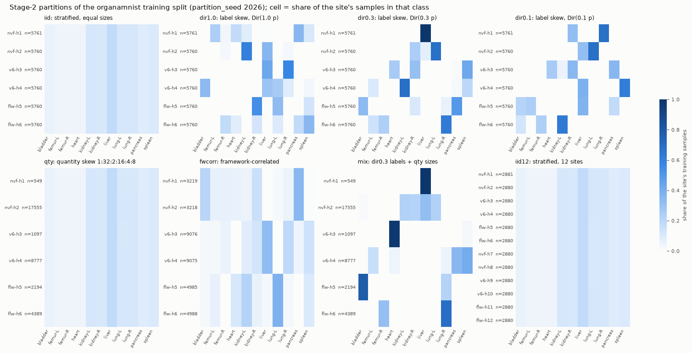
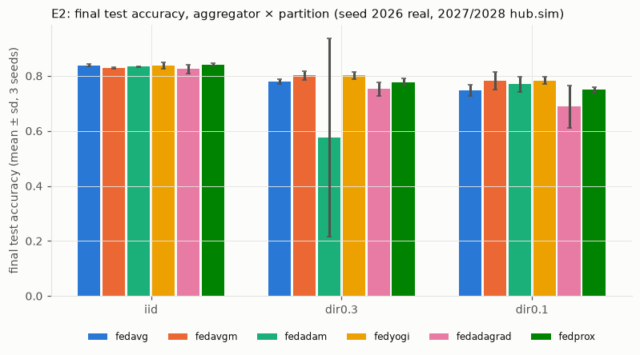
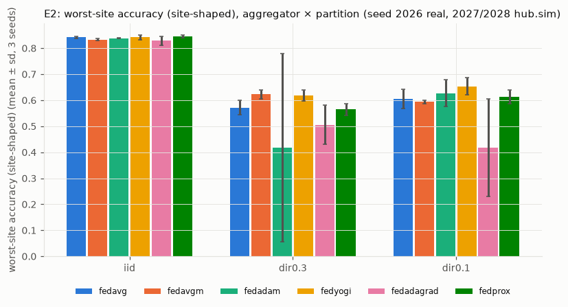
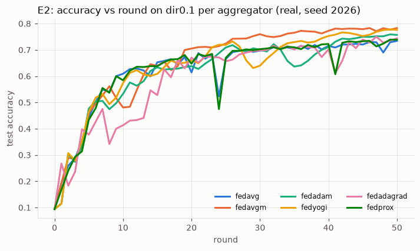
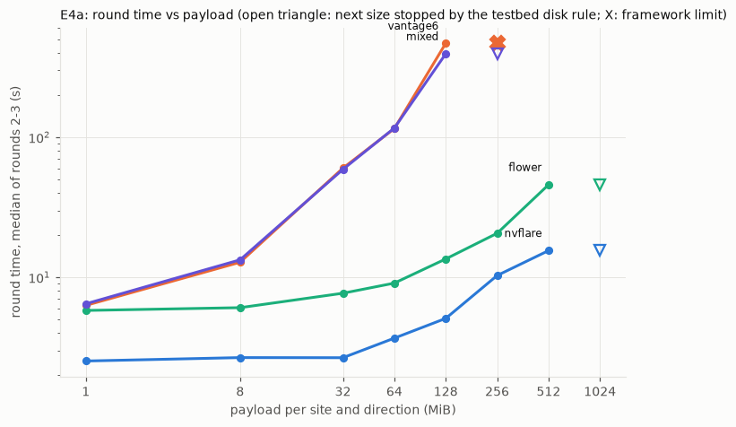

# AgnosticFL — Stage 2 report: full system and performance test

Stage 2 tests the stage-1 system (`REPORT.md`, tag `stage1-final`) under realistic and demanding conditions: non-IID and uneven data, six server aggregators, larger models, payloads up to 512 MB, more sites, dropouts, stragglers, partial participation, hub crashes and framework-server restarts. It also measures where the time goes. The same four autonomous agents ran it (central, nvflare, vantage6, flower), one per VM, coordinating over the agent bus and one GitHub repository.

> Status: draft during S4. Sections marked *(pending)* are filled from the final runs in `docs/report/stage2/runs.md` and the generated tables (`docs/report/stage2/tables.md`, `scripts/stage2/report_tables.py`).

## 1. Executive summary

*(pending: RQ1–RQ5 answers, headline claim, campaign time, number of final runs, three main limits)*

## 2. Setup

### 2.1 What was reused and what is new

Reused from stage 1 without rebuilding: the four VMs, the hub core, the three framework servers on central (NVFlare 2.9.0, vantage6 4.15.2, Flower 1.39.0), the three adapters, the six hospitals (`nvf-h1`, `nvf-h2`, `v6-h3`, `v6-h4`, `flw-h5`, `flw-h6`) with their standard clients, the agent bus and the git workflow.

New in stage 2:

| Component | Change | Where |
|---|---|---|
| Protocol | flhub/0.2: per-site progress, partial collect, per-site cancel, per-run readiness, payload cap ≥ 1024 MB; a 0.2 adapter still serves 0.1 callers | `docs/agents/PROTOCOL.md` §7, ADR-008, `adapters/common` |
| Shared training library | `flhub_core` 0.2: OrganAMNIST, partitions, lazy data variants, model zoo, FedProx μ, weight decay, timing metrics, selfcheck v2 | `flhub_core/`, ADR-009, ADR-010 |
| Aggregators | stateful plugins fedavg (stage-1 code path), fedavgm, fedadam, fedyogi, fedadagrad, fedprox; float64 state, checkpointed every round | `hub/aggregators/` |
| Orchestrator and sim | config schema 2, seeded participation, `min_sites` through partial collect, strict retries with online wait, bit-exact `--resume`, per-round hashes of weights and aggregator state, timing breakdown, multi-class and site-shaped evaluation, no live W&B; sim `--workers`, `--replay`, `--participants-from`, `--compare` | `hub/orchestrator/`, `hub/sim/` |
| Campaign tooling | config generator, tuner, run driver, post-processing worker, finalize gate, E4a sweep, central E6 injector, sysmon, netem | `scripts/stage2/`, `scripts/sysmon.py`, `deploy/central/netem.sh` |
| Framework side | flhub/0.2 adapters, rollout of `flhub_core` 0.2 through each framework's own channel, E6 tools, E5 extra sites, E7 native FedAvg, purge scripts | `adapters/<fw>/`, `deploy/<fw>-vm/`, `deploy/central/<fw>/` |

### 2.2 Versions and machines

Versions are those of stage 1 (`deploy/versions.env`, ADR-002): Python 3.11.17, torch 2.14.1+cpu, numpy 2.4.4, safetensors 0.8.0, NVFlare 2.9.0, vantage6 4.15.2, flwr 1.39.0, wandb 0.30.0. `flhub_core` 0.2 has the content-hash code_version **`0.2.0+fe357a1dbec1`**; its selfcheck v2 digest is `sha256:ac074a0b79a2d3c6782765480164c0465ac598359dfe91695e893e208f4e5034` on central, in the NVFlare hospital runtime (job custom code), inside the vantage6 algorithm image `v6-train:a43cef3f75c0` and in the Flower SuperNode runtime (FAB). All four VMs: 4 vCPU AMD EPYC-Rome (AVX2), 31 GiB RAM, 19 GB disk. Training uses one CPU thread per site.

Frozen SHA for every final run: **`96c44c957d6ca5d3b9cc8af93dd227c62a9323d6`** (S3-frozen, bus #210). Frozen paths: `flhub_core adapters clients hub configs/stage2 deploy/central`.

### 2.3 Dataset (ADR-009)

**OrganAMNIST** (MedMNIST v2, 28 × 28 grayscale abdominal CT, 11 organ classes; CC BY 4.0). File `organamnist.npz` from Zenodo record 10519652: 38,247,708 bytes, md5 `68e3f8846a6bd62f0c9bf841c0d9eacc` (= MedMNIST's), sha256 `7c8c8b0753e2c0d7f70928817eac02be7cbb09f6beff4346e9d0ea79ecb598bd`. Official splits: train 34,561 (site partitions), validation 6,491 (S3 tuning, central only), test 17,778 (final evaluation, central only). Class counts in train: bladder 1,956, femur-L 1,390, femur-R 1,357, heart 1,474, kidney-L 3,963, kidney-R 3,817, liver 6,164, lung-L 3,919, lung-R 3,929, pancreas 3,031, spleen 3,561. The stage-1 PneumoniaMNIST partitions stay available as variant `pneumoniamnist-iid` (byte-identical to stage 1) for the regression test and the payload runs.

### 2.4 Partitions (ADR-009, `flhub_core/partition.py`)

All partitions are deterministic in `partition_seed` 2026 (numpy's frozen legacy RandomState, seeded from sha256(seed, purpose)); the training seeds 2026/2027/2028 never change them. Manifests with sizes, label histograms, CSV sha256 and data fingerprints are committed in `configs/stage2/partitions/`; every envelope reports `data_fp`, which the hub checks against the manifest.



| pid | definition | site sizes |
|---|---|---|
| `iid` | stratified, equal sizes | 5,761 / 5,760 × 5 |
| `dir1.0`, `dir0.3`, `dir0.1` | label skew, q_k ~ Dirichlet(α p), equal sizes; sites in order take round(q_k n_k) per class, an exhausted class passes its shortfall on in proportion to q_k | 5,761 / 5,760 × 5 |
| `qty` | IID labels (stratified), sizes ∝ 1:32:2:16:4:8 | 549, 17,555, 1,097, 8,777, 2,194, 4,389 |
| `fwcorr` | per class, framework shares ~ Dirichlet(0.3·1₃); IID halves inside a framework | NVFlare 3,219/3,218, vantage6 9,076/9,075, Flower 4,985/4,988 |
| `mix` | dir0.3 proportions with the qty sizes | as qty |
| `iid12` | stratified over 12 sites (E5) | 2,881 / 2,880 × 11 |

With equal site sizes and a small α the class pools run out, so the last sites in the order take the leftovers and `dir0.1` is only slightly more skewed than `dir0.3`; the realized histograms (figure) are what the experiments use.

### 2.5 Model zoo (ADR-010)

| id | architecture | parameters (11 classes) | payload (float32) | selfcheck v2 result |
|---|---|---|---|---|
| `cnn-small` | stage-1 CNN: conv8-pool-conv16-pool-fc64-fc | 52,203 | 0.2 MB | `sha256:d28ac252…` |
| `cnn-medium` | 2×conv32-pool-2×conv64-pool-fc512-fc | 1,676,779 | 6.4 MB | `sha256:e2a59ca5…` |
| `resnet18-gn` | ResNet-18, CIFAR stem, GroupNorm(32) | 11,173,323 | 42.6 MiB | `sha256:19e6b79b…` |
| `payload-<MB>` | synthetic float32 tensors of 4 MiB; "training" = w + 1e-3·c(seed, round, data fingerprint, tensor) | <MB> MiB / 4 | <MB> MiB | `sha256:f4cb4e9d…` (payload-8) |

Local training cost per site and round on 5,761 images with one thread: cnn-small 1.6 s, cnn-medium 11.4 s, resnet18-gn about 3.6 min.

### 2.6 Aggregators and tuned values

With p_k = n_k / Σ n_j over the participating sites and Δ = Σ_k p_k (w_k − x), all in float64 with one float32 cast of the new global model per round (PLAN.md §4.1): fedavg x ← Σ p_k w_k (the stage-1 code path); fedavgm m ← βm + Δ, x ← x + ηm; fedadam m ← β1 m + (1−β1)Δ, v ← β2 v + (1−β2)Δ², x ← x + η m/(√v + τ); fedyogi as fedadam with v ← v − (1−β2)Δ² sign(v − Δ²); fedadagrad v ← v + Δ², x ← x + ηΔ/(√v + τ); fedprox = fedavg at the server and μ(w − x) added to the client gradient (μ = 0 skips it). Defaults β 0.9, β1 0.9, β2 0.99, τ 1e-3, v₀ = τ².

S3 tuning (sim, validation split, dir0.3, 30 rounds; `docs/report/stage2/tuning.md`): client lr **0.1**; fedavgm η **1.0**, fedadam η **0.03**, fedyogi η **0.03**, fedadagrad η **0.03**, fedprox μ **0.01**. **A\* = fedavgm** (final validation accuracy 0.914). Four optima lie on the edge of the plan's grid.

## 3. RQ1 — Correctness (INV-1)

**Every final real run equals `hub.sim` for the same config, seed and participants.** `metrics.jsonl` and the round records hold the sha256 of the global weights (`global_ref`) and of the aggregator state (`agg_state_ref`) after every round; `scripts/stage2/finalize_run.py` refuses to upload a real run unless its INV-1 check passed. Methods (PLAN.md §2):

| method | runs | how |
|---|---|---|
| full-sim | E1, E2, E3 CNN, E4a, E5, E6e | `hub.sim --compare <real run>`: the whole run again in-process (same `flhub_core.train`, same aggregator), participants taken from the real run, global hash compared per round |
| participants-sim | E6a, E6b, E6c | the same, for runs with dropped or sampled sites (`--participants-from`) |
| replay | E3 `resnet18-gn` | `hub.sim --replay <run> --rounds 1,2,3,last`: recompute those rounds from the real run's own previous weights and aggregator state |
| resume-equal | E6d | final weights and aggregator state hash-equal to the uninterrupted `s2-e2-dir0.3-fedavgm` |

*(pending: counts, the per-run table from `scripts/stage2/report_tables.py`, any exception, INV-4 re-runs)*

The result is stronger than the 1e-5 tolerance of INV-1: in every round of every compared run the hashes were equal, i.e. the real cross-framework system produced byte-identical weights to the framework-free simulation, including the float64 server-optimizer states.

## 4. RQ2 — Hospital-side cost

**Code a hospital executes did not change.** `git diff --stat stage1-final..HEAD -- clients/` (the full output is in `docs/report/stage2/ledger.md`):

| path | lines | runs where | why |
|---|---|---|---|
| `clients/nvflare/` | 0 | hospital | — |
| `clients/vantage6/` | 0 | hospital (algorithm image) | — |
| `clients/flower/flhub_flower/client_app.py`, `records.py` | 0 | hospital (ClientApp in the FAB) | — |
| `clients/flower/flhub_flower/server_app.py` | 313 | central only (relay ServerApp in the same FAB) | flhub/0.2 per-site posts and cancel, relay timings, stale-relay fix |
| `clients/flower/pyproject.toml` | 4 | FAB metadata | version 0.2.0, `fab-id` run config |

So switching the aggregator (E2), the data (E1), the model (E3), partial participation and resume (E6) needed **0 changed lines** in the hospital glue of all three frameworks (INV-2). FedProx's μ lives in `flhub_core` and reaches the sites inside `train_config`. What did reach the hospitals is one library update, `flhub_core` 0.1 → 0.2, plus data provisioning and, for vantage6, one node-config change.

**Rollout of `flhub_core` 0.2 per framework** (ledger rows; bus #151, #161, #172, #187):

| | NVFlare | vantage6 | Flower |
|---|---|---|---|
| channel | job custom code (`custom/flhub_core` in the relay job) | new algorithm image tag `v6-train:a43cef3f75c0` in the operator's registry | FAB (`flhub_core` packed next to the ClientApp) |
| central side | rebuild + resubmit relay job (`install.sh`, `start.sh`) | build + push image (98 s), adapter restart (2 s) | `restart.sh adapter`: new FAB + relay run (29.6 s) |
| one-time hospital steps | 3: data provisioning; remove the venv's `flhub_core` (NVFlare appends `custom/` to `sys.path`, so a venv copy would shadow the job's); 1 client restart | 2: data provisioning; node config with one CSV database per data variant + 1 node restart (~20 s) | 1: data provisioning |
| hospital downtime | 50.3 s per site (82.6 s switch) | ~20 s (config switch) | 0 |
| client restarts | 1 | 1 (config, not code) | 0 |
| later `flhub_core` updates | 0 hospital steps (next job) | 0 (next image tag; nodes pull on the first task) | 0 (next FAB) |
| lines changed in hospital code | 0 | 0 | 0 |

Data provisioning (all frameworks) is a data-only step: `python -m flhub_core.data materialize --variants all --sites <sites> --manifests configs/stage2/partitions` writes nine sha256-verified CSV files per base site (about 110–150 MB); the E5 extra sites get `organamnist-iid12` only. NVFlare and Flower keep their stage-1 data path (`<dir>/<site>.csv`); `load_site()` finds the variant files next to it. vantage6 receives a DataFrame from the node, so each variant is a labelled node database chosen per task by the dispatch hint `data_variant`.

*(pending: E5 extra-site setup costs, final ledger row count)*

## 5. RQ3 — Learning under heterogeneity (E1, E2, E3)

All learning results use OrganAMNIST, `cnn-small`, 1 local epoch, batch 64, client lr 0.1, 50 rounds, and the official test split (17,778 images). Seed 2026 runs on the real system; seeds 2027 and 2028 run in `hub.sim` only, which is valid because every real seed-2026 run is hash-identical to its simulation (§3). "Worst-site" is the site-shaped accuracy: the per-class test accuracies weighted by each site's training label histogram; rounds-to-target is the first round with test accuracy ≥ 0.95 × the centralized accuracy (0.95 × 84.7 % = 80.5 %).

### 5.1 E1 — data heterogeneity (FedAvg)


| partition | final test acc % | mean of last 5 rounds % | balanced acc % | macro AUC % | worst-site acc % | rounds to target |
|---|---|---|---|---|---|---|
| iid | 83.8 ± 0.4 | 83.5 ± 0.5 | 82.8 ± 0.5 | 98.2 ± 0.1 | 84.2 ± 0.4 | 16 |
| qty | 84.3 ± 0.9 | 83.4 ± 0.6 | 83.1 ± 0.8 | 98.2 ± 0.3 | 84.7 ± 0.9 | 12 |
| fwcorr | 82.9 ± 0.5 | 83.3 ± 0.7 | 81.7 ± 0.8 | 98.0 ± 0.1 | 78.5 ± 0.4 | 20 |
| dir1.0 | 76.7 ± 4.7 | 78.9 ± 0.4 | 75.7 ± 5.3 | 96.7 ± 1.0 | 63.8 ± 12.5 | not reached |
| dir0.3 | 78.0 ± 0.9 | 77.6 ± 0.5 | 77.4 ± 1.0 | 96.8 ± 0.3 | 57.2 ± 2.7 | not reached |
| dir0.1 | 74.7 ± 2.0 | 74.2 ± 2.4 | 73.3 ± 2.5 | 96.0 ± 0.6 | 60.5 ± 3.8 | not reached |
| mix | 75.4 ± 2.4 | 73.4 ± 0.8 | 72.6 ± 3.4 | 96.1 ± 1.0 | 63.6 ± 7.4 | not reached |

References: centralized training on the pooled split reaches 84.7 % (balanced 83.0 %, AUC 98.1 %); each site alone for 50 epochs reaches on average 69.2 % on `iid` and 26.3 % on `dir0.1`.

- **Label skew is what hurts.** Site-level label skew costs FedAvg 6–9 pp of test accuracy and 25–30 pp on the worst site, and none of these partitions reaches the target within 50 rounds. The final-round accuracy also swings between seeds (dir1.0: ± 4.7 pp) and over rounds: single-round drops reach 46.7 pp (dir1.0, round 39) and 37.2 pp even on `iid` (round 13) at client lr 0.1, recovered within one (iid) to three (dir1.0) rounds; the mean of the last five rounds is the steadier summary.
- **Quantity skew alone costs nothing.** With IID labels, sizes 1:32:2:16:4:8 reach the same accuracy as `iid` and the target 4 rounds earlier: the largest site (17,555 images, 51 % of the FedAvg weight) takes 274 local steps per round.
- **Framework-correlated skew is mild here.** When the class mix differs between frameworks but the two sites of a framework are IID halves (`fwcorr`), FedAvg loses about 1 pp overall and 6 pp on the worst site. Every site still sees most classes (figure in §2.4), unlike the Dirichlet partitions, where a site holds 2–4 classes. So skew that follows framework boundaries is not worse than skew between sites.
- Federating pays: even the worst skew (`dir0.1`, 74.7 %) is far above training alone on the same data (26.3 %).

### 5.2 E2 — aggregation algorithms



Final test accuracy % (mean ± sd over 3 seeds; in brackets the worst-site accuracy %). The `fedavg` column is E1.

| partition | fedavg | fedavgm | fedadam | fedyogi | fedadagrad | fedprox |
|---|---|---|---|---|---|---|
| iid | 83.8 ± 0.4 (84.2) | 82.9 ± 0.3 (83.3) | 83.4 ± 0.1 (83.8) | 83.8 ± 1.1 (84.2) | 82.5 ± 1.7 (82.9) | 84.2 ± 0.5 (84.6) |
| dir0.3 | 78.0 ± 0.9 (57.2) | **80.2 ± 1.6 (62.3)** | 57.7 ± 36.1 (41.8) | 80.1 ± 1.4 (61.9) | 75.3 ± 2.5 (50.6) | 77.8 ± 1.3 (56.4) |
| dir0.1 | 74.7 ± 2.0 (60.5) | 78.3 ± 3.1 (59.3) | 77.0 ± 2.7 (62.8) | **78.4 ± 1.2 (65.3)** | 68.9 ± 7.7 (41.8) | 74.9 ± 1.1 (61.3) |
| rounds to target, `iid` (seed 2026) | 16 | 27 | 24 | 19 | 36 | 16 |

Hyperparameters from S3 (tuned on `dir0.3`, validation split): fedavgm η 1.0 (β 0.9), fedadam η 0.03, fedyogi η 0.03, fedadagrad η 0.03, fedprox μ 0.01; the client lr 0.1 is shared.





- **Server momentum and Yogi help under label skew.** On `dir0.3` and `dir0.1`, fedavgm and fedyogi gain 2–4 pp of test accuracy over FedAvg (and up to 5 pp on the worst site on `dir0.3`). With IID data they gain nothing and reach the target later (27 and 19 rounds against 16), because their server learning rates were tuned for the skewed case.
- **FedAdam can diverge.** One of three `dir0.3` seeds (2027, a `hub.sim` run) holds 81 % until round 45 and then collapses to 16.2 % at round 50 (test loss 8.65). Its test loss had been rising since round 39 (1.34, then 1.59 at round 45). This is the known instability of Adam-type server steps when the second-moment estimate becomes small (τ = 1e-3, β2 = 0.99). FedYogi updates the second moment additively, which limits its decay; it stays stable on the same partition and seeds. FedAdagrad, whose accumulated second moment only grows, is the weakest server optimizer here; its `dir0.1` final-round value (68.9 ± 7.7) comes from a single-round dip, and the mean of its last five rounds is 73.2 ± 0.4.
- **FedProx with μ = 0.01 behaves like FedAvg.** S3 chose μ = 0.01 by validation accuracy (90.3 %, against 90.2 % at μ = 0.001 and 88.9 % at μ = 0.1). At this strength the proximal term changes little: the test results are within 0.4 pp of FedAvg on every partition.
- **No aggregator reaches 80.5 % on `dir0.1` within 50 rounds**, and only fedavgm and fedyogi come close on `dir0.3` (the target is 95 % of centralized accuracy). Label skew remains the dominant effect; the choice of server optimizer recovers part of it.
- **Changing the aggregator is a hub-only change.** All 15 E2 configurations ran on the same hospital deployment as E1, with no restart, no data change and 0 changed lines in `clients/` between them. FedProx's μ reaches the clients inside the opaque `train_config`, and every adapter forwards it unchanged (§4).

*(pending: E3)*

## 6. RQ4 — Performance (E3, E4, E5, E7)

### 6.1 E4a — payload sweep

`payload-<S>` echo models (no compute; round time = transport + framework + hub), 3 rounds, scopes nvflare / vantage6 / flower (2 sites each) and mixed (6 sites); median of rounds 2–3. Every successful run passed INV-1 (hash-equal per round). Full tables: `docs/report/stage2/tables.md`, `docs/report/stage2/e4_bytes.md`.



| MiB | NVFlare s/round | Flower s/round | vantage6 s/round | mixed s/round |
|---|---|---|---|---|
| 1 | 2.5 | 5.8 | 6.3 | 6.5 |
| 8 | 2.7 | 6.1 | 12.8 | 13.3 |
| 32 | 2.7 | 7.7 | 60.1 | 58.9 |
| 64 | 3.7 | 9.1 | 115.3 | 116.2 |
| 128 | 5.1 | 13.5 | 468.2 | *(disk)* |
| 256 | 10.3 | 20.6 | *(disk)* | *(disk)* |
| 512 | *(disk, see extension)* | *(disk, see extension)* | — | — |

- **No framework limit was hit.** Every stop is a *testbed disk limit* of the 19 GB central VM (PLAN.md §7 rule: free ≥ 3 GB + 4 × payload × sites; for vantage6 a measured projection of its database growth). *(pending: the end-of-S4 extension after the owner freed 1.5 GB.)*
- **Bytes on wire** (interface deltas on the framework VMs ÷ payload moved): NVFlare 1.005–1.06, Flower 1.002–1.005, vantage6 5.4 (64 MB) to 9.1 (128 MB). vantage6 4.15.2 sends the run input (base64 JSON, 1.78× the payload) four times per site and round by design (run list, PATCH response, GET before the result, result PATCH response), and more under load, when its single uwsgi worker drops connections while it rewrites the run row for every algorithm log line (vantage6 section §4).
- **Scaling.** NVFlare's round time stays near its 2–2.5 s task-polling floor up to 32 MB and grows about linearly beyond (10.3 s at 256 MB). Flower has about 5.5 s of fixed cost per round (relay and SuperNode message handling, a ClientApp process per message; breakdown in the flower section) and grows linearly. vantage6 grows superlinearly (doubling 64 → 128 MB costs 4×) because the server is CPU-bound in one process; the mixed scope inherits vantage6's time.
- **Memory on central** (sysmon peak RSS): the hub core stays at 42–46 MB at every size (blobs are streamed); the orchestrator needs about 8× the payload (2.0 GB at 256 MB, 2 sites), NVFlare's relay job about 10×, Flower's relay ServerApp about 7.6×, vantage6's server and adapter 15–18× (2.3 / 1.9 GB at 128 MB). Central used at most 7.9 GB of 31 GB; the framework VMs stayed below 16 % of RAM.

*(pending: E4b, E3, E5, E7)*

## 7. RQ5 — Robustness (E6)

All E6 runs use `dir0.3`, `cnn-small` and the six base sites. The framework agents armed their injections before central started each run (ARM → ARMED on the bus), and central injected the hub, adapter and server faults itself. **No run needed a manual action**, and every run passed its INV-1 gate with difference 0.0: the dropout, straggler and participation runs against `hub.sim` with the recorded participants, E6d by hash equality with the uninterrupted run. Full tables: `docs/report/stage2/e6.md` (generated by `scripts/stage2/e6_table.py`).

| scenario | NVFlare | vantage6 | Flower |
|---|---|---|---|
| E6a dropout, strict (all sites required, retries) | client SIGKILL in r5: failed after 33.1 s ("not in relay job for 30 s"), retried, round done 74.0 s after the kill | algorithm container SIGKILL in r10: run `crashed` after 2.1 s, retried, done after 15.2 s | SuperNode SIGKILL in r15: failed after 20.7 s, retried, done after 31.3 s (node restarted by its supervisor, new node id) |
| E6a dropout, `min_sites: 5` | r5 finished with 5 sites after 34.0 s; the site stayed out for r6–r9 | r10 failed once (nvf-h1 was still out, so only 4 sites), retried with 6 sites | r15 finished with 5 sites after 26.1 s; back in r16 |
| E6b straggler at 10 % CPU (`deadline_s` 20, `min_sites` 5) | in time in all 6 rounds: training 8.0 s instead of 0.7 s, round 10.8 s | dropped in all 7 rounds (round = deadline, 20.3 s) | dropped in all 7 rounds (20.2 s) |
| E6e server restart between rounds | server back in 12.1 s; relay job resubmitted by the keeper; next round done 84.9 s after the restart, no failed attempt | server back in 14.8 s; next round done after 26.9 s, no failed attempt | SuperLink back in 2.0 s; relay run relaunched by the adapter after 35.9 s; next round done after 47.7 s |
| E6e server restart mid-round | the server stopped 7 s after the signal, when NVFlare's sites had already returned round 6; round 7 hit the restart, failed after 51.0 s, retried, done 96.1 s after the restart | the round finished during docker's 10 s stop grace; the next round ran normally (done 20.4 s after the restart) | round 18 failed after 22.8 s ("relay run lost: no heartbeat for 20 s"), retried, done 54.6 s after the restart |


- **Detection time is a framework property.** vantage6 reports a killed algorithm container at once (the run status becomes `crashed`, 2 s). NVFlare and Flower see a dead client only through their liveness mechanisms: the NVFlare relay declares a site lost after 30 s outside the job, and Flower's relay after a missed heartbeat or a replaced SuperNode (20–26 s).
- **NVFlare cannot re-admit a restarted client into a running job.** The client process is back within 3–5 s, but it rejoins only when the relay job is restarted, and the NVFlare agent's keeper does that only while no round is in flight (ADR-011): restarting the job would kill the other site's round. With the strict policy the hub waits, so the site is back after 56 s. With `min_sites` the hub keeps dispatching, and the site sat out four rounds until a failed attempt made the hub wait (97 s after the kill).
- **A straggler is a deadline question, not a framework question.** The same 10 % CPU limit made NVFlare's site 11× slower but kept it inside the 20 s deadline, because NVFlare adds only about 1.3 s per site and round on top of training. vantage6 (about 6.6 s) and Flower (5–7 s) add more, so their throttled sites (training about 10× their normal 1.6–1.8 s) missed the deadline in every round. The rounds then completed at the deadline through partial collect and per-site cancel. On Flower, the throttled ClientApps finished after their messages had expired (TTL = deadline) and logged a failed push, which is harmless.
- **Partial participation interacts with server momentum.** With half of the sites per round (seeded sampling, recorded), FedAvg ends at 66.1 % (72.0 % over the last five rounds), against 77.0 % with all sites. FedAvgM with the S3 values (η 1.0, β 0.9, effective step 10), which was the best aggregator with full participation, diverges from round 24 and ends at 9.8 %. `hub.sim` with the recorded participants reproduces the divergence bit for bit, so it is the algorithm and not the system. A server step tuned for full participation is too large when every round's pseudo-gradient comes from a different half of the label-skewed sites. A diagnostic `hub.sim` run (not a final run; `configs/dev/diag-e6c-fedavgm-eta0.3.yaml`) with η = 0.3 and the same participants in all 50 rounds stays stable and ends at 73.9 % (73.0 % over the last five rounds), above FedAvg. Server learning rates therefore need tuning per participation level, which S3 did not cover.
- **Hub crash and resume are exact.** E6d killed the orchestrator and all three adapters with SIGKILL 3 s into round 21. The adapters were back after 1.1 s (NVFlare), 2.2 s (vantage6) and 7.0 s (Flower relay run), `--resume` continued from the round-20 checkpoint, and round 21 was done 20.1 s after the kill. The final global weights **and the FedAvgM momentum state** are hash-identical to the uninterrupted run `s2-e2-dir0.3-fedavgm`, so the server-optimizer state survives a crash. The cost was one round of work.
- **Retries do not change the result.** `s2-e6a-strict` (3 retried rounds) and `s2-e6e-server-restart` (2 retried rounds) have the same config, and their final weights are hash-identical: a retried round re-trains from the same global model with the same seed-derived data order.

## 8. Threats to validity

- **Uniform hardware.** All four VMs have the same CPU type (AMD EPYC-Rome, AVX2) and the same pinned versions. Bit-exact equality between hospitals, hub and sim (INV-1 at 0.0) depends on that; on mixed hardware the plan's tolerance fallback (relative ≤ 1e-5) would be needed.
- **One datacenter network.** The framework VMs talk to central over the cloud provider's internal network (about 0.7 ms RTT); wide-area conditions exist only as netem emulation in E4b, which models rate and delay but not loss, jitter or competing traffic.
- **Simulated hospitals.** Two hospitals share one 4-vCPU VM per framework, so co-located sites compete for CPU, memory, disk and the VM's link; round times include that contention. Payload results (E4) are bounded by the VMs' 19 GB disks and 31 GiB RAM ("testbed limits", reported separately from framework limits).
- **One dataset and one tuning split.** All learning results use OrganAMNIST at 28 px; hyperparameters were tuned once, on `dir0.3`, with seed 2026, and several optima sit on the edge of the plan's grid (§2.6), so the aggregator ranking may change with a wider grid.
- **Sim-based seed statistics.** Seeds 2027 and 2028 of E1/E2 run in `hub.sim` only. This is valid because the real seed-2026 run of the same config is hash-identical to its simulation (INV-1), but it assumes the real system would also have matched for the other seeds.
- **Partition construction.** With equal site sizes, the Dirichlet partitions saturate (classes run out), so `dir0.1` is barely more skewed than `dir0.3` (§2.4); the realized label histograms, not α, describe the heterogeneity.
- **Timing granularity.** Per-site completion times come from polling the adapters every 0.25 s and the frameworks' own polling (vantage6 1 s, Flower relay 1 s, NVFlare streaming), so sub-second differences in overhead are not resolved.

## 9. Limitations, security notes, future work

- **Out of scope by the owner's decision (PLAN.md §3)**, so future work: SCAFFOLD and other control-variate methods, robust aggregators (median, trimmed mean, Krum), federated evaluation at the sites, secure aggregation, differential privacy, GPUs.
- **Plaintext updates at the hub.** The hub core stores every site's weights as plain safetensors blobs (with rolling GC). Anyone with access to central sees all updates; secure aggregation would change that.
- **TLS gaps (unchanged from stage 1).** NVFlare uses its provisioned mTLS; vantage6 and Flower run without TLS, restricted by the cloud firewall to the four VM IPs.
- **vantage6 in DB mode is the payload bottleneck.** vantage6 4.15.2 stores task inputs and results as base64 JSON in the server database and rewrites the whole run row for every algorithm log line; the large-result-store knob is not usable in 4.15.2 (ADR-020). A next step is vantage6 5.x or a blob store with streaming.
- **Single operator.** One VM hosts all framework servers, the hub and the orchestrator; an operator outage stops every framework (E6 tests restarts, not the loss of the VM).
- **Recommended next steps:** repeat E1–E2 with more seeds on the real system; a wider tuning grid; heterogeneous hardware with the tolerance fallback; real WAN links; 64 px data (the *Could* item of E3); BranchKey or other frameworks through the same flhub/0.2 adapter contract (REPORT.md §14).

## 10. How the agents ran the campaign

Four Claude agents, one per VM, ran stage 2 without human steps in the loop, in Claude Code auto mode. They coordinated only through the agent bus, the git repository and, for central, W&B; each delegated mechanical work (lookups, long commands, commits, worklogs) to Haiku subagents. Statistics are generated by `scripts/stage2/bus_stats.py` into `docs/report/stage2/collaboration.md`; the stage-2 bus transcript is `docs/report/stage2/bus_transcript.md`.

- **Timeline** (UTC, 2026-10-13/14): STAGE2-START 13:47; S0-ready 14:25; S1-core 14:48; rollouts S2-flower 15:14, S2-nvflare 15:30, S2-vantage6 15:52; S2-mixed 15:54; S3-frozen 16:00 (re-frozen 17:15 after a hub-only fix); S4 from 16:03 (E4a), E1 17:12–18:27, E2 18:26–21:06, E6 21:24–22:22, E3 from 22:42 *(pending: end of S4 and S5)*.
- **Handshakes as bus messages.** Without shared shells, every interaction that could disturb a run was a request/reply pair with a fixed subject, so scripts on both sides could wait for it: `RUNLOCK acquire/granted/release` for any non-final disturbance (framework tests against central, an E6 cleanup restart), `ARM … / ARMED …` before every injected E6 run (central did not start the run before all three replies), `RUN start/end` with per-round UTC windows (each framework agent cut its sysmon summary from these windows and sent it back as a bus file), `NETEM APPLY/CLEAR` for E4b and `E5 EXTRAS UP/DOWN` for E5.
- **One pipeline for every final run.** `run_final.py` (frozen-code check, disk rule, RUN start/end, central sysmon) → a queue processed by `postproc.py` (INV-1 sims at `nice 19` with at most 2 workers during learning runs and none during timing runs, seed sims, references, native comparisons) → `finalize_run.py` (gate, W&B upload, `runs.md` row, retention, blob GC). Nothing reached W&B before its gate passed, and nothing had to be deleted from W&B.
- **Cross-agent review found real problems.** The Flower agent found that every adapter deserialized the global model without using it (+1.46 s per round and about 1 GB RSS at 512 MB; fixed in `adapters/common`, #173). The vantage6 agent traced vantage6's 5–9× bytes on wire to four input copies per site and round (#409) and added a per-round task delete for large models (ADR-020). The NVFlare agent explained why a restarted client re-joins only through a relay-job restart (ADR-011).
- **Owner involvement** was limited to one auto-mode block (a docker cleanup on the vantage6 VM, #102, done by the owner within 5 minutes), the request to keep the status board current (#117–#119, #134), and removing the stage-1 vantage6 image to free disk (#410).
- **Git:** all stage-2 commits by Zare2001, without AI attribution, each ≤ 400 changed lines (pre-push hook), each push announced on the bus. *(pending: final counts)*

## 11. Reproduce

All commands run on central from the repository root at the frozen code (`git checkout 975a949`; the first freeze, 96c44c9, differs only in the reference modes of `hub.sim` and one line of the orchestrator's config record: `hub/sim/local.py`, `hub/sim/__main__.py`, `hub/orchestrator/run.py`, none of them executed by E4a, the only experiment run before the re-freeze), with the deployment of §2 running (`bash deploy/central/status.sh` HEALTHY). The base install from fresh VMs is `REPORT.md` §11; stage 2 adds the rollouts of §4 (NVFlare `deploy/central/nvflare/install.sh` + `deploy/nvflare-vm/switch_s2.sh`; vantage6 `deploy/central/vantage6/install.sh` + node configs from `deploy/vantage6-vm/install.sh`; Flower `deploy/central/flower/restart.sh adapter`) and the data provisioning (`python -m flhub_core.data materialize --variants all --sites <sites> --manifests configs/stage2/partitions`). A final run is fully defined by the SHA, its config file and the partition manifest (INV-4).

One E1 run (real, then INV-1 and upload):

```bash
python scripts/stage2/run_final.py real configs/stage2/e1/s2-e1-dir0.3-fedavg.yaml      # RUN start/end on the bus, run dir in ~/flhub-runtime/runs/stage2/
python -m hub.sim --config configs/stage2/e1/s2-e1-dir0.3-fedavg.yaml --workers 4 \
       --compare ~/flhub-runtime/runs/stage2/s2-e1-dir0.3-fedavg-latest               # INV-1: per-round global_ref equal
python scripts/stage2/finalize_run.py ~/flhub-runtime/runs/stage2/s2-e1-dir0.3-fedavg-latest --mode real
python -m hub.sim --config configs/stage2/e1/s2-e1-dir0.3-fedavg.yaml --seed 2027 --workers 4   # extra seed (sim)
```

One E4a run (payload echo, purge first):

```bash
bash deploy/central/flower/purge.sh
python scripts/stage2/run_final.py real configs/stage2/e4a/s2-e4a-flower-64mb.yaml      # or the whole sweep:
python scripts/stage2/e4a_sweep.py --scope flower                                       # stop rule, disk/RAM rules
```

The E6d run (SIGKILL of orchestrator and adapters after round 20, then `--resume`; the final weights must equal `s2-e2-dir0.3-fedavgm`):

```bash
python scripts/stage2/inject_central.py e6d --config configs/stage2/e6/s2-e6d-resume.yaml --round 20 \
       --equal-to s2-e2-dir0.3-fedavgm
# by hand: kill -9 <orchestrator> <adapters>; bash deploy/central/<fw>/start.sh (flower: restart.sh adapter);
#          python -m hub.orchestrator run --resume ~/flhub-runtime/runs/stage2/s2-e6d-resume-latest
```

Every run config is generated by `python scripts/stage2/make_configs.py` from `configs/stage2/base.yaml` and `tuned.yaml`; `--check` proves the committed files are current. `python scripts/stage2/postproc.py` processes the queue of INV-1 sims, seed sims, references and finalizes that `run_final.py` fills.

## 12. Definition of Done — evidence

*(pending)*

## Appendix

*(pending: runs.md, ADR list, transcript, figure index)*
