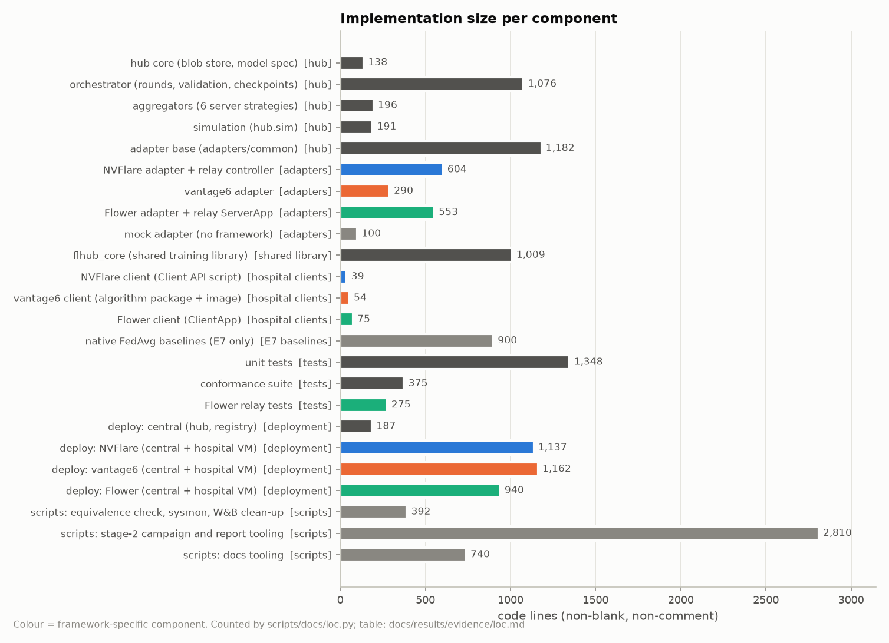
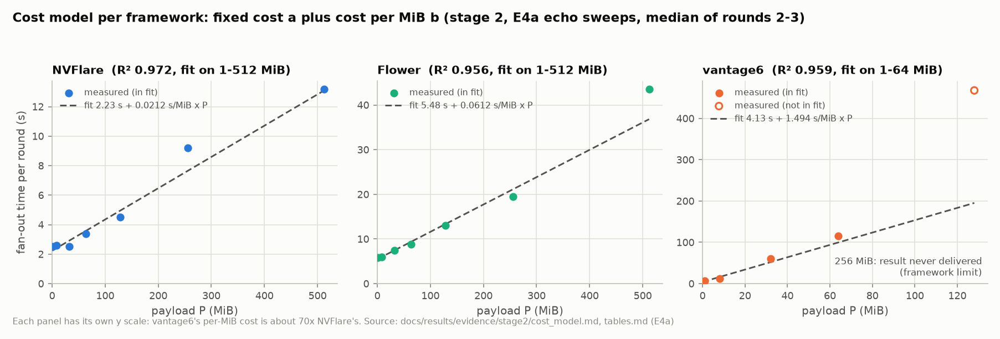
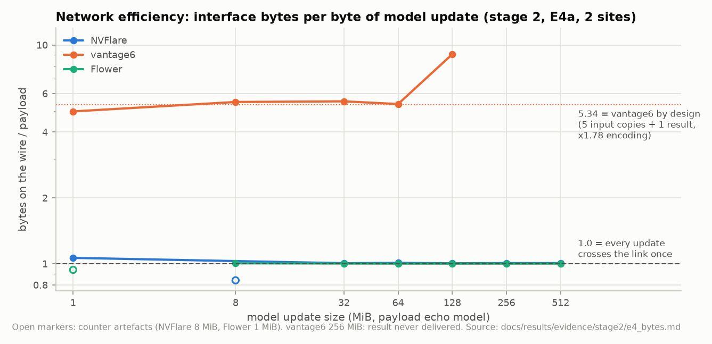

# Cost and efficiency

What it costs to build the framework-agnostic hub, to bring it to hospitals that already run NVFlare, vantage6 or Flower, and to run federated training through it, compared with each framework on its own. Every number was measured on the reference testbed (§11) and cites its evidence file under [`results/evidence/`](results/evidence/). Payload sizes are MiB (`payload-<N>` = N MiB per site and direction); memory is MiB or GiB. The per-framework detail is in the guides: [NVFlare](frameworks/nvflare.md) §5, [vantage6](frameworks/vantage6.md) §5, [Flower](frameworks/flower.md) §5.

## 1. At a glance

| Cost dimension | NVFlare 2.9.0 | vantage6 4.15.2 | Flower 1.39.0 | Hub-wide | Source |
|---|---|---|---|---|---|
| Adapter code (code lines) | 604 | 290 | 553 (adapter 210, relay ServerApp 342, package marker 1) | shared adapter base 1,182; hub 1,601 | [loc.md](results/evidence/loc.md) |
| Hospital code (code lines) | 39 | 54 + 11 config | 75 + 26 config | shared training library `flhub_core` 1,009 | [loc.md](results/evidence/loc.md) |
| Hospital code changed in stage 2 | 0 lines | 0 lines | 0 lines | aggregators, models, data, participation changed on the hub only | [hospital ledger](results/evidence/hospital-ledger.md) |
| Hospital steps per new `flhub_core` version | 0 | 0 | 0 | | [ledger](results/evidence/hospital-ledger.md) |
| One-time hospital step to adopt the rollout channel | remove the installed copy, 1 client restart (50.3 s offline per site) | none for code; data variants: node config + 1 restart (14.7 s offline) | none | | [ledger](results/evidence/hospital-ledger.md) |
| Round time, hub vs the framework's own FedAvg (E7): `cnn-small` / 45 MiB | −0.23 s (−6.5 %) / +0.10 s (+4.1 %) | 0.00 s (0 %) / −13.4 s (−14 %) | −1.93 s (−20 %) / +0.73 s (+9.8 %) | at most +0.73 s per round | [tables.md](results/evidence/stage2/tables.md), [nvflare/e7](results/evidence/stage2/nvflare/e7-native-vs-hub.md) |
| Fixed cost per round, a | 2.23 s | 4.13 s (6.3 s measured at 1 MiB) | 5.48 s | hub aggregation 0.001–0.21 s | [cost_model.md](results/evidence/stage2/cost_model.md), [tables.md](results/evidence/stage2/tables.md) |
| Cost per MiB of model, b | 0.0212 s | 1.49 s (1–64 MiB), superlinear above | 0.0612 s | | [cost_model.md](results/evidence/stage2/cost_model.md) |
| Overhead per site and round with training (E3): 0.2 / 6.4 / 42.6 MiB models | 1.6 / 1.9 / 2.7 s | 7.2 / 14.1 / 42.0 s | 5.6 / 6.3 / 10.9 s | | [tables.md](results/evidence/stage2/tables.md) |
| Bytes on the wire ÷ payload (E4a) | 1.005–1.064 | 4.97–5.53 (≤ 64 MiB), 9.08 (128 MiB) | 1.002–1.005 | | [e4_bytes.md](results/evidence/stage2/e4_bytes.md) |
| Bandwidth efficiency at 20 Mbit/s (E4b) | 0.94 | 0.16 (0.87 against its own transfer volume, 21.36·P in both directions) | 0.89 | | [cost_model.md](results/evidence/stage2/cost_model.md) |
| Largest model update carried | 512 MiB (15.5 s per round) | 128 MiB (468.2 s); 256 MiB never delivered | 512 MiB (45.8 s) | above that: testbed disk limit | [tables.md](results/evidence/stage2/tables.md) |
| Central memory at that size (peak RSS) | relay job 3,779 MiB (7.4×) | server 2,349 MiB (18×), adapter 1,925 MiB (15×) | relay ServerApp 3,647 MiB (7.1×) | orchestrator about 8× the update; hub core 41–47 MiB | [central-e4a-memory.md](results/evidence/stage2/central-e4a-memory.md) |
| Hospital VM memory at that size (two sites) | 5.0 GiB | 5.2 GiB | 7.5 GiB | | [nvflare](results/evidence/stage2/nvflare/e4a-memory.md), [vantage6](results/evidence/stage2/vantage6/e4a-vm-memory.md), [flower](results/evidence/stage2/flower/e4a-flower-vm-memory.md) |
| 6 → 12 sites (E5), fan-out per round | 3.0 → 2.8 s | 9.1 → 10.4 s | 7.6 → 8.3 s | round 9.1 → 10.4 s (+14 %) | [tables.md](results/evidence/stage2/tables.md) |
| Hospital killed mid-round (E6a): detected / round done after | 33.1 / 74.0 s | 2.1 / 15.2 s | 20.7 / 31.3 s | no manual action in any fault run | [e6.md](results/evidence/stage2/e6.md) |
| Framework server restarted between rounds (E6e): next round done after | 84.9 s | 26.9 s | 47.7 s | hub crash: resumed bit-exactly, 20.1 s lost | [e6.md](results/evidence/stage2/e6.md) |

In short: the translation layer is cheap at run time (at most 0.73 s per round against each framework's own FedAvg, and often faster) and cheap at the hospitals (0 lines of hospital code changed, 0 steps per library update). The large differences are between the frameworks themselves: vantage6 costs 24–70× more per MiB than Flower and NVFlare, moves 5–9× the payload over the network and sets the pace of every mixed federation.

## 2. Implementation cost

Code lines are non-blank, non-comment lines, counted by [`scripts/docs/loc.py`](../scripts/docs/loc.py); the full table with the counted paths is [loc.md](results/evidence/loc.md).

| Part | Components (code lines) | Total |
|---|---|---|
| Hub | hub core 138, orchestrator 1,076, aggregators 196, simulation 191 | 1,601 |
| Adapter base (`adapters/common`) | protocol, JSON-RPC server, `BaseAdapter`, `RelayAdapter`, hub-core client | 1,182 |
| Framework adapters | NVFlare 604, vantage6 290, Flower 553 (incl. the relay ServerApp), mock 100 | 1,547 |
| Shared training library (`flhub_core`) | data, partitions, models, deterministic training, weights, selfcheck | 1,009 |
| Hospital clients | NVFlare 39, vantage6 54 (+ 11 config), Flower 75 (+ 26 config) | 168 |
| Tests | unit 1,348, conformance suite 375, Flower relay 275 | 1,998 |
| Testbed deployment (`deploy/`) | central 187, NVFlare 1,137, vantage6 1,162, Flower 940 (incl. experiment tooling) | 3,426 |
| Native FedAvg baselines (E7 only, not needed to run the hub) | NVFlare and vantage6 baselines | 900 |

- **Adding a framework** cost 290–604 code lines on top of the shared adapter base, plus the hospital client (39–75 lines) and deployment scripts. The orchestrator, the hub core and the protocol did not change for any framework. What has to be written, and the checklist, are in [Adding a framework](adding-a-framework.md).
- **Moving to `flhub/0.2`** (per-site progress, partial collect, per-site cancel) changed `adapters/nvflare/` by +313/−94 lines and 0 lines of `clients/nvflare/` ([NVFlare guide](frameworks/nvflare.md) §5.2); the protocol only added optional fields ([protocol](protocol.md) §7).
- **Wall time.** Stage 1, from the start of the build to the final runs, took about 70 minutes; stage 2, including the 122 final runs, about 19 hours. Both stages were carried out by AI coding agents, so these times do not transfer to a human team; the code size above is the more useful measure ([stage-1 results](results/stage1.md), [stage-2 results](results/stage2.md)).

## 3. Integration cost at the hospitals

A hospital keeps its framework, its standard client and its credentials. What it needs for the hub:

| | NVFlare | vantage6 | Flower |
|---|---|---|---|
| Code the hospital writes or changes | none: `client.py` arrives inside the relay job | none: the training code is the algorithm image | none: the ClientApp arrives inside the FAB |
| Software | `nvflare`, torch, numpy, safetensors; **no** `flhub_core` (the job ships it) | the standard vantage6 node (CLI, Docker, node image); no torch on the host | `flwr`, torch, numpy, safetensors (`flhub_core` ships in the FAB) |
| Credentials | the NVFlare startup kit from the operator (mTLS) | the node's API key from the vantage6 server | none on the testbed (`--insecure`, restricted by the cloud firewall); a production federation adds TLS and SuperNode authentication (not tested) |
| Configuration | the server name resolves; the data path (`FLHUB_DATA_PATH` or `FLHUB_DATA_DIR`) | node YAML: server URL, API key, one CSV database per data variant, image policy allowing the operator's image, `share_config: false`; on the testbed also the operator's plain-HTTP registry in Docker's `insecure-registries` | SuperNode `--superlink <central-host>:9092` and node config `site-id` (+ optional `data-path`) |
| Rollout channel for new training code | the next relay job (`custom/`) | the next algorithm image tag, pulled per task | the next FAB, sent with the run |
| Steps per later code update | 0 | 0 (optional pre-pull, 12.6 s) | 0 |
| One-time steps in stage 2 | remove an installed `flhub_core`, restart the client once: 50.3 s offline per site (82.6 s for the switch of both) | data-variant node config, 1 restart per node: 14.7 s offline (both nodes together) | none |
| Data provisioning (all frameworks) | sha256-verified CSV files, one per data variant: 12.9 s | the same (under 1 min for 2 sites), each file a labelled node database | the same: 44 s for 4 sites |
| Operations | none beyond the framework's own | clean up `task-<run id>` folders, which nodes never delete (about 2.7× the model per site and round) | none beyond the framework's own |

Sources: [hospital ledger](results/evidence/hospital-ledger.md) (23 stage-2 rows, the `clients/` diff), [NVFlare guide](frameworks/nvflare.md) §3, [vantage6 guide](frameworks/vantage6.md) §3, [Flower guide](frameworks/flower.md) §3, [client contract](client-contract.md).

**Server-side rollout of a new `flhub_core` version** (on the operator's machine): NVFlare rebuilds and resubmits the relay job; vantage6 builds and pushes a new image tag (98 s) and restarts the adapter (2 s); Flower restarts the adapter, which stages a new FAB and starts a new relay run (healthy after 29.6 s; the SuperNodes had the new FAB 21.5 s after the adapter's SIGTERM). Every stage-2 change after the rollout (aggregators, FedProx μ, partitions, models, participation, resume) needed **no** hospital step: FedProx's μ, for example, travels inside the opaque `train_config`.

## 4. Runtime overhead

### 4.1 Against each framework's own FedAvg (E7)

The same two hospitals, the same `flhub_core.train` and configuration, once through the framework's idiomatic FedAvg (NVFlare's built-in `FedAvg` workflow, a vantage6 central function, Flower's `FedAvg` strategy) and once through the hub. Median round time over rounds ≥ 2.

| Framework | C1 `cnn-small`, 20 rounds: native / hub (s) | Overhead | C2 `payload-45` echo, 5 rounds: native / hub (s) | Overhead | Native vs hub weights |
|---|---|---|---|---|---|
| NVFlare | 3.50 / 3.27 | −0.23 s (−6.5 %) | 2.52 / 2.62 | +0.10 s (+4.1 %) | 3e-8 after one round (NVFlare aggregates in float32) |
| vantage6 | 8.81 / 8.81 | 0.00 s (0 %) | 95.52 / 82.12 | −13.40 s (−14 %) | hash-identical every round |
| Flower | 9.48 / 7.55 | −1.93 s (−20 %) | 7.45 / 8.19 | +0.73 s (+9.8 %) | hash-identical every round |

Sources: [tables.md](results/evidence/stage2/tables.md) (E7), [nvflare/e7-native-vs-hub.md](results/evidence/stage2/nvflare/e7-native-vs-hub.md) (NVFlare: a round is "model sent → aggregated model", which adds the hub's aggregation step; the generated table's C2 value without it is 2.55 s, +1.4 %).

Where the hub path is slower it pays for the weights' round trip through the hub core (Flower C2). It is faster where the native exchange waits longer: Flower's `Grid.send_and_receive` sleeps 3 s between pulls while the relay pulls every second, and vantage6's native central function moves every input and result through the node's proxy and waits for one multi-organisation subtask, while the adapter uploads per site in parallel and fetches each result as soon as that site is done ([stage-2 results](results/stage2.md)).

### 4.2 Where the time of a round goes (E3)

Median over rounds ≥ 2 of the real learning runs, FedAvg; *train* and *overhead* are means over the framework's two sites (overhead = transport + framework + adapter); hub evaluation runs on the hub's own CPU, outside the hospitals' path.

| Model (update size) | NVFlare train / overhead (s) | vantage6 train / overhead (s) | Flower train / overhead (s) | Hub aggregation (s) | Hub evaluation (s) | Round (s) |
|---|---|---|---|---|---|---|
| `cnn-small` (0.2 MiB) | 0.71 / 1.58 | 1.84 / 7.23 | 1.60 / 5.63 | 0.001 | 1.94 | 9.13 |
| `cnn-medium` (6.4 MiB) | 11.65 / 1.90 | 13.47 / 14.08 | 13.93 / 6.25 | 0.025 | 14.56 | 28.77 |
| `resnet18-gn` (42.6 MiB) | 214.04 / 2.72 | 225.26 / 41.99 | 223.31 / 10.86 | 0.133 | 105.62 | 267.97 |

Source: [tables.md](results/evidence/stage2/tables.md) (E3). As the model grows, training dominates and the framework overhead shrinks as a share of a framework's fan-out: NVFlare from 56 % to 1 %, Flower from 72 % to 5 %, vantage6 from 79 % to 16 %. The hub itself is never the bottleneck: aggregation takes at most 0.21 s (FedAvgM on 11 M parameters, float64).

### 4.3 Cost model

Per framework, the fan-out time of a round (dispatch to the last result) is fitted as a + b·P on the payload sweep (echo models without training; P in MiB; median of rounds 2–3). Adding the slowest site's training time predicts the learning runs:

| Framework | Fit range | a (s) | b (s/MiB) | R² | Prediction error: `cnn-small` / `cnn-medium` / `resnet18-gn` |
|---|---|---|---|---|---|
| NVFlare | 1–512 MiB | 2.23 | 0.0212 | 0.972 | +3 to +5 % / 0 to +4 % / 0 % |
| Flower | 1–512 MiB | 5.48 | 0.0612 | 0.956 (quadratic 0.997) | −10 % / −4 to −1 % / −1 % |
| vantage6 | 1–64 MiB | 4.13 | 1.494 | 0.959 (1–128 MiB: 0.581 linear, 0.981 quadratic) | −38 to −31 % / −4 to −3 % / +10 % |

Source: [cost_model.md](results/evidence/stage2/cost_model.md). With link transfer added (V·P/rate, V = the bytes a framework moves per link and round in units of P: 4 for NVFlare and Flower, 17.8 for vantage6, which is its downstream volume alone, §5.1), the model predicts all twelve framework-profile pairs of the bandwidth test within ±13 % (same file). Counting vantage6's upstream results too (21.36·P), its predictions are −5 %, +17 % and +2 % at 1 Gbit/s, 100 and 20 Mbit/s.

**Fixed floors per round and their causes:**

- **NVFlare, about 2.5 s:** the server tells each client to wait `task_request_interval` (default 2 s) before its next task request. A server-side job setting that changes latency only ([nvflare/e4a-breakdown.md](results/evidence/stage2/nvflare/e4a-breakdown.md)).
- **Flower, about 5.5 s:** a fresh ClientApp process for every message. At a hospital the process started 0.3 s after the train message, but training began only about 3.2 s after it (process start-up and imports such as torch); pull intervals add the rest ([flower/e4a-breakdown.md](results/evidence/stage2/flower/e4a-breakdown.md), [Flower guide](frameworks/flower.md) §5.3).
- **vantage6, 6.3 s at 1 MiB:** one algorithm container per task and site, plus the task and result round trips through the server. The straight line (a = 4.13 s) underestimates this floor, and real training adds about 0.8 s per task that the echo runs do not have (reading the CSV database into a DataFrame, a slower container exit after a torch run), so it predicts `cnn-small` rounds 31–38 % too short ([vantage6 guide](frameworks/vantage6.md) §5.3; [stage-2 report](https://github.com/Zare2001/AgnosticFL/blob/stage2-final/REPORT_STAGE2.md) §6.6).

## 5. Network efficiency

### 5.1 Bytes on the wire

Interface byte counters of each framework's hospital VM during the payload sweep, divided by the payload moved (sites × 2 directions × rounds × size).

- **NVFlare 1.005–1.064 and Flower 1.002–1.005:** each update crosses the link once; the small excess is protocol framing and, at 1 MiB, background traffic. Two rows read below 1 (NVFlare 8 MiB 0.840, Flower 1 MiB 0.938): counter artefacts, since every round of those runs finished with weights hash-equal to the simulation.
- **vantage6 4.97–5.53 up to 64 MiB, 9.08 at 128 MiB:** by design, a 4.15.2 node receives the run input five times per site and round (the run listing, the responses to its three PATCH requests for start time, status and result, and an extra `GET run/<id>`), and the input is the weights base64-encoded inside JSON that is base64-encoded again (1.78× the update). Per site and round that is 8.9× the update down and 1.78× up, a design ratio of (8.9 + 1.78) ÷ 2 = 5.34, which the measurements at 8–64 MiB match (8.8–9.1× down). At 128 MiB a node downloaded about 16× the update per site and round, because it retried requests after the busy server dropped the connection ([vantage6 guide](frameworks/vantage6.md) §5.4).

Source: [e4_bytes.md](results/evidence/stage2/e4_bytes.md), [vantage6 guide](frameworks/vantage6.md) §5.

### 5.2 Bandwidth (E4b)

`payload-45` (about the size of `resnet18-gn`), all three frameworks in one federation, rate and delay emulated with `netem` on every hospital link in both directions. Lower bound = 4·P/rate (each link carries two sites: 2P down, 2P up); efficiency = lower bound ÷ measured fan-out.

| Profile | Lower bound (s) | NVFlare (s), efficiency | Flower (s), efficiency | vantage6 (s), efficiency | vantage6 against its own volume 21.36·P |
|---|---|---|---|---|---|
| none | – | 3.3 | 7.5 | 81.8 | – |
| 1 Gbit/s, 5 ms | 1.5 | 4.3, 0.35 | 8.9, 0.17 | 83.3, 0.02 | 8.1 s bound, 0.10 |
| 100 Mbit/s, 20 ms | 15.1 | 17.0, 0.89 | 22.7, 0.67 | 129.5, 0.12 | 80.6 s bound, 0.62 |
| 20 Mbit/s, 40 ms | 75.5 | 80.3, 0.94 | 85.1, 0.89 | 463.8, 0.16 | 403.2 s bound, 0.87 |

Source: [cost_model.md](results/evidence/stage2/cost_model.md) (E4b table), [tables.md](results/evidence/stage2/tables.md). vantage6's volume counts both directions like the bound: 2 sites × (5 input copies + 1 result) × 1.78 = 21.36·P; its downstream direction alone (17.8·P, the V of cost_model.md) gives 0.72 at 20 Mbit/s. On slow links NVFlare and Flower come close to the wire limit; on fast links their fixed per-round cost dominates. Under realistic hospital bandwidth vantage6 sets the round time of a mixed federation (464 s against 80–85 s at 20 Mbit/s).

## 6. Memory and disk

### 6.1 Memory

(The figure's axis says MB; the values are MiB, as recorded by the sampler.)

**Central machine** (hub and framework servers; peak RSS per process, [central-e4a-memory.md](results/evidence/stage2/central-e4a-memory.md)):

| Process | Peak RSS against the update size P | At the largest size |
|---|---|---|
| Hub core (blob store) | 41–47 MiB at every size: blobs are streamed to disk | 47 MiB |
| Orchestrator | about 8× P from 128 MiB on (it holds the global model, the updates and float64 aggregation buffers) | 4,063–4,266 MiB at 512 MiB |
| NVFlare relay job (server job process) | 7.4–10.9× P from 64 MiB on | 3,779 MiB at 512 MiB |
| Flower relay ServerApp | 7.1–8.5× P from 64 MiB on | 3,647 MiB at 512 MiB |
| vantage6 server + adapter | server 18–24× P, adapter 14–15× P | 2,349 + 1,925 MiB at 128 MiB |
| Adapters of NVFlare and Flower | 40–170 MiB, independent of P (the relay holds the weights) | |
| Whole machine (31.3 GiB) | | 11.8 GiB at 512 MiB (Flower run), 9.1 GiB (NVFlare run) |

**Hospital VMs** (two sites each, memory in use on the whole VM): NVFlare 1.68 GiB at 1 MiB to 5.01 GiB at 512 MiB, one client job process up to 2.11 GiB ([nvflare/e4a-memory.md](results/evidence/stage2/nvflare/e4a-memory.md)); Flower 1.88 GiB to 7.54 GiB (24 % of RAM) at 512 MiB, each ClientApp about 4.8× P ([flower/e4a-flower-vm-memory.md](results/evidence/stage2/flower/e4a-flower-vm-memory.md)); vantage6 1.75 GiB to 5.16 GiB at 128 MiB ([vantage6/e4a-vm-memory.md](results/evidence/stage2/vantage6/e4a-vm-memory.md)). With real training (`resnet18-gn`), one training process needed 1.0–1.1 GiB (vantage6: 2.1 GiB for its two training containers together) and the central orchestrator 1.7–2.1 GiB ([tables.md](results/evidence/stage2/tables.md), E3).

### 6.2 Disk

The hub core keeps blobs with a rolling clean-up during runs. The framework stores grow on their own and need a purge step between large runs:

| Store | Growth | Purge |
|---|---|---|
| NVFlare server job store | one entry per job; the relay is one long-running job | [`deploy/central/nvflare/purge.sh`](../deploy/central/nvflare/purge.sh) deletes finished jobs |
| vantage6 server database (SQLite) | every task keeps its input and result, each 1.78× the update (about 456 MiB per site and direction at 256 MiB, ADR-020) | the adapter deletes a round's tasks for models ≥ 16 MiB; [`purge.sh --vacuum`](../deploy/central/vantage6/purge.sh) between runs |
| vantage6 node task folders (hospital) | `task-<run id>` folders are never deleted: about 2.7× the model per site and round | a clean-up next to the node ([`taskdir_gc.sh`](../deploy/vantage6-vm/taskdir_gc.sh)) |
| Flower SuperLink database | message objects are deleted after delivery, but SQLite keeps the space: about 4× the payload with two sites | [`deploy/central/flower/purge.sh`](../deploy/central/flower/purge.sh): stops the adapter and the SuperLink, runs `VACUUM`, starts both (about 35 s; refuses while a round is in flight) |

Sources: the framework guides ([NVFlare](frameworks/nvflare.md) §2.5, [vantage6](frameworks/vantage6.md) §5–§6, [Flower](frameworks/flower.md) §5.5), [stage-2 results](results/stage2.md). On the testbed's 19 GB central disk, these stores (plus run checkpoints) limited the payload sweep to 512 MiB for a single framework (1024 MiB did not fit) and to 128 MiB for the three-framework federation (256 MiB did not fit); those are testbed limits, not framework limits.

## 7. Scaling

| | 6 sites | 12 sites |
|---|---|---|
| Round time (median) | 9.1 s | 10.4 s (+14 %) |
| Fan-out NVFlare / vantage6 / Flower | 3.0 / 9.1 / 7.6 s | 2.8 / 10.4 / 8.3 s |
| Hub aggregation | 0.6 ms | 1.0 ms |

Source: [tables.md](results/evidence/stage2/tables.md) (E5), [stage-2 results](results/stage2.md). Twelve sites with half the data each cost the hub almost nothing; NVFlare stayed flat, vantage6 and Flower grew by 1.3 s and 0.7 s because four training processes now share each 4-vCPU hospital VM.

**A mixed federation runs at the pace of its slowest framework.** The hub waits for every participating site (or for `min_sites` and the deadline), so the round time is the slowest fan-out: vantage6 had the slowest fan-out in every mixed run with per-framework timings in the evidence (E1/E2 `dir0.3`, E3, E4a, E4b, E5), for example 392.3 s of the 393.8 s round at 128 MiB, while NVFlare needed 5.5 s and Flower 12.7 s ([tables.md](results/evidence/stage2/tables.md), E4a).

## 8. Robustness cost

Every injected fault recovered without manual action, and every run still ended with weights equal to the simulation of the same participants (the resumed run: equal to the uninterrupted run) ([e6.md](results/evidence/stage2/e6.md)).

| Scenario | NVFlare | vantage6 | Flower |
|---|---|---|---|
| Hospital killed mid-round, all sites required: detected / round done after the kill | 33.1 s / 74.0 s (1 retry) | 2.1 s / 15.2 s (1 retry) | 20.7 s / 31.3 s (1 retry) |
| Same with `min_sites: 5` | round done with 5 sites after 34.0 s; site out for 4 rounds | 2.1 s, then 1 retry because an NVFlare site was still out (4 sites < `min_sites` 5); round done 32.3 s after the kill | round done with 5 sites after 26.1 s; back next round |
| Straggler at 10 % CPU, `deadline_s` 20 | in time in all 6 rounds | dropped at the deadline in 7 rounds (round 20.3 s) | dropped at the deadline in 7 rounds (round 20.2 s) |
| Framework server restarted between rounds: next round done after | 84.9 s | 26.9 s | 47.7 s |
| Framework server restarted mid-round: round done after the restart | 96.1 s (1 retry) | 20.4 s (no retry) | 54.6 s (1 retry) |

**Hub crash:** the orchestrator and all three adapters killed in round 21 resumed from the round-20 checkpoint; round 21 was done 20.1 s after the kill, and the final weights and the FedAvgM momentum state were hash-identical to the uninterrupted run. The cost of a hub crash is the round in flight.

More timelines: [all sites required](results/figures/e6_timeline_s2-e6a-strict.png), [framework server restarts](results/figures/e6_timeline_s2-e6e-server-restart.png), [hub crash and resume](results/figures/e6_timeline_s2-e6d-resume.png).

Detection time is a framework property: vantage6 reports a dead algorithm container at once; NVFlare and Flower see a dead client only through liveness checks (the NVFlare adapter's 30 s offline rule; Flower's relay, when the node leaves the SuperLink's online list or answers under a new node id after a restart: 20.7 and 26.1 s in E6a). Retried rounds do not change the result: a retry re-trains from the same global model with the same seed-derived data order.

## 9. Learning efficiency

Federated training through the hub learns exactly what a framework-free FedAvg simulation learns (every compared real run equals its framework-free reference, [results](results/README.md)), so the learning cost is the cost of federation itself, not of the hub.

- **Stage 1** (PneumoniaMNIST, 6 IID sites, 30 rounds): federated 86.5 % test accuracy / 0.925 AUC against 86.1 % / 0.928 for centralized training on the pooled data. The federated runs stay at the majority class (62.5 %) through round 13 and reach 80 % at round 23; centralized training reaches it after 3 epochs ([final-runs.json](results/evidence/stage1/final-runs.json), [stage-1 results](results/stage1.md)).
- **Stage 2** (OrganAMNIST, 11 classes, 50 rounds; centralized 84.7 %, target 80.5 % = 95 % of it): IID data reaches the target in 16 rounds (83.8 % final), quantity skew in 12 (84.3 %), framework-correlated skew in 20 (82.9 %); label skew (Dirichlet α 1.0 to 0.1) costs 6–9 points and does not reach the target in 50 rounds. Server momentum (FedAvgM) and FedYogi recover 2–4 points under label skew ([tables.md](results/evidence/stage2/tables.md), [stage-2 results](results/stage2.md), [aggregators](aggregators.md)).

## 10. When is it worth it

**It is worth it** when one operator wants to train one model with hospitals that already use different frameworks, or wants to keep the server side (aggregation, participation policy, checkpoints, evaluation, audit of every update) in one place while hospitals keep their framework:

- The run-time price of the translation layer is small: −20 % to +10 % of a round against each framework's own FedAvg, never more than 0.73 s (§4.1).
- The hospital price is the framework's own: no hub code at the hospital, and 0 steps for every later library update (§3).
- The server features come once for all frameworks: six aggregators, partial participation with deadlines, per-site cancel, bit-exact resume, data variants, and an equivalence check against a framework-free simulation.

**Per framework:**

- **NVFlare:** the lowest overhead (1.6–2.7 s per site and round) and the best bandwidth use (0.94 at 20 Mbit/s); the best choice for large models. Costs: a one-time hospital restart to adopt job-shipped code, a 2.5 s latency floor, and a crash of one site's training process ends the round for every NVFlare site, because one relay job serves them all (a killed client fails alone) ([guide](frameworks/nvflare.md) §6).
- **Flower:** no hospital steps at all for code updates and near-ideal bytes on the wire (1.002–1.005); the costs are about 5.5 s of fixed time per round, which matters only for small models, a SuperLink database that keeps about 4× the payload until it is purged, and a relay run that ends with the SuperLink (the adapter starts a new one; the round in flight is retried) ([guide](frameworks/flower.md) §6).
- **vantage6:** fine for small models (6.3 s per round at 1 MiB, 12.8 s at 8 MiB) and where hospitals already run vantage6 nodes. Each MiB costs 1.49 s, 24–70× more than with Flower and NVFlare (60 s per round at 32 MiB, 115 s at 64 MiB), and above 64 MiB the default SQLite server grows superlinearly (468 s per round at 128 MiB, no delivery at 256 MiB). Candidate fixes, both untested: a PostgreSQL server database, `share_algorithm_logs: false` on the nodes ([guide](frameworks/vantage6.md) §6).
- **Mixed federations** run at the pace of the slowest framework (§7). Put large models on NVFlare or Flower sites, or accept vantage6's pace.

**It is not worth it** for a single-framework federation that needs nothing beyond that framework's own FedAvg; for round times below the frameworks' own floors (about 2.5 s with NVFlare, 5.5 s with Flower, 6.3 s with vantage6 at 1 MiB), which the native FedAvg of each framework has as well; or where updates must stay hidden from the server: the hub sees every update in plaintext, and there is no secure aggregation or differential privacy ([architecture](architecture.md#trust-and-security-model), [limitations](limitations-and-future-work.md)).

## 11. Method and caveats

- **Hardware.** Four VMs with 4 vCPUs (AMD EPYC-Rome, AVX2), 31 GiB RAM and 19 GB disk each, CPU-only, in one data centre (about 0.7 ms round-trip time). One VM runs the hub and all three framework servers; each framework's two hospitals share one VM, so co-located sites compete for CPU, memory and the link.
- **Network.** Wide-area links exist only as `netem` emulation of rate and delay (E4b), without loss, jitter or competing traffic.
- **Timing.** The orchestrator polls the adapters every 0.25 s (stage 2; 1 s in stage 1), and the frameworks poll on their own schedules (vantage6 every 1 s, for models ≥ 16 MiB every P/16 s, e.g. 8 s at 128 MiB; Flower relay 1 s; NVFlare clients wait 2 s between task requests, the NVFlare relay checks for replies every 0.1 s), so sub-second differences are not resolved. Medians exclude round 1 (start-up).
- **Seeds.** Every real run used seed 2026; the extra seeds of the learning experiments ran in the simulation, which is valid because each real run is hash-identical to its simulation.
- **Memory.** Sampled once per second; peak values can miss shorter spikes. Long-lived processes keep memory from earlier runs, so the central tables list only the processes of each run's scope ([central-e4a-memory.md](results/evidence/stage2/central-e4a-memory.md)).
- **Versions.** All numbers hold for the tested versions in [`deploy/versions.env`](../deploy/versions.env); framework upgrades change them.
