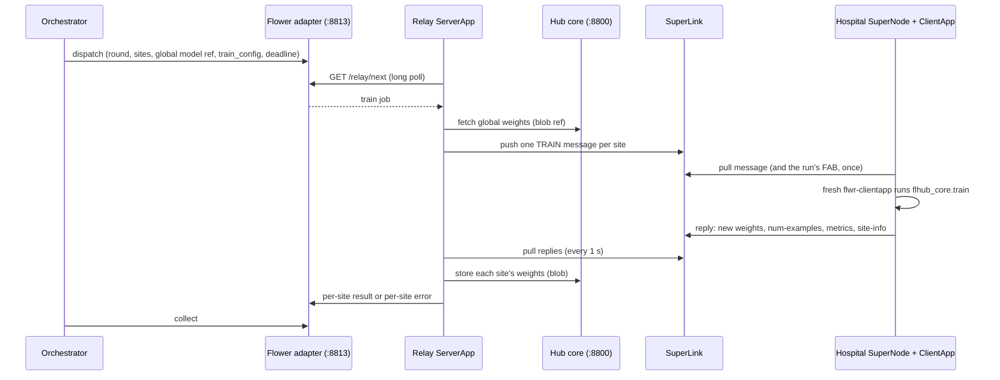
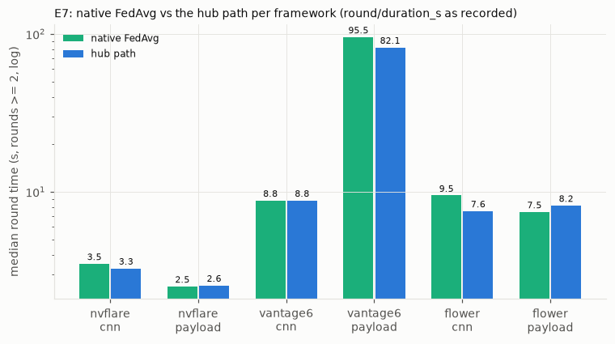
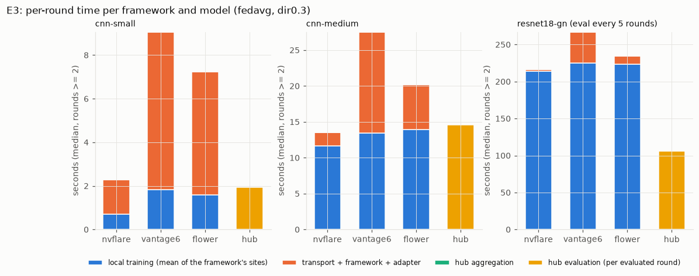
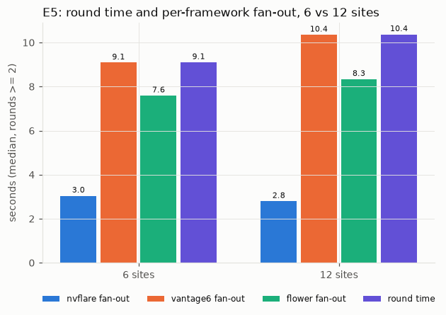
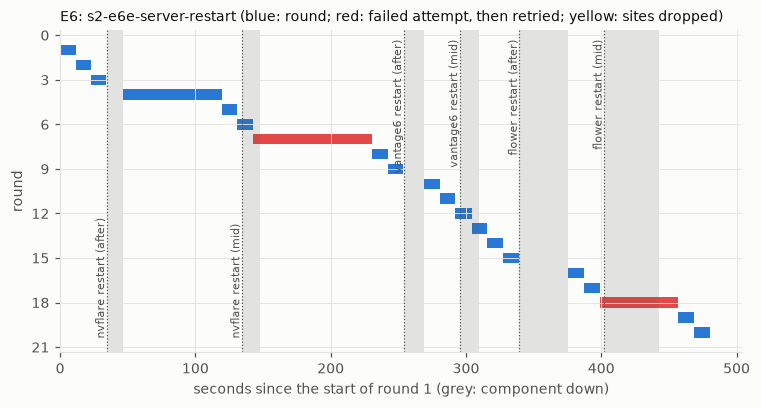

# Flower guide

This guide explains how the hub drives a [Flower](https://flower.ai) federation: what runs on the server side, what a Flower hospital runs, how to deploy the adapter next to an existing Flower federation, what it costs, and what we learned in testing. The framework-independent part of the client contract is in [client-contract.md](../client-contract.md); the wire protocol between the hub and the adapters is in [protocol.md](../protocol.md).

## 1. Summary

| | |
|---|---|
| Tested version | Flower (`flwr`) 1.39.0, Python 3.11.17, torch 2.14.1+cpu, numpy 2.4.4, safetensors 0.8.0 ([`deploy/versions.env`](../../deploy/versions.env)) |
| Status | Tested in stage 1 (flhub/0.1) and stage 2 (flhub/0.2). Conformance suite v2: 13 of 13 checks pass against the deployed system, weight difference 0.0 in every round. 53 of the 69 stage-2 real runs included the Flower sites; all 69 equal the framework-free simulation (maximum weight difference 0.0). |
| Results with Flower | Stage 1: the Flower-only run (2 sites, 30 rounds) reached test accuracy 0.758 and AUC 0.915 in 221 s (7.3 s per round); the run over all six sites of the three frameworks produced the same global weights as the framework-free simulation in all 30 rounds (maximum difference 0.0) ([stage-1 report](https://github.com/Zare2001/AgnosticFL/blob/stage1-final/REPORT.md) §7, [equivalence-final.json](../results/evidence/stage1/equivalence-final.json)). Stage 2: §5. |
| Server side | the Flower adapter [`adapters/flower/service.py`](../../adapters/flower/service.py) (flhub on `127.0.0.1:8813`) and the relay ServerApp [`clients/flower/flhub_flower/server_app.py`](../../clients/flower/flhub_flower/server_app.py), which runs inside one long-lived Flower run on the SuperLink |
| Hospital side | the standard `flower-supernode` with the standard ClientApp [`clients/flower/flhub_flower/client_app.py`](../../clients/flower/flhub_flower/client_app.py), which calls `flhub_core.train` |
| Rollout channel | the FAB (Flower App Bundle). The adapter packs `flhub_core` into the FAB of the relay run; connected SuperNodes fetch it with the next run. A new `flhub_core` version needs no hospital action and no restart. |
| Transport security in the testbed | none (`--insecure`), restricted by the cloud firewall. TLS and SuperNode authentication are future work (§8). |

What the adapter does: it keeps one Flower run alive on the SuperLink. That run's ServerApp, the *relay*, takes each round from the adapter and sends one standard TRAIN message per site through Flower's `Grid`; the hospitals answer through Flower's Message API, and the relay hands every reply back to the adapter as a per-site result.

Sources for this guide. Full stage reports and Flower sections at their tags: [stage-1 report](https://github.com/Zare2001/AgnosticFL/blob/stage1-final/REPORT.md), [stage-1 Flower section](https://github.com/Zare2001/AgnosticFL/blob/stage1-final/docs/report/flower.md), [stage-2 report](https://github.com/Zare2001/AgnosticFL/blob/stage2-final/REPORT_STAGE2.md), [stage-2 Flower section](https://github.com/Zare2001/AgnosticFL/blob/stage2-final/docs/report/stage2/flower.md). Decisions: ADR-007, ADR-016 and ADR-017 in [design/decisions.md](../design/decisions.md). Evidence: conformance reports [stage 1](../results/evidence/stage1/conformance-flower-central.json) and [stage 2](../results/evidence/stage2/conformance-v2-flower-central.json), the run tables in [tables.md](../results/evidence/stage2/tables.md) (the equivalence check of every real run is under RQ1), the [hospital ledger](../results/evidence/hospital-ledger.md) and the Flower evidence files in [results/evidence/stage2/flower/](../results/evidence/stage2/flower/). Summaries of both stages: [results/stage1.md](../results/stage1.md), [results/stage2.md](../results/stage2.md).

## 2. Server side: how the adapter maps flhub onto Flower

### 2.1 Components

All server-side components run on the central host, next to the hub.

| Component | Process | Listens on | Code |
|---|---|---|---|
| SuperLink | `flower-superlink` | Fleet API `0.0.0.0:9092` (hospitals), HTTP API `127.0.0.1:9093` (`flwr run`, ServerApp runtime) | Flower |
| relay ServerApp | `flwr-serverapp`, started by Flower's `flower-superexec` for the relay run | none (client of 9093 and 8813) | [`server_app.py`](../../clients/flower/flhub_flower/server_app.py) |
| Flower adapter | `python -m adapters.flower.service` | `127.0.0.1:8813` (flhub JSON-RPC and `/relay/*` routes) | [`service.py`](../../adapters/flower/service.py), on [`adapters.common.RelayAdapter`](../../adapters/common/relay.py) |
| hub core | `python -m hub.core` | `127.0.0.1:8800` (blob store) | [`hub/`](../../hub/) |

The relay is a normal ServerApp: Flower starts it like any other run, and it only uses the public `Grid` API. It exists because a Flower server workflow must run inside a Flower run; the adapter itself stays outside Flower.

### 2.2 One round, step by step



1. The orchestrator calls `dispatch` on the adapter. [`RelayAdapter`](../../adapters/common/relay.py) queues a job: job id, round, sites, the global model's blob reference, `config` (the dispatch `train_config` plus `round`) and the deadline.
2. The relay long-polls `GET /relay/next` (5 s timeout, `poll-timeout-s`) and sends its FAB id with every poll. It fetches the global weights from the hub core and wraps them in an `ArrayRecord`, keeping tensor names and order.
3. For every site with a connected SuperNode, the relay pushes one TRAIN `Message` whose content is `RecordDict({"arrays": ArrayRecord, "config": ConfigRecord})`. The message goes to that site's node id, `ttl` is the time left until the deadline, and `group_id` is the hub round. Sites without a connected SuperNode get up to min(60 s, deadline/4) to connect while the others already train; then they fail alone.
4. Each SuperNode pulls its message over the Fleet API, fetches the run's FAB if it does not have it yet, and starts a fresh `flwr-clientapp` process that runs the ClientApp's `@app.train()` handler (§3).
5. The relay pulls replies every second. For each reply it checks the reported `site-id`, stores the weights in the hub core and posts the site's result to the adapter at once (`/relay/site_result`). It adds its own timings to the metrics: `flower_relay_prep_s`, `flower_relay_push_s`, `flower_relay_reply_s` and `flower_relay_store_s`. Failures go to `/relay/site_error`, one site at a time.
6. Every 5 s the relay asks the adapter which sites it still waits for (`/relay/job`). Cancelled sites are dropped; their late replies are still pulled, so they do not stay in the SuperLink, and then discarded. Every 5 s it also re-reads the online nodes: a site whose node went offline, or was replaced by a restarted SuperNode, fails at once instead of at the deadline.
7. The adapter turns the per-site results into flhub envelopes. The orchestrator collects them, also partially (flhub/0.2 partial collect and per-site cancel).

### 2.3 Sites: discovery and identity

A SuperNode gets a new random node id at every start, and a ServerApp cannot read a SuperNode's `--node-config`. The relay therefore maps node ids to hub site ids with a standard Flower QUERY message:

- Every 5 s the relay reads `Grid.get_node_ids()` (online nodes only) and sends a QUERY to every node it does not know yet. The ClientApp's `@app.query()` handler answers with its `site-id` (and its `flhub_core` code version).
- The queries do not block: replies are collected on later passes; a node that does not answer within 60 s is asked again after 30 s.
- If two nodes claim the same site (a restarted SuperNode while its old id is still listed as online), the node that answered last wins and the old id is ignored.
- The relay reports the mapped sites to the adapter with every beat (`/relay/sites`); the adapter's `discover` lists them as `online`. Sites registered with the adapter (`--sites`) but not mapped are `offline`. Without a live relay, `discover` lists every site as `unknown`, because nothing can be dispatched.

### 2.4 Relay lifecycle and liveness

The adapter's relay launcher keeps exactly one relay run alive ([ADR-007, ADR-016](../design/decisions.md)):

- **Start.** At start-up the adapter copies `clients/flower` and the `flhub_core` package into one FAB source directory (default `~/flhub-runtime/flower/fab-src`) and computes a content id, the *fab id* (sha256 prefix over paths and bytes). It submits the directory with `flwr run <fab-src> flhub --run-config "adapter-url=... hub-url=... fab-id=..."`; `flhub` is a connection in `$FLWR_HOME/config.toml` that points to the SuperLink's HTTP API. `flwr run` returns as soon as the run is submitted; the adapter reads the run id from its output.
- **Liveness.** The relay posts `/relay/beat` every 5 s from its own thread (fab id, run id, current job, `flhub_core` code version). The adapter declares the relay lost after 20 s without a poll, progress post or beat. It then fails the rounds that relay had taken at once and submits a new run. It retries every 10 s while `flwr run` fails and gives a submitted run 60 s to start polling. At adapter start it waits 15 s, so that a relay that is still running can re-attach.
- **Stale relays.** A relay that reports another fab id, for example one left over from a rollout, is told to leave and never gets a job.
- **Adapter crash.** The relay keeps running when only the adapter dies. A restarted adapter on the same commit stages the same FAB (same fab id) and waits 15 s, so the live relay re-attaches with its run id; no new run is needed. In a single-VM test the adapter answered 1.5 s after the restart command and the server side was healthy after 2.7 s; in the hub-crash experiment (E6d, §5.7) the Flower relay was back 7.0 s after the SIGKILL.
- **Stop.** On SIGTERM the adapter asks the relay to shut down and waits up to 15 s; if the relay does not take the request, the adapter ends the relay runs it started itself with `flwr stop <run-id>`. The relay also exits by itself when the adapter has been unreachable for 600 s.

The relay's log is the Flower run log: `FLWR_HOME=<runtime>/flwr-home flwr log <run-id> flhub --show`. `curl http://127.0.0.1:8813/relay/status` shows `relay_alive`, the fab id, the relay's run id and its `flhub_core` code version.

### 2.5 Ports

| Port | Host | Bound to | Who connects |
|---|---|---|---|
| 9092 | central | all interfaces | hospital SuperNodes (Fleet API, gRPC). The only port hospitals need. |
| 9093 | central | `127.0.0.1` | the adapter's `flwr run` / `flwr stop` and the relay ServerApp (SuperLink HTTP API) |
| 8813 | central | `127.0.0.1` | the orchestrator (flhub JSON-RPC) and the relay (`/relay/*`) |
| 8800 | central | `127.0.0.1` | the adapter and the relay (hub core blobs) |
| 9094, 9095 | hospital | local | each SuperNode's own runtime API (`--port`); two SuperNodes on one host need two ports |

Flower 1.39 has no separate ServerAppIo port: `flwr run` and the ServerApp share the one HTTP API on `--host/--port`. Port 9091, planned for ServerAppIo, is unused ([ADR-007](../design/decisions.md)).

### 2.6 Configuration

Adapter options (`python -m adapters.flower.service --help`):

| Option | Default | Meaning |
|---|---|---|
| `--host`, `--port` | `127.0.0.1`, `8813` | flhub endpoint |
| `--sites` | `flw-h5 flw-h6` | hub site ids served by this adapter |
| `--hub` | `$FLHUB_HUB_URL` or `http://127.0.0.1:8800` | hub core |
| `--app-dir` | `clients/flower` | the Flower app that goes into the FAB |
| `--core-dir` | `flhub_core/src/flhub_core` | the `flhub_core` package that goes into the FAB |
| `--flwr-home` | `~/flhub-runtime/flower/flwr-home` | `FLWR_HOME` for `flwr run`; the FAB source goes next to it |
| `--connection` | `flhub` | connection name in `$FLWR_HOME/config.toml` |
| `--no-launch` | off | never start a relay run (tests) |

The adapter declares `max_payload_mb` 2048 in its capabilities. The relay's run config lives in [`clients/flower/pyproject.toml`](../../clients/flower/pyproject.toml) (`[tool.flwr.app.config]`: `adapter-url`, `hub-url`, `poll-timeout-s` 5.0, `query-timeout-s` 60.0, `fab-id`); the adapter overrides `adapter-url`, `hub-url` and `fab-id` when it submits the run.

SuperLink command in the testbed ([`deploy/central/flower/start.sh`](../../deploy/central/flower/start.sh)):

```bash
FLWR_HOME=~/flhub-runtime/flower/flwr-home flower-superlink --insecure \
    --fleet-api-address 0.0.0.0:9092 --host 127.0.0.1 --port 9093 \
    --database ~/flhub-runtime/flower/superlink.db --disable-runtime-dependency-installation
```

- `--database` keeps node ids and runs across a SuperLink restart, so connected SuperNodes stay registered.
- `--disable-runtime-dependency-installation`: the dependencies are preinstalled; the SuperLink never installs FAB dependencies at run time.
- The SuperLink and the SuperNodes start `flower-superexec`, `flwr-serverapp` and `flwr-clientapp` by bare name, so the venv's `bin` directory must be on `PATH`.

### 2.7 Start, stop, health

The reference scripts in [`deploy/central/flower/`](../../deploy/central/flower/):

| Command | What it does |
|---|---|
| `bash deploy/central/flower/install.sh` | venv with `flwr`, torch (CPU), `flhub_core` and the hub package; writes the `flhub` connection to `$FLWR_HOME/config.toml` |
| `bash deploy/central/flower/start.sh` | starts the SuperLink, then the adapter; the adapter starts the relay run within about 20 s |
| `bash deploy/central/flower/status.sh [--no-sites]` | checks SuperLink ports, adapter, relay liveness and `discover`; exit 0 only when the base sites are online (`--no-sites`: do not require them) |
| `bash deploy/central/flower/stop.sh` | stops the adapter (which ends the relay run), then the SuperLink |
| `bash deploy/central/flower/restart.sh adapter` | rollout of a new `flhub_core`: new FAB, new relay run; SuperLink and hospitals stay connected |
| `bash deploy/central/flower/restart.sh superlink [--kill]` | restarts the SuperLink; the adapter relaunches the relay |
| `bash deploy/central/flower/purge.sh [--online]` | reclaims SuperLink database space (§5.5); `--online` only checkpoints the WAL |

## 3. Client side: what the hospital code must contain

### 3.1 What runs at a hospital

A Flower hospital runs only standard Flower software plus the shared training library:

- the standard `flower-supernode` process, started with the SuperLink address and a node config that names the site and its data file:

  ```bash
  flower-supernode --insecure --superlink <central-host>:9092 --port 9094 \
      --node-config "site-id='flw-h5' data-path='/home/<user>/flhub-data/flw-h5.csv'"
  ```

- the ClientApp from the run's FAB: [`client_app.py`](../../clients/flower/flhub_flower/client_app.py) and [`records.py`](../../clients/flower/flhub_flower/records.py), plus the `flhub_core` package that the adapter puts into the same FAB;
- a Python environment with `flwr`, torch, numpy and safetensors at the pinned versions ([`deploy/versions.env`](../../deploy/versions.env)). Flower does not install FAB dependencies at the hospital.

The same FAB also carries [`server_app.py`](../../clients/flower/flhub_flower/server_app.py), the relay. It is central-side code: a SuperNode loads only the `clientapp` entry of the FAB's [`pyproject.toml`](../../clients/flower/pyproject.toml), so the relay is never imported at a hospital.

```toml
[tool.flwr.app.components]
serverapp = "flhub_flower.server_app:app"   # relay, runs only on the central host
clientapp = "flhub_flower.client_app:app"   # hospital ClientApp
```

In the testbed the hospital environment could not import the hub (`import adapters` and `import hub` fail), and the SuperNodes run with a working directory outside the repository.

### 3.2 The ClientApp, line by line

The training handler is the whole hospital-side integration ([`client_app.py`](../../clients/flower/flhub_flower/client_app.py), lines 27 and 46–61, docstring omitted):

```python
app = ClientApp()

@app.train()
def train(msg: Message, context: Context) -> Message:
    weights = arrayrecord_to_weights(msg.content[ARRAYS])
    train_config = dict(msg.content[CONFIG])  # flhub_core.TrainConfig keys incl. "round"
    site_id = str(context.node_config["site-id"])
    data_path = context.node_config.get("data-path") or site_path(site_id)
    new_weights, num_examples, metrics = flhub_train(weights, load_site(data_path), train_config)
    reply = RecordDict(
        {
            ARRAYS: weights_to_arrayrecord(new_weights),
            METRICS: MetricRecord({"num-examples": num_examples, **metrics}),
            SITE_INFO: _site_info(context),
        }
    )
    return Message(reply, reply_to=msg)
```

| Line | Flower standard | flhub-specific |
|---|---|---|
| `app = ClientApp()`, `@app.train()`, `train(msg, context)` | the Message API pattern of every Flower 1.x ClientApp | — |
| `msg.content[ARRAYS]`, `msg.content[CONFIG]` | the request's `RecordDict`; `"arrays"` and `"config"` are also the default keys of Flower's own strategies | the config holds `flhub_core.TrainConfig` keys (`lr`, `local_epochs`, `model`, `data_variant`, ...) and the hub round as `round`; it is passed on unchanged |
| `context.node_config["site-id"]`, `.get("data-path")` | node config set on the SuperNode command line | the hub's site id and the site's data file; without `data-path` the client uses `$FLHUB_DATA_DIR/<site-id>.csv` (default `~/flhub-data`) |
| `flhub_train(weights, load_site(data_path), train_config)` | where a Flower app runs its own training loop | **the only training code**: `flhub_core.train`, identical in every framework, deterministic (one CPU thread, seeded data order) |
| `RecordDict({...})`, `MetricRecord`, `Message(reply, reply_to=msg)` | the standard reply | the reply carries the new weights, `num-examples` (FedAvg weight; also the default `weighted_by_key` of Flower's FedAvg) with the metrics of `flhub_core.train` (`train_loss`, `train_acc`, `train_time_s`, `data_load_s`, `peak_rss_mb`, `data_fp`), and a `site-info` record |

The weights are converted without renaming or reordering ([`records.py`](../../clients/flower/flhub_flower/records.py)):

```python
def weights_to_arrayrecord(weights: Mapping[str, np.ndarray]) -> ArrayRecord:
    return ArrayRecord(
        {name: Array(np.ascontiguousarray(arr)) for name, arr in weights.items()}
    )

def arrayrecord_to_weights(record: ArrayRecord) -> OrderedDict[str, np.ndarray]:
    return OrderedDict((name, arr.numpy()) for name, arr in record.items())
```

`ArrayRecord` and `Array` are Flower's standard containers. The flhub-specific part is the canonical weight format: an ordered mapping of `flhub_core` state-dict names to float32 arrays. Flower serializes each `Array` with `np.save`, so float32 values arrive bit-exact.

The site-info QUERY handler lets the relay map random node ids to site ids (§2.3):

```python
def _site_info(context: Context) -> ConfigRecord:
    return ConfigRecord(
        {
            "site-id": str(context.node_config["site-id"]),
            "client-code-version": code_version(),
            "flwr-version": version("flwr"),
        }
    )

@app.query()
def query(msg: Message, context: Context) -> Message:
    return Message(RecordDict({SITE_INFO: _site_info(context)}), reply_to=msg)
```

`@app.query()` is Flower's standard handler for QUERY messages. `client-code-version` is `flhub_core.code_version()`, the package version plus a hash of its source files; the hub receives it with every site result, so it can show that every site ran the same training code. The same record is attached to every training reply.

Because the record keys are Flower's defaults, the same ClientApp also served Flower's built-in `FedAvg` strategy unchanged in the native baseline (E7, §5.3).

### 3.3 Data and data variants

- The node config `data-path` points to the site's CSV file in the `flhub_core` layout ([client-contract.md](../client-contract.md)). `load_site(data_path)` returns a lazy handle.
- If the round's `train_config` has a `data_variant` (for example `organamnist-dir0.3`), `flhub_core.train` reads `<variant>-<site>.csv` from the same directory instead. The SuperNode's node config is the same for every variant; no restart is needed to switch.
- In the testbed the files were created with `flhub_core`'s provisioning tool, sha256-checked against the committed manifests:

  ```bash
  python -m flhub_core.data materialize --sites flw-h5 flw-h6                  # stage-1 files <site>.csv
  python -m flhub_core.data materialize --variants all --sites flw-h5 flw-h6 flw-h11 flw-h12 \
      --manifests configs/stage2/partitions                                   # stage-2 variants
  ```

  The stage-2 step took 44 s. The 20 variant files of the four Flower sites hold 222.7 MB (`du -b`); the tool also downloads the 38.2 MB OrganAMNIST source file once.

### 3.4 Packaging and rollout

The FAB is Flower's own code-distribution channel ([ADR-016](../design/decisions.md)):

- **What a FAB may hold.** By default `flwr run` packs the app directory's `*.py`, `*.toml`, `*.md`, `*.yaml`, `*.yml`, `*.json` and `*.jsonl` files. It skips `test_*.py`, `*_test.py`, `build/`, `lib/`, `__pycache__/` and files ignored by `.gitignore`, and refuses FABs larger than 10 MiB (`FAB_INCLUDE_PATTERNS`, `FAB_EXCLUDE_PATTERNS` and `FAB_MAX_SIZE` in `flwr/common/constant.py`). `flhub_core` must therefore stay pure Python without data files.
- **How a new version arrives.** Every message starts a fresh `flwr-clientapp`. It unpacks the run's FAB into `$FLWR_HOME/apps/<publisher>.<name>.<version>.<hash8>` and puts that directory first on `sys.path` before it imports the ClientApp (`flwr/supercore/object_ref.py:182`). A `flhub_core/` inside the FAB therefore wins over any copy installed in the hospital environment: in a single-VM test, SuperNodes whose environment held `flhub_core` 0.1.0 reported the version of a marked test copy in the FAB, `0.1.99+29638ceb7307`. Connected SuperNodes fetch a new run's FAB by its hash, without a restart.
- **Rollout procedure.** Restart the adapter on the new commit (`bash deploy/central/flower/restart.sh adapter`). It stages a new FAB, starts a new relay run and retires the old one. Rollback is the same command on the old commit.

The rollout of `flhub_core` 0.2 on the real system (2026-10-13; [hospital-ledger.md](../results/evidence/hospital-ledger.md)):

| Step | Who | Wall time | Hospital restarts | Hospital downtime |
|---|---|---|---|---|
| `restart.sh adapter` on the central host | operator | 29.6 s to HEALTHY | 0 | 0 s (no relay for about 30 s on the server side) |
| SuperNodes fetch and unpack FAB `agnosticfl.flhub-flower.0.2.0.3733e3db` | automatic, with the new relay's first message | 21.5 s after the adapter's SIGTERM | 0 | 0 s |

Afterwards both hospitals reported `flhub_core` 0.2.0+fe357a1dbec1, and `python -m flhub_core.selfcheck` in the hospital runtime (hospital Python with the FAB first on `sys.path`) printed the same digest as the central host, `sha256:ac074a0b…`. The hospital environment still holds the stage-1 copy of `flhub_core` (0.1.0), which the FAB copy shadows; a hospital without any installed `flhub_core` was not tested.

### 3.5 Hospital-side change ledger

Every change on the Flower hospital VM during stage 2 ([hospital-ledger.md](../results/evidence/hospital-ledger.md), Flower rows). The hospital-executed code (`client_app.py`, `records.py`) has 0 changed lines since stage 1.

| UTC (2026-10-13/14) | Type | What | Lines in `clients/` | Restart |
|---|---|---|---|---|
| 13:55 | ops | hospital venv: `flhub_core` 0.1.0 reinstalled as a fixed copy of the stage-1 release instead of an editable link to the VM's checkout | 0 (`install.sh`: 10) | no |
| 14:41 | data | stage-2 data variants provisioned next to `<site>.csv`, sha256-checked | 0 | no |
| 14:45 | ops | fault-injection and straggler tools for the robustness experiments | 0 | no |
| 14:50 | ops | start/stop script for the two extra sites of the scaling experiment | 0 | no |
| 15:10 | code | `flhub_core` 0.2 inside the FAB (§3.4) | 0 hospital-executed lines; FAB metadata only (`pyproject.toml`: version 0.2.0, `fab-id` key) | no: 0 steps, 0 restarts, 0 s downtime |
| 21:41 | ops | watchdog cron line uses `flock -n -o` | 0 (`install.sh` 1, `extra.sh` 1) | no |
| 16:01–09:00 | ops | experiment actions (kills, CPU quota, extra sites, traffic shaping), all reverted | 0 | automatic restarts only |

### 3.6 Checklist: your Flower client must

1. be a standard Flower `ClientApp`, referenced as `clientapp` in `[tool.flwr.app.components]` of the FAB's `pyproject.toml`;
2. in `@app.train()`, read the global weights from the `"arrays"` `ArrayRecord` and the training configuration from the `"config"` `ConfigRecord`, and pass that configuration unchanged (it contains `round`) to `flhub_core.train`;
3. train only through `flhub_core.train(weights, load_site(data_path), config)`, never with its own loop, so that every framework runs byte-identical training code;
4. reply with `"arrays"` (the new weights: same names, same order, float32), `"metrics"` (`num-examples` plus every metric `flhub_core.train` returns, including `data_fp`) and `"site-info"` (`site-id`, `client-code-version` = `flhub_core.code_version()`);
5. answer the site-info QUERY in `@app.query()` with its `site-id`;
6. read `site-id` (required) and `data-path` (optional) from the SuperNode's `--node-config`;
7. ship `flhub_core` inside the FAB and stay within the FAB rules; the hospital environment provides `flwr`, torch, numpy and safetensors at the pinned versions;
8. import nothing from the hub (`hub`, `adapters`): only `flwr`, `flhub_core` and numpy.

## 4. Deploying next to an existing Flower federation

Apart from the site's data and the Python packages for training, the only change to a running Flower federation is one node-config entry per SuperNode. The adapter talks to the SuperLink as an ordinary Flower user: it submits a run with `flwr run`, and that run's ServerApp is the relay. General deployment of the hub is in [deployment.md](../deployment.md).

### 4.1 Requirements

- A Flower 1.39 SuperLink with connected SuperNodes (other versions are not tested).
- The hub core and the Flower adapter on a host that reaches the SuperLink's HTTP API (`--host/--port`, the API that `flwr run` uses). In the testbed both run on the SuperLink host and the API is bound to `127.0.0.1:9093`; a separate adapter host was not tested.
- At each hospital: torch, numpy and safetensors in the SuperNode's environment, at the versions pinned in [`deploy/versions.env`](../../deploy/versions.env). Bit-identical training across sites needs the same torch version everywhere ([client-contract.md](../client-contract.md)).

### 4.2 Server side

1. Install an environment with `flwr` (the SuperLink's version), torch (CPU), `flhub_core` and the hub package. [`deploy/central/flower/install.sh`](../../deploy/central/flower/install.sh) has the exact commands.
2. Add a connection for the adapter to `$FLWR_HOME/config.toml`:

   ```toml
   [superlink]
   default = "flhub"

   [superlink.flhub]
   address = "127.0.0.1:9093"
   insecure = true
   ```

   For a SuperLink with TLS, replace `insecure = true` by `root-certificates = "<CA certificate file>"`. Flower 1.39 reads the keys `address`, `root-certificates`, `insecure`, `federation` and `options` (`flwr/cli/constant.py`). Not tested.
3. Decide how the SuperLink treats the FAB's dependencies (`flwr`, numpy, safetensors in [`clients/flower/pyproject.toml`](../../clients/flower/pyproject.toml)). The testbed runs the SuperLink with `--disable-runtime-dependency-installation` and preinstalls them; the SuperLink's default (install at run time) was not tested. SuperNodes do not install dependencies unless started with `--allow-runtime-dependency-installation`.
4. Start the hub core and the adapter from the repository checkout:

   ```bash
   python -m hub.core --port 8800
   python -m adapters.flower.service --sites <site-id> [<site-id> ...] --hub http://127.0.0.1:8800 \
       --flwr-home <dir containing config.toml> --connection flhub
   ```

5. Within about 20 s the adapter submits the relay run, and the relay maps each SuperNode with one QUERY (§2.3). `curl -s http://127.0.0.1:8813/relay/status` must show `"relay_alive": true`, and `discover` must list the sites as `online`. In the testbed an adapter restart took 29.6 s until both sites were online again (§3.4).

### 4.3 Hospital side

1. Give each SuperNode a hub site id: add `site-id='<site-id>'` and, if the data is not at `~/flhub-data/<site-id>.csv`, `data-path='<file>'` to its `--node-config`, then restart it once. The site id must be unique and must appear in the adapter's `--sites`.
2. Provide the site's data in the `flhub_core` CSV layout at that path ([client-contract.md](../client-contract.md)), plus the variant files if the experiments use data variants (§3.3).
3. Nothing else. The ClientApp and `flhub_core` arrive in the relay run's FAB; later `flhub_core` versions arrive the same way (§3.4).

If the SuperNodes accept only signed FABs (`--trusted-entities`), the hub's FAB must be signed by a trusted entity; this was not tested.

### 4.4 Credentials

The testbed exchanges no credentials: Flower runs with `--insecure`, and the cloud firewall restricts the Fleet API port to the hospital hosts ([ADR-007](../design/decisions.md)). The adapter needs only access to the SuperLink's HTTP API. It needs no hospital credentials, and the hospitals need none from the hub. A federation with TLS or SuperNode authentication keeps its own certificates and keys; the adapter's connection then needs the CA certificate (§4.2 step 2).

### 4.5 Verify

Run the conformance suite against the adapter. It checks dispatch, collect, cancel, subset rounds, partial collect, offline sites, an adapter restart, a 64 MiB payload and a data variant, and compares every site's weights with a local run of `flhub_core.train`:

```bash
pytest tests/conformance --adapter http://127.0.0.1:8813 --sites flw-h5 flw-h6 \
    --variant organamnist-dir0.3 --restart-cmd 'bash deploy/central/flower/restart.sh adapter'
```

Against the testbed this passed 13 of 13 checks with a weight difference of 0.0 in every round ([conformance-v2-flower-central.json](../results/evidence/stage2/conformance-v2-flower-central.json)). The suite needs the sites' data files on the machine that runs it (`--data-dir`; created if missing).

### 4.6 The reference testbed

[`deploy/central/flower/`](../../deploy/central/flower/) runs the server side (§2.7). [`deploy/flower-vm/`](../../deploy/flower-vm/) runs two hospitals on one VM:

| Command | What it does |
|---|---|
| `bash deploy/flower-vm/install.sh` | hospital venv (torch CPU, `flwr`, a fixed copy of the stage-1 `flhub_core`; newer versions come with the FAB), site data, watchdog cron entry |
| `bash deploy/flower-vm/start.sh` | starts one supervised `flower-supernode` per site ([`supernode.sh`](../../deploy/flower-vm/supernode.sh) restarts it if it exits); `FLHUB_SUPERLINK=<host>:9092` selects the SuperLink |
| `bash deploy/flower-vm/status.sh` | per site: process alive and TCP connection to the SuperLink; HEALTHY or UNHEALTHY |
| `bash deploy/flower-vm/stop.sh` | stops the SuperNodes and disables the watchdog |

Each SuperNode has its own `FLWR_HOME` (so two nodes never unpack the same FAB at the same time), its own runtime port (9094, 9095) and a working directory outside the repository. A cron watchdog re-runs the idempotent `start.sh` every minute while the nodes are enabled.

**Everything on one machine.** For development, [`deploy/flower-vm/island.sh`](../../deploy/flower-vm/island.sh) runs the whole Flower path on one VM with its own runtime directory (`~/flhub-runtime/island`), apart from any SuperNodes on that VM that serve another SuperLink: a hub core on `127.0.0.1:8800`, the SuperLink (Fleet API `127.0.0.1:9092`, HTTP API `127.0.0.1:9093`) and the adapter on `127.0.0.1:8813` from the environment `~/venvs/island` (created on first use), and the SuperNodes `flw-h5` and `flw-h6` from the hospital environment on runtime ports 19094 and 19095:

```bash
bash deploy/flower-vm/install.sh       # hospital environment and site data, once
bash deploy/flower-vm/island.sh up
~/venvs/island/bin/python -m hub.orchestrator run --config deploy/flower-vm/island-3r.yaml
bash deploy/flower-vm/island.sh down
```

**Experiment tools.** These scripts produced the stage-2 measurements; running the hub does not need them.

| Script | Purpose |
|---|---|
| [`deploy/flower-vm/inject.sh`](../../deploy/flower-vm/inject.sh) | one fault at a given hub round, triggered by the SuperNode log: kill the ClientApp, kill the SuperNode process tree, or stop the SuperNode ([ADR-017](../design/decisions.md)) |
| [`deploy/flower-vm/straggler.sh`](../../deploy/flower-vm/straggler.sh) | a CPU quota for one SuperNode in a user systemd scope, no root needed ([ADR-017](../design/decisions.md)) |
| [`deploy/flower-vm/extra.sh`](../../deploy/flower-vm/extra.sh) | two more SuperNodes (`flw-h11`, `flw-h12`) for the scaling experiment |
| [`deploy/flower-vm/netem.sh`](../../deploy/flower-vm/netem.sh) | rate and delay on the traffic to the SuperLink's Fleet API, with a revert timer set first |
| [`deploy/flower-vm/sysmon.sh`](../../deploy/flower-vm/sysmon.sh), [`run_follow.py`](../../deploy/flower-vm/run_follow.py) | per-site CPU and memory sampling, a summary per run |
| [`deploy/flower-vm/endstate.sh`](../../deploy/flower-vm/endstate.sh) | checks that the VM is back in its clean state after the experiments |
| [`deploy/flower-vm/analysis/e4a_breakdown.py`](../../deploy/flower-vm/analysis/e4a_breakdown.py) | the round-time breakdown of §5.3 |
| [`deploy/central/flower/restart_server.sh`](../../deploy/central/flower/restart_server.sh) | restarts only the SuperLink (server-restart experiment) |
| [`deploy/central/flower/native/`](../../deploy/central/flower/native/) | Flower's built-in FedAvg with recording hooks, for the comparison in §5.3 |

## 5. Cost and efficiency for Flower

All numbers are from the reference testbed: 4-vCPU AMD EPYC-Rome VMs with 31 GiB RAM in one data centre, CPU only, with the SuperLink on the central VM and the two Flower hospitals on one hospital VM. Memory figures come from the testbed's sampler (`scripts/sysmon.py`, 1 s interval) and are in MiB/GiB; payload sizes `payload-<N>` are N MiB. The hub-wide view, with the other frameworks, is in [cost-and-efficiency.md](../cost-and-efficiency.md).

### 5.1 At a glance

| Dimension | Flower | Source |
|---|---|---|
| Adapter code | 553 lines: adapter service 210, relay ServerApp 342 (central only), package marker 1 | [loc.md](../results/evidence/loc.md) |
| Hospital code | 75 lines (`client_app.py` 50, `records.py` 24, package marker 1) and 26 configuration lines of FAB metadata; 0 lines changed since stage 1 | [loc.md](../results/evidence/loc.md), [ledger](../results/evidence/hospital-ledger.md) |
| Hospital steps per new `flhub_core` version | 0 steps, 0 restarts, 0 s downtime | [ledger](../results/evidence/hospital-ledger.md) |
| Server-side rollout | `restart.sh adapter`: HEALTHY after 29.6 s; SuperNodes had the new FAB 21.5 s after the adapter's SIGTERM | [ledger](../results/evidence/hospital-ledger.md) |
| Hub overhead against Flower's own FedAvg (E7) | −1.93 s (−20.3 %) per round with `cnn-small`; +0.73 s (+9.8 %) with a 45 MiB payload | [tables.md](../results/evidence/stage2/tables.md) |
| Fixed cost per round, cost per MiB | a = 5.48 s, b = 0.0612 s/MiB (R² 0.956, 1–512 MiB) | [cost_model.md](../results/evidence/stage2/cost_model.md) |
| Bytes on the wire ÷ payload (E4a) | 1.002–1.005 (8–512 MiB) | [e4_bytes.md](../results/evidence/stage2/e4_bytes.md) |
| Bandwidth efficiency at 20 Mbit/s (E4b) | 0.89 of the lower bound | [cost_model.md](../results/evidence/stage2/cost_model.md) |
| Largest payload carried | 512 MiB per site and direction (45.8 s per round) | [tables.md](../results/evidence/stage2/tables.md) |
| Overhead per site and round (E3) | 5.6 s (`cnn-small`), 6.3 s (`cnn-medium`), 10.9 s (`resnet18-gn`) | [tables.md](../results/evidence/stage2/tables.md) |
| 6 → 12 sites (E5) | Flower fan-out 7.6 s → 8.3 s | [tables.md](../results/evidence/stage2/tables.md) |
| Hospital crash (E6a): detected / recovered | 20.7 s / 31.3 s, no manual action | [e6.md](../results/evidence/stage2/e6.md) |

### 5.2 Implementation and integration cost

Code lines are non-blank, non-comment lines as counted by [`scripts/docs/loc.py`](../../scripts/docs/loc.py) ([loc.md](../results/evidence/loc.md) has the component totals; the per-file numbers come from the same counter).

| Part | Files | Code lines | Runs on |
|---|---|---|---|
| adapter and relay launcher | [`adapters/flower/service.py`](../../adapters/flower/service.py) (+ `__init__.py`, 1 line) | 210 | central host |
| relay ServerApp | [`clients/flower/flhub_flower/server_app.py`](../../clients/flower/flhub_flower/server_app.py) | 342 | central host, inside a Flower run |
| hospital ClientApp | [`client_app.py`](../../clients/flower/flhub_flower/client_app.py), [`records.py`](../../clients/flower/flhub_flower/records.py) (+ `__init__.py`, 1 line) | 50 + 24 | hospitals, inside the FAB |
| FAB metadata | [`clients/flower/pyproject.toml`](../../clients/flower/pyproject.toml) | 26 configuration lines | — |
| tests | [`tests/flower/test_flower_relay.py`](../../tests/flower/test_flower_relay.py), 11 tests with a fake `Grid` that runs the real ClientApp | 275 | developer machine |
| reference deployment | [`deploy/central/flower/`](../../deploy/central/flower/), [`deploy/flower-vm/`](../../deploy/flower-vm/) (25 files, including the experiment tools, without the E7 baseline) | 940 (+ 27 configuration lines) | testbed |

For comparison, the shared adapter base in `adapters/common` that the Flower adapter builds on has 1,182 lines, and the mock adapter 100 ([loc.md](../results/evidence/loc.md)).

The native FedAvg baseline in [`deploy/central/flower/native/`](../../deploy/central/flower/native/) exists only for the E7 comparison and is not needed to run the hub.

The adapter uses these Flower interfaces:

| Flower interface | Used for |
|---|---|
| `ServerApp`, `@app.main()`, `Grid.get_node_ids`, `Grid.push_messages`, `Grid.pull_messages`, `Context.run_config`, `Context.run_id` | the relay |
| `Message` (`MessageType.TRAIN`, `MessageType.QUERY`, `ttl`, `group_id`, `reply_to`, `has_error`, `error`), `metadata.reply_to_message_id` | requests and replies |
| `RecordDict`, `ArrayRecord`, `Array`, `ConfigRecord`, `MetricRecord` | message content |
| `ClientApp`, `@app.train()`, `@app.query()`, `Context.node_config` | the hospital ClientApp |
| `flwr run`, `flwr stop`, connections in `$FLWR_HOME/config.toml` | relay lifecycle |
| `flower-superlink` (`--database`, `--disable-runtime-dependency-installation`), `flower-supernode` (`--node-config`) | deployment |

The hospital-side cost, split as in [cost-and-efficiency.md](../cost-and-efficiency.md) (details in §3 and the [ledger](../results/evidence/hospital-ledger.md)):

| Hospital step | Flower |
|---|---|
| (a) code rollout of `flhub_core` 0.2 | 0 steps, 0 restarts, 0 s downtime: the new FAB arrived with the next relay run |
| (b) data provisioning for the stage-2 data variants | data only: variant files next to `<site>.csv` (44 s), no restart |
| (c) configuration for data variants | none: `flhub_core` finds `<variant>-<site>.csv` next to the configured file |
| (d) later code updates | 0 steps |
| one-time setup | the standard SuperNode with `site-id` and `data-path` in its node config, the site's data, and torch, numpy and safetensors in its environment |

### 5.3 Runtime overhead

**Against Flower's own FedAvg (E7).** Same two hospitals, same ClientApp, same `flhub_core.train`, same configuration. The native path is Flower's built-in `FedAvg` strategy (`fraction_train` 1.0, no federated evaluation) in its own ServerApp, run on the same SuperLink next to the idle relay run. Its only additions are recording hooks: `round` in the train config (Flower's FedAvg adds only `server-round`), one SuperNode per site, and hub-format checkpoints and evaluation. Median over rounds ≥ 2 ([tables.md](../results/evidence/stage2/tables.md), E7):

| Configuration | Native round | Hub round | Hub overhead | Global weights |
|---|---|---|---|---|
| C1: `cnn-small`, `iid`, 20 rounds | 9.48 s | 7.55 s | −1.93 s (−20.3 %) | hash-identical in every round |
| C2: `payload-45`, 5 rounds | 7.45 s | 8.19 s | +0.73 s (+9.8 %) | hash-identical in every round |



- **Why the hub path is faster for C1.** `Grid.send_and_receive`, which Flower's built-in strategies use, sleeps 3 s between pulls (`flwr/serverapp/grid/grid.py`), so native rounds come in steps of about 3 s. The relay pulls every second.
- **Why it is slower for C2.** The hub path moves the weights through the hub core. Per site: relay preparation 0.12 s, push 0.63 s, store 0.19 s; push to reply 6.15 s.
- **Round time.** Native: end of `configure_train` to start of `aggregate_train`. Hub: dispatch to the last result. Neither includes aggregation or evaluation.
- **Why the weights are identical.** Both sites hold the same number of examples (5,760 in C1, 784 in C2), so each weight factor is exactly 0.5. Flower's `FedAvg` accumulates the weighted arrays in float32, in reply order (`aggregate_arrayrecords` in `flwr/serverapp/strategy/strategy_utils.py`); with factors of 0.5 every term is exact, and both paths round the same exact sum once. With unequal site sizes they differ: in an extra test with the `qty` partition (factors 2194/6583 and 4389/6583), the native weights differed from the hub's by 3.0e-8 after round 1, by 1e-6 to 7e-6 in rounds 2–4 and by about 2e-2 from round 6, because SGD amplifies small differences; test accuracy was equal up to round 4 and within 0.6 percentage points afterwards. This is a property of Flower's float32 aggregation, not of the transport.
- **Memory on the central host** (peak RSS). C1: relay ServerApp 139 MiB + adapter 44 MiB + hub core 47 MiB + orchestrator 377 MiB (with evaluation) = 607 MiB, against 624 MiB for the native ServerApp (strategy and the same evaluation). C2: 390 + 44 + 47 + 566 = 1,047 MiB against 887 MiB.

E7 sources besides `tables.md`: the [stage-2 Flower section](https://github.com/Zare2001/AgnosticFL/blob/stage2-final/docs/report/stage2/flower.md) (§5) at the `stage2-final` tag.

**Round-time breakdown with training (E3).** FedAvg runs, median over rounds ≥ 2 ([tables.md](../results/evidence/stage2/tables.md), E3). *Overhead* is the time per site and round that is not training: transport, Flower and the adapter.

| Model (parameters) | Flower training | Flower overhead per site | Flower fan-out | Round, all frameworks |
|---|---|---|---|---|
| `cnn-small` (52,203) | 1.60 s | 5.63 s | 7.86 s | 9.13 s |
| `cnn-medium` (1,676,779) | 13.93 s | 6.25 s | 21.08 s | 28.77 s |
| `resnet18-gn` (11,173,323) | 223.31 s | 10.86 s | 235.49 s | 267.97 s |

Flower's overhead falls from 72 % of its fan-out time with `cnn-small` to 5 % with `resnet18-gn`.



**Cost model.** Fan-out time per round ≈ a + b·P + the slowest site's training, with P the model size in MiB, fitted on the E4a echo sweep ([cost_model.md](../results/evidence/stage2/cost_model.md)): a = 5.48 s, b = 0.0612 s/MiB, R² 0.956 over 1–512 MiB; a quadratic term (c = 5.26e-5 s/MiB²) raises R² to 0.997. The linear model predicts the fan-out of the learning runs within −10 % (`cnn-small`), −4 to −1 % (`cnn-medium`) and −1 % (`resnet18-gn`).

**Where the fixed cost comes from.** Breakdown of the E4a echo runs on the real system, medians over rounds 2–3 and both sites, from the relay's timing metrics ([e4a-breakdown.md](../results/evidence/stage2/flower/e4a-breakdown.md)). *Site result* is the time from dispatch to a site's result at the hub. *Flower transport* is the time from push to reply minus training and data loading: SuperNode download, ClientApp start, upload and the relay's pull.

| Payload (MiB) | Round | Site result | Relay preparation | Push to SuperLink | Flower transport | Store in hub core | Training (echo) |
|---|---|---|---|---|---|---|---|
| 1 | 5.79 s | 5.28 s | 0.00 s | 0.07 s | 5.11 s | 0.01 s | 0.00 s |
| 8 | 6.07 s | 5.04 s | 0.02 s | 0.14 s | 4.69 s | 0.03 s | 0.00 s |
| 32 | 7.69 s | 6.29 s | 0.09 s | 0.47 s | 5.47 s | 0.14 s | 0.01 s |
| 64 | 9.08 s | 7.93 s | 0.17 s | 0.82 s | 6.46 s | 0.27 s | 0.03 s |
| 128 | 13.51 s | 12.58 s | 0.24 s | 1.61 s | 10.03 s | 0.53 s | 0.05 s |
| 256 | 20.61 s | 17.75 s | 0.37 s | 3.35 s | 12.75 s | 1.06 s | 0.10 s |

Flower's own path costs about 5 s per round at any size and about 0.03 s per MiB on top; the hub side (relay preparation, push, store and the adapter) adds 0.16 s at 1 MiB and 4.90 s at 256 MiB. The largest part of the 5 s is the fresh `flwr-clientapp` process that Flower starts for every message: at a hospital the process started 0.3 s after the train message arrived, but training (1.6 s, `cnn-small`) began only about 3.2 s after it and ended at about 4.8 s; the process ended at about 5.0 s. Pull intervals add the rest.


### 5.4 Network efficiency

**Bytes on the wire.** Interface byte counts on the hospital VM during each run, divided by the payload the run must move (sites × 2 directions × rounds × size) ([e4_bytes.md](../results/evidence/stage2/e4_bytes.md)):

| Runs | Bytes on the wire ÷ payload |
|---|---|
| E4a, Flower only, 8–512 MiB | 1.002–1.005 |
| E4a, mixed scope, 1–128 MiB | 1.003–1.023 |
| E4b, `payload-45` under traffic shaping | 1.003–1.021 |
| E7, hub path / native path, `payload-45` | 1.002 / 1.003 |

Flower moves each update once. At 1 MiB the count is too coarse to use: 11.2 MiB counted for 12 MiB moved (ratio 0.938), with 2.7 MiB of background traffic on the idle VM. Flower's own accounting of the native E7 runs (`flwr ls --format json`) agrees: 17.2 MB (10⁶ bytes) on the wire for C1, against 16.7 MB expected, and 943.9 MB for C2, against 943.7 MB.

**Bandwidth efficiency (E4b).** `payload-45` in the mixed scope, 3 rounds per profile, with `netem` rate and delay on the hospital links in both directions. The lower bound is the time to move 4 × P over the link (two sites, each P down and P up); efficiency = bound ÷ measured fan-out ([cost_model.md](../results/evidence/stage2/cost_model.md), E4b; RTT from the [stage-2 Flower section](https://github.com/Zare2001/AgnosticFL/blob/stage2-final/docs/report/stage2/flower.md) §4):

| Profile | Rate, delay per direction | Lower bound | Flower fan-out | Efficiency | Measured RTT to port 9092 |
|---|---|---|---|---|---|
| none | — | — | 7.5 s | — | 0.8 ms |
| wan1g | 1 Gbit/s, 5 ms | 1.5 s | 8.9 s | 0.17 | 10.9 ms |
| wan100 | 100 Mbit/s, 20 ms | 15.1 s | 22.7 s | 0.67 | 40.9 ms |
| wan20 | 20 Mbit/s, 40 ms | 75.5 s | 85.1 s | 0.89 | 81.0 ms |

On fast links Flower's fixed cost per round dominates; on the 20 Mbit/s link the transfer dominates and Flower reaches 89 % of the bound. No SuperNode reconnected or logged an error under shaping.


### 5.5 Memory and disk

**Hospital VM** (two SuperNodes, E4a echo runs on the real system; peak over the run; [e4a-flower-vm-memory.md](../results/evidence/stage2/flower/e4a-flower-vm-memory.md)):

| Payload (MiB) | VM memory in use | ClientApp per site | SuperNode per site | SuperExec per site |
|---|---|---|---|---|
| 1 | 1,923 MiB | 319 MiB | 199–314 MiB | 124 MiB |
| 8 | 2,033 MiB | 313–368 MiB | 254–346 MiB | 124 MiB |
| 32 | 2,156 MiB | 404–405 MiB | 322–370 MiB | 124 MiB |
| 64 | 2,519 MiB | 624–636 MiB | 404–406 MiB | 124 MiB |
| 128 | 3,704 MiB | 949–950 MiB | 584–620 MiB | 124 MiB |
| 256 | 5,054 MiB | 1,433–1,462 MiB | 921–982 MiB | 124 MiB |
| 512 | 7,723 MiB (24 % of 31.3 GiB) | 2,461 MiB | 1,113–1,180 MiB | 123–124 MiB |

At 512 MiB a hospital's ClientApp peaks at about 4.8 × the payload and its SuperNode at 2.2–2.3 ×. With real training (E3) the largest Flower process was a ClientApp of 432 MiB (`cnn-small`), 524–532 MiB (`cnn-medium`) and 998–1,012 MiB (`resnet18-gn`), and the hospital VM peaked at 2,152, 2,432–2,475 and 3,395–3,487 MiB ([tables.md](../results/evidence/stage2/tables.md), E3 resources).

**Central host.** The relay ServerApp's peak RSS grew to about 7.6 × the payload in the E4a sweep ([stage-2 report](https://github.com/Zare2001/AgnosticFL/blob/stage2-final/REPORT_STAGE2.md) §6.1); [e4a_peak_rss_vs_payload.png](../results/figures/e4a_peak_rss_vs_payload.png) shows the SuperLink and the other central components in the mixed scope.

**SuperLink disk.** With `--database` the SuperLink keeps message objects (the weights, in 5 MiB chunks) in SQLite. They are deleted once delivered, but SQLite keeps the freed pages and the write-ahead log, so the database stays at its peak size: about 4 × the payload with two sites (2,082 MiB after a 512 MiB run in a single-VM test). [`purge.sh`](../../deploy/central/flower/purge.sh) stops the adapter and the SuperLink, checkpoints the log, runs `VACUUM` and starts both again; this brought the database to about 1 MiB in about 35 s. Node rows survive, so the SuperNodes reconnect with their ids. Plan free disk on the central host accordingly for large models; more than two Flower sites were not measured.

### 5.6 Scaling (E5)

`iid` over 6 sites against `iid12` over 12 sites (Flower: 2 → 4 sites on one VM; each extra site holds half as much data), FedAvg, 20 rounds ([tables.md](../results/evidence/stage2/tables.md), E5; per-site and CPU rows from the [stage-2 report](https://github.com/Zare2001/AgnosticFL/blob/stage2-final/REPORT_STAGE2.md) §6.4):

| | 6 sites | 12 sites |
|---|---|---|
| Flower fan-out | 7.6 s | 8.3 s |
| training per Flower site | 1.61 s | 1.29 s |
| overhead per Flower site | 5.6 s | 6.4 s |
| Flower VM CPU, mean | 25.2 % | 39.8 % |

Four ClientApp processes now share the hospital VM's 4 vCPUs, and each extra site adds its own per-message start-up. The two extra SuperNodes were started with the standard scripts and were connected and mapped by the relay 12 s after their start. In a mixed federation the round waits for the slowest framework ([cost-and-efficiency.md](../cost-and-efficiency.md)).



### 5.7 Robustness (E6)

Faults injected on the real system, `dir0.3`, `cnn-small`, six base sites ([e6.md](../results/evidence/stage2/e6.md); [stage-2 report](https://github.com/Zare2001/AgnosticFL/blob/stage2-final/REPORT_STAGE2.md) §7). No run needed a manual action, and every run still equals `hub.sim` (with the recorded participants).

| Fault | Detection | Recovery |
|---|---|---|
| SuperNode process tree of `flw-h5` killed 4 s after round 15's train message arrived, all sites required | 20.7 s (relay: SuperNode replaced) | round retried, done 31.3 s after the kill |
| the same with `min_sites` 5 | 26.1 s | round finished with 5 sites 26.1 s after the kill; `flw-h5` back in round 16 |
| `flw-h6` throttled to 10 % CPU, deadline 20 s, `min_sites` 5 | — | `flw-h6` dropped in all 7 throttled rounds; rounds ended at the deadline (20.2 s) |
| SuperLink restarted between rounds | — | relay relaunched by the adapter after 35.9 s; next round done 47.7 s after the restart |
| SuperLink restarted mid-round | 22.8 s (no relay heartbeat for 20 s) | round retried, done 54.6 s after the restart |
| orchestrator and all adapters killed (SIGKILL) | — | Flower relay run back 7.0 s after the kill; the resumed run is hash-identical to the uninterrupted one |

At the hospital, the killed SuperNode was restarted by its supervisor after 10 s and registered again 11.1 s after the kill with a new node id. Through the SuperLink restarts the SuperNodes kept running and kept their node ids (persistent `--database`). Throttled ClientApps finished after their messages had expired (TTL = deadline), so Flower dropped those late replies at the hospital. On a single-VM setup, a SuperLink SIGKILL in round 3 of 8 failed that round 25 s after the kill, the retry completed 16 s later and the run finished all 8 rounds ([ADR-016](../design/decisions.md)). Tests on the same setup ([ADR-017](../design/decisions.md)) showed Flower's own detection: a killed ClientApp process alone is reported by Flower as `CLIENT_APP_CRASHED` after 58 s (task heartbeat expiry), and a SIGTERM to a SuperNode as `NODE_UNAVAILABLE` after 1.2 s.



## 6. Limits, known issues and knobs

### 6.1 Measured limits

| Limit | Value | Evidence |
|---|---|---|
| Largest payload carried | 512 MiB per site and direction, 45.8 s per round, no knob changed. 1024 MiB was not run: the testbed's central disk was the limit, not Flower. | [tables.md](../results/evidence/stage2/tables.md) (E4a) |
| gRPC message size | 2 GiB − 1 B (`GRPC_MAX_MESSAGE_LENGTH`, `flwr/supercore/grpc.py`), not configurable. Arrays travel in 5 MiB chunks, so this does not cap the model size; the adapter declares `max_payload_mb` 2048. | Flower 1.39.0 source |
| FAB size | 10 MiB, file types as in §3.4. The FAB carries the Flower app and `flhub_core`. | Flower 1.39.0 source |
| SuperLink HTTP API (relay ↔ SuperLink) | FastAPI/uvicorn; no request-size limit found | Flower 1.39.0 source |
| Fixed cost per round | about 5.5 s (a = 5.48 s), largely the fresh ClientApp process per message | §5.3 |
| SuperLink database | about 4 × the payload with two sites, not released without `VACUUM` | §5.5 |
| Hospital memory at 512 MiB | 7,723 MiB for two sites (24 % of the VM) | §5.5 |
| Detection of a dead SuperNode | 20–26 s through the relay (node offline or replaced); a crashed ClientApp alone: 58 s through Flower's task heartbeat | §5.7 |
| Sites tested | up to 4 Flower sites on one VM (12 sites in total) | §5.6 |

### 6.2 Known issues and failure modes

- **The relay dies with the SuperLink.** Flower's parent-process monitors end SuperExec and the relay ServerApp when the SuperLink stops, and Flower does not restart a run. The adapter notices after 20 s without a beat, fails the round in flight and starts a new relay; the hub retries the round (§5.7).
- **SuperNodes exit when the SuperLink forgets them.** A SuperLink restarted without its database answers `UNAUTHENTICATED`; the SuperNode then stops itself ("SuperNode terminated gracefully"). Run the SuperLink with `--database` and supervise the SuperNodes.
- **Old node ids stay listed for up to 60 s** after a SuperNode restart, because offline detection is heartbeat-based. The relay's site mapping handles this (§2.3).
- **Late replies are dropped at the hospital.** A message's TTL is the round deadline; a ClientApp that finishes later cannot push its reply, and the SuperNode logs `NoObjectInStoreError` / `Failed to push reply message`. Harmless: the hub has already finished the round without that site.
- **The SuperLink database does not shrink** (§5.5), and reclaiming the space needs a short SuperLink restart (`purge.sh`). The SuperNodes reconnect with their ids and log a few `Connection attempt failed, retrying` lines.
- **No transport security in the testbed.** Flower runs with `--insecure` and without SuperNode authentication, restricted by the cloud firewall (§8).
- **The SuperLink logs every HTTP request** of its local API; a long-lived deployment should use `--log-file` with rotation.
- **The FAB declares a license string.** [`clients/flower/pyproject.toml`](../../clients/flower/pyproject.toml) contains `license = "Apache-2.0"` as FAB metadata, although no license has been chosen for this repository yet. This is a known inconsistency that stays until the author chooses a license ([limitations-and-future-work.md](../limitations-and-future-work.md)).

### 6.3 Knobs

| Knob | Side | Default | In the testbed |
|---|---|---|---|
| `deadline_s`, `round_retries`, `participation: {fraction, min_sites}` (orchestrator config) | hub | per run | set per experiment; the relay uses the deadline as message TTL and gives a missing SuperNode min(60 s, deadline/4) |
| `--database` | SuperLink | in memory | SQLite file, keeps node ids across restarts |
| `--disable-runtime-dependency-installation` (SuperLink), `--allow-runtime-dependency-installation` (SuperNode) | both | SuperLink installs, SuperNode does not | installation off on both sides |
| `--isolation subprocess\|process` | SuperLink, SuperNode | `subprocess` | `subprocess` |
| array chunk size `FLWR_PRIVATE_MAX_ARRAY_CHUNK_SIZE` (environment; `flwr/common/constant.py`) | sender of a message | 5 MiB | default |
| concurrent object transfers `FLWR_PRIVATE_MAX_CONCURRENT_OBJ_PUSHES` / `_PULLS` (environment; `flwr/supercore/constant.py`) | each side | 2 | default |
| message TTL (`DEFAULT_TTL`, `flwr/app/constants.py`) | ServerApp | 12 h | the relay sets the round deadline |
| heartbeat (`flwr/common/constant.py`) | SuperNode | every 30 s × (0.8 ± 0.1); offline after 60 s | default |
| relay timing constants (`NODE_REFRESH_S`, `PULL_INTERVAL_S`, `SITE_WAIT_S`, `BEAT_S`, ...) | central, in [`server_app.py`](../../clients/flower/flhub_flower/server_app.py) | §2.2–2.4 | defaults |
| adapter timing constants (`RELAY_STALE_S`, `LAUNCH_COOLDOWN_S`, ...) | central, in [`service.py`](../../adapters/flower/service.py) | §2.4 | defaults |

Flower's knobs take effect when the process that reads them starts again; on the hospital side that means a SuperNode restart. None of them had to change to carry 512 MiB.

## 7. Troubleshooting

Problems met during the two test stages, as symptom → cause → fix.

- **`flower-superlink` has no ServerAppIo port option, `flower-supernode` no `--clientappio-api-address`.** → Flower 1.39 has one HTTP API per process. → Use `--host/--port` on the SuperLink (9093 here) and a distinct `--port` for each SuperNode on one host.
- **`flower-superexec`, `flwr-serverapp` or `flwr-clientapp` not found.** → Flower starts them by bare name. → Put the venv's `bin` directory on `PATH` for the SuperLink and the SuperNodes.
- **SuperNodes log "SuperNode terminated gracefully" after a SuperLink restart.** → An in-memory SuperLink forgot their node ids, answered `UNAUTHENTICATED`, and the SuperNodes stopped themselves. → Run the SuperLink with `--database`; supervise each SuperNode (here [`supernode.sh`](../../deploy/flower-vm/supernode.sh), back about 10 s after an exit).
- **A restarted hospital trains under a new node id while the old one is still listed online.** → Node ids are random per start; offline detection takes up to 60 s. → Nothing to do: the relay maps sites by QUERY and the newest node wins.
- **A round waits for its deadline after the SuperLink was killed.** → The relay died with the SuperLink. → Fixed in the adapter: 20 s without a relay beat fails the round at once and starts a new relay; [`restart.sh`](../../deploy/central/flower/restart.sh) waits for the new relay run.
- **`status.sh` says HEALTHY seconds after a SuperLink kill.** → Site reports of the lost relay were still cached. → Fixed: without a live relay the adapter reports every site as `unknown`.
- **An adapter restart takes about 97 s instead of about 30 s.** → The old relay (previous FAB) was told to leave through one global shutdown flag in the adapter; the new relay polled first and took that shutdown itself, and the launcher waited out its 60 s cooldown before starting another. → Fixed: the relay sends its fab id with every poll, only a relay with another fab id is told to leave, and its beats no longer count as liveness.
- **`start.sh` reports "adapter started" for an adapter that exited.** → The previous adapter still held the port and answered `/health`. → `start.sh` checks the new process after `/health`.
- **The SuperLink database stays hundreds of MiB large after large-payload runs.** → SQLite keeps freed pages. → `bash deploy/central/flower/purge.sh` between runs.
- **SuperNode logs show `NoObjectInStoreError` / `Failed to push reply message`.** → The ClientApp finished after the message's TTL (the round deadline). → Harmless; give slow sites a longer deadline if they should count.
- **A round fails with `CLIENT_APP_CRASHED` ("ClientApp stopped responding") after about a minute.** → The ClientApp process died; Flower reports it when its task heartbeat expires. → The hub retries the round; check the hospital's resources.
- **The cron watchdog never restarts anything ("watchdog lock busy").** → A SuperNode supervisor started by the watchdog under `flock -n` inherited the lock's file descriptor. → Use `flock -n -o` in the cron line ([`install.sh`](../../deploy/flower-vm/install.sh) does).
- **A `git pull` on the hospital VM changes the hospital's training code.** → `flhub_core` was installed in editable mode from the VM's checkout. → Install a fixed copy ([`deploy/flower-vm/install.sh`](../../deploy/flower-vm/install.sh) does); newer versions arrive with the FAB.
- **`Address already in use` when the adapter is restarted.** → The start script had recorded the pid of a wrapper shell, so the stop script did not stop the adapter. → Fixed: the scripts record the adapter's own pid.
- **Every round costs about 1.5 s more and the adapter about 1 GiB more memory at 512 MiB.** → The shared adapter base loaded the global model for every task, although a relay adapter never uses it. → Fixed in `adapters/common`: relay adapters set `needs_weights = False`.
- **Creating a Flower `Message` in a unit test fails.** → Outside a run, Flower has no task identity. → Set one at the start of the test module, as [`tests/flower/test_flower_relay.py`](../../tests/flower/test_flower_relay.py) does: `TaskIdentity.run_id, TaskIdentity.node_id, TaskIdentity.task_id = 1, 1, 1`.
- **`flwr new` fails on a host without internet access.** → In Flower 1.39 it fetches the app template from the Flower platform. → Write the app's `pyproject.toml` by hand; [`clients/flower/pyproject.toml`](../../clients/flower/pyproject.toml) is a complete example.
- **Where is the relay's log?** → It is the log of a Flower run. → `FLWR_HOME=<runtime>/flwr-home flwr log <run-id> flhub --show`; the run id is in `/relay/status`.

## 8. Future work and upstream reports

What would lift the limits or harden a deployment:

- **TLS and SuperNode authentication.** SuperLink `--ssl-certfile`, `--ssl-keyfile`, `--ssl-ca-certfile`, `--enable-supernode-auth` with `--auth-list-public-keys`; SuperNodes `--root-certificates` and `--auth-supernode-private-key` / `--auth-supernode-public-key` (flags of Flower 1.39.0). The adapter's `flwr` connection then needs `root-certificates`. Not tested.
- **A lower fixed cost per round.** `--isolation process` runs the ClientApp as a long-lived process instead of one per message; it could remove most of the ClientApp start-up (§5.3). Not tested.
- **Large models.** Reclaim SuperLink database space without a restart, or move the object store off SQLite; measure beyond 512 MiB and beyond two sites per VM.
- **Signed FABs.** SuperNodes that accept only FABs from trusted entities (`--trusted-entities`) need a signed hub FAB; not tested.
- **Separate hosts.** The adapter and the hub on a host other than the SuperLink's, reaching its HTTP API over TLS; not tested.
- **Other Flower versions.** Only 1.39.0 was tested; the relay uses only the public `Grid`, `Message` and record APIs.

**Upstream reports.** We found no Flower bug in the two test stages. Improvement ideas that could be proposed upstream (not filed):

1. *Configurable poll interval for `Grid.send_and_receive`.* It sleeps a fixed 3 s between pulls (`flwr/serverapp/grid/grid.py`), so the rounds of a built-in strategy come in steps of about 3 s. In our E7 comparison the native FedAvg rounds took 9.48 s against 7.55 s through our relay, which pulls every second.
2. *Reproducible FedAvg aggregation.* `aggregate_arrayrecords` accumulates in the arrays' dtype (float32), in reply order. With unequal site sizes the result differs from a float64 reference (we measured 3e-8 after one round, growing to about 2e-2 through training), and with three or more sites the float32 sum can also depend on the reply order. Accumulating in float64, in a fixed order, would make the aggregate reproducible.
3. *Reclaim SQLite space in the SuperLink.* Message objects are deleted after delivery, but the database file keeps its peak size (about 4 × the payload); incremental or automatic vacuuming would release it without a restart.
4. *Clearer message for expired replies.* A ClientApp that finishes after its message's TTL logs `NoObjectInStoreError`; a message such as "reply not pushed: message expired" would make the cause obvious.
5. *Run recovery after a SuperLink restart.* A ServerApp run ends with the SuperLink and is not restarted; a documented way to resubmit or resume a long-lived run would help applications like the relay.
