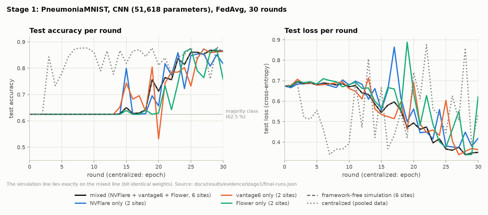
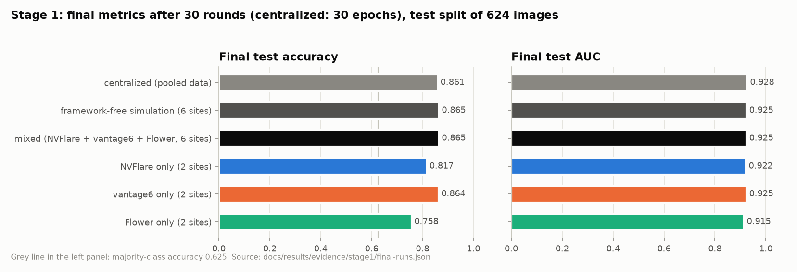
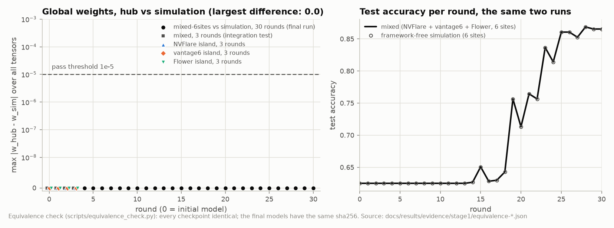
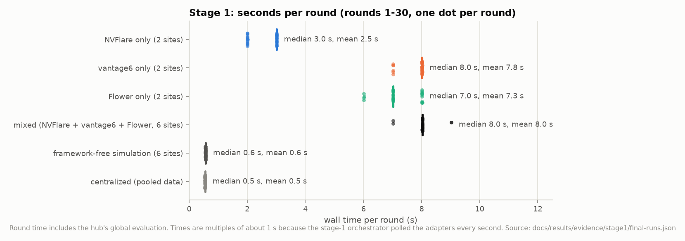

# Stage 1: one FedAvg hub across NVFlare, vantage6 and Flower

Stage 1 built the system and tested its central claim: hospitals keep their own federated-learning framework and its standard client, and one hub trains a single model with plain weighted FedAvg across all of them, with the same result as a framework-free FedAvg. This page condenses the stage-1 report; the full original is [`REPORT.md` at tag `stage1-final`](https://github.com/Zare2001/AgnosticFL/blob/stage1-final/REPORT.md). Dates are 2026-10-13.

## Setup

**Federation.** Six simulated hospitals on three hospital VMs, each with its framework's standard client:

| Sites | Framework | Hospital-side client |
|---|---|---|
| `nvf-h1`, `nvf-h2` | NVFlare 2.9.0 | NVFlare Client API script, shipped as job custom code |
| `v6-h3`, `v6-h4` | vantage6 4.15.2 | vantage6 node running the operator's algorithm image |
| `flw-h5`, `flw-h6` | Flower 1.39.0 | Flower SuperNode running a ClientApp from the FAB |

The hub, the three framework servers and their adapters ran on a fourth VM. The orchestrator spoke `flhub/0.1` to the adapters ([protocol](../protocol.md)); each adapter carried the rounds through its framework's own channel ([architecture](../architecture.md)). All four VMs: 4 vCPU AMD EPYC-Rome, Python 3.11.17, torch 2.14.1+cpu, numpy 2.4.4 ([`deploy/versions.env`](../../deploy/versions.env)).

**Data** (ADR-001 in [design/decisions.md](../design/decisions.md)). PneumoniaMNIST from MedMNIST v2 (28 × 28 grayscale chest X-rays, normal vs pneumonia; CC BY 4.0), file `pneumoniamnist.npz` from Zenodo record 10519652 with a pinned sha256. The official training split (4,708 images) was split into six IID partitions with a frozen random stream, one CSV file per site with a pinned sha256:

| Site | nvf-h1 | nvf-h2 | v6-h3 | v6-h4 | flw-h5 | flw-h6 | test (hub only) |
|---|---|---|---|---|---|---|---|
| Examples | 785 | 785 | 785 | 785 | 784 | 784 | 624 |
| Pneumonia | 593 | 569 | 567 | 584 | 591 | 590 | 390 (62.5 %) |

**Model and training.** A CNN without normalization layers (conv 1→8, pool, conv 8→16, pool, fc 784→64, fc 64→2): 51,618 float32 parameters, a 207,168-byte safetensors blob. 30 rounds, 1 local epoch, batch 64, SGD with learning rate 0.05 and no momentum, seed 2026, a fresh optimizer every round ([`configs/final.yaml`](../../configs/final.yaml)). A short tuning in the simulation (30 rounds) gave accuracy 0.865 / AUC 0.925 at learning rate 0.05, 0.872 / 0.923 at 0.1 and 0.861 / 0.919 at 0.2; the default was kept.

**Determinism** (ADR-003). Training uses one CPU thread, `torch.use_deterministic_algorithms(True)` and a data order seeded by (seed, round, fingerprint of the site's data), so it needs no hospital-side configuration. `python -m flhub_core.selfcheck` printed the same hash on all four VMs and inside the vantage6 algorithm image.

## Questions

1. Can one FedAvg hub train across NVFlare, vantage6 and Flower while every hospital runs only its framework's standard client?
2. Is the result numerically the same as a framework-free FedAvg on the same data?
3. How does the federated model compare with centralized training on the pooled data?
4. What does each framework add to the time of a round?

## Results

**Admission test.** Every adapter passed the conformance suite against the deployed framework servers: 7 of 7 tests, and the weights returned by the remote hospitals equal local training bit for bit (max abs difference 0.0 in rounds 1, 2 and 4) ([evidence](evidence/stage1/): `conformance-{nvflare,vantage6,flower}-central.json`).

**Final runs.** Six runs, all finished, logged to the W&B project `AgnosticFL` (tag `final`); per-round metrics in [final-runs.json](evidence/stage1/final-runs.json).

| Run | Sites | Test accuracy | Test AUC | Test loss | Wall time | W&B |
|---|---|---|---|---|---|---|
| mixed (NVFlare + vantage6 + Flower) | 6 | **0.8654** | **0.9247** | 0.3497 | 244 s | [iehjnc44](https://wandb.ai/hpml_surf-surf/AgnosticFL/runs/iehjnc44) |
| framework-free simulation | 6 | 0.8654 | 0.9247 | 0.3497 | 20 s | [kur37gs2](https://wandb.ai/hpml_surf-surf/AgnosticFL/runs/kur37gs2) |
| centralized (pooled data, 30 epochs) | – | 0.8606 | 0.9279 | 0.5412 | 20 s | [j5gn5knm](https://wandb.ai/hpml_surf-surf/AgnosticFL/runs/j5gn5knm) |
| NVFlare only | 2 | 0.8173 | 0.9224 | 0.4188 | 80 s | [pavr8q6u](https://wandb.ai/hpml_surf-surf/AgnosticFL/runs/pavr8q6u) |
| vantage6 only | 2 | 0.8638 | 0.9246 | 0.3631 | 238 s | [twk49dhp](https://wandb.ai/hpml_surf-surf/AgnosticFL/runs/twk49dhp) |
| Flower only | 2 | 0.7580 | 0.9149 | 0.6225 | 221 s | [011lasv0](https://wandb.ai/hpml_surf-surf/AgnosticFL/runs/011lasv0) |

Test accuracy / AUC every 5 rounds (round 0 = the initial model; centralized: epochs):

| Round | centralized | simulation | NVFlare only | vantage6 only | Flower only | mixed |
|---|---|---|---|---|---|---|
| 0 | 0.625 / 0.649 | 0.625 / 0.649 | 0.625 / 0.649 | 0.625 / 0.649 | 0.625 / 0.649 | 0.625 / 0.649 |
| 5 | 0.780 / 0.916 | 0.625 / 0.644 | 0.625 / 0.609 | 0.625 / 0.648 | 0.625 / 0.611 | 0.625 / 0.644 |
| 10 | 0.861 / 0.923 | 0.625 / 0.809 | 0.625 / 0.780 | 0.625 / 0.820 | 0.625 / 0.775 | 0.625 / 0.809 |
| 15 | 0.819 / 0.920 | 0.651 / 0.915 | 0.800 / 0.923 | 0.744 / 0.921 | 0.639 / 0.918 | 0.651 / 0.915 |
| 20 | 0.811 / 0.920 | 0.713 / 0.912 | 0.657 / 0.905 | 0.532 / 0.921 | 0.630 / 0.898 | 0.713 / 0.912 |
| 25 | 0.878 / 0.928 | 0.861 / 0.923 | 0.848 / 0.921 | 0.732 / 0.910 | 0.873 / 0.928 | 0.861 / 0.923 |
| 30 | 0.861 / 0.928 | 0.865 / 0.925 | 0.817 / 0.922 | 0.864 / 0.925 | 0.758 / 0.915 | 0.865 / 0.925 |

**Equivalence.** `scripts/equivalence_check.py` compared the global weights of the mixed run and the simulation after every round (round 0 = the initial model): the maximum absolute difference was **0.0 in all 31 checkpoints**, the final accuracies differ by 0.0 points, and the two final models have the same sha256 (`7fd3e2a4…`). The pass criteria were ≤ 1e-5 per round and ≤ 0.1 points. The 3-round integration tests of each framework alone (*island* tests: one framework on a single VM) and of the mixed federation also gave 0.0 in every round ([evidence](evidence/stage1/): `equivalence-*.json`).

**Time per round.** Wall time per round, including the hub's global evaluation:

The round time comes from the framework, not from the hub: NVFlare keeps one job running (mean 2.5 s per round); vantage6 starts one algorithm container per task (7.8 s); Flower starts one ClientApp process per message, which imports torch every time (7.3 s). The mixed federation waits for its slowest framework (8.0 s). The simulation and centralized training need 0.5–0.6 s per round. Stage-1 round times are multiples of about 1 s because the orchestrator polled the adapters every second.

**What the runs show:**

- **Framework-agnostic FedAvg is exact.** Routing the same round through NVFlare, vantage6 and Flower at once changes nothing numerically: each framework carries float32 weights losslessly (NVFlare `FULL` numpy parameters, vantage6 base64 safetensors, Flower `ArrayRecord`), and the deterministic shared training code makes every hospital's update reproducible.
- **FedAvg over six sites matches centralized training.** 0.865 against 0.861 accuracy and 0.925 against 0.928 AUC after the same number of passes over the data. The federated runs stay at the majority class (0.625) through round 13 and reach 0.80 at round 23, while AUC rises from round 1; centralized training reaches 0.80 after 3 epochs, and both end at the same level.
- **Single-framework runs** use two sites and a third of the data. Their AUC is similar (0.915–0.925), but their accuracy at the 0.5 threshold swings from round to round (vantage6 only: 0.53 at round 20, 0.86 at round 30), so their final accuracies (0.76–0.86) reflect that noise, not the framework: the training code is identical everywhere.

## Hospital side

Each hospital ran its framework's standard client pattern; the only hub-specific items were connection settings, credentials and the data path. The training library arrived through the framework's own channel or as a dependency of the client.

| | NVFlare | vantage6 | Flower |
|---|---|---|---|
| Installs | `nvflare`, torch, numpy, safetensors, `flhub_core` | vantage6 CLI and Docker; `flhub_core` only inside the algorithm image | `flwr`, torch, numpy, safetensors, `flhub_core` |
| Configures | startup kit from the operator (server name, mTLS certificates); data path | node YAML: server URL and port, API key, data file, image policy; Docker registry setting | SuperNode `--superlink <central-host>:9092` and node config `site-id`, `data-path` |
| Code that runs | standard Client API loop around `flhub_core.train` | algorithm `train` (`@data(1)`, `@metadata`, `wrap_algorithm()`) around `flhub_core.train` | ClientApp `@app.train()` around `flhub_core.train`, `@app.query()` for the site id |
| How it arrives | job custom code, deployed by the NVFlare server | image pulled by the node from the operator's registry | FAB sent by `flwr run` |

Every envelope carried the same `client_code_version` (`0.1.0+9c6b064c1e96`) as the hub. In stage 2, `flhub_core` reached the NVFlare and Flower hospitals inside the job and the FAB: the NVFlare hospitals removed their installed copy once, and on the Flower hospitals the FAB copy takes precedence over the installed one ([stage 2](stage2.md)). The per-framework details are in the guides: [NVFlare](../frameworks/nvflare.md), [vantage6](../frameworks/vantage6.md), [Flower](../frameworks/flower.md).

## Threats to validity and limits

- **A test network.** The hub sees every update in plaintext (no secure aggregation, no differential privacy, by design of the brief). NVFlare used its provisioned mTLS; vantage6 and Flower ran without TLS, protected by a firewall that admitted only the testbed's machines. One operator hosted all framework servers.
- **Uniform hardware.** Bit-exact equality needs identical CPU code paths and pinned library versions; all VMs had the same CPU type. On mixed hardware a tolerance (≤ 1e-5) replaces bit-exactness.
- **One seed, one small model, IID data.** Stage 2 tested non-IID data, larger models and more seeds ([stage 2](stage2.md)).
- **Latency.** vantage6 and Flower start a container or process per task, about 7–8 s per round: fine for tens of rounds, not for thousands.

Problems met while building stage 1 and their fixes (the port layout of Flower 1.39, the vantage6 4.15 command line on Python 3.11, NVFlare's handling of script paths and restarted clients) are in the troubleshooting sections of the framework guides and in ADR-004 to ADR-007.

## Evidence

- [`evidence/stage1/final-runs.json`](evidence/stage1/final-runs.json): per-round metrics of the six final runs (extracted from their run directories by [`scripts/docs/plots_stage1.py`](../../scripts/docs/plots_stage1.py), which also draws the four figures above).
- [`evidence/stage1/`](evidence/stage1/): conformance reports per adapter (deployed servers and single-framework test setups), equivalence checks (final run and integration tests), the W&B listing of the six final runs.
- Full report with every acceptance check: [`REPORT.md` at `stage1-final`](https://github.com/Zare2001/AgnosticFL/blob/stage1-final/REPORT.md).
