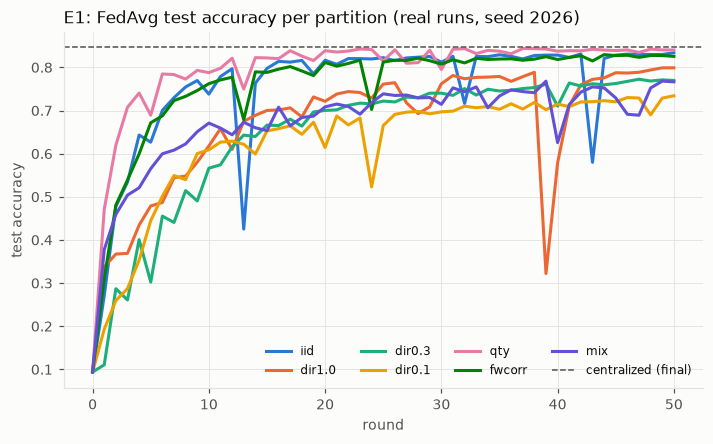
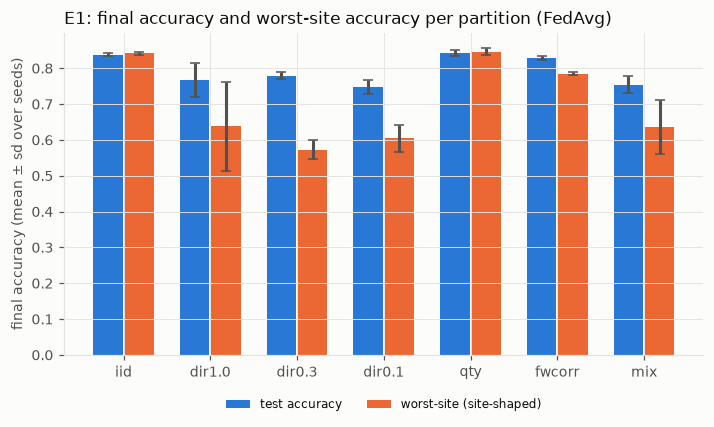
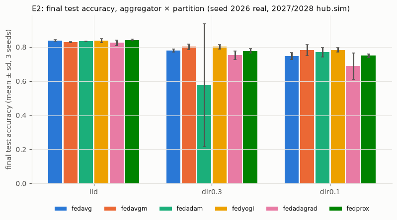
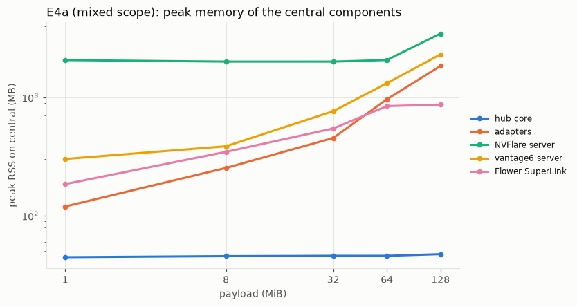
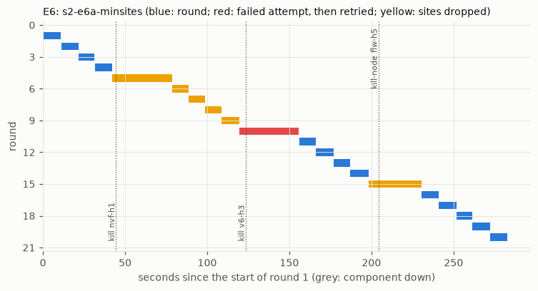

# Stage 2: full system and performance test

Stage 2 tested the stage-1 system under realistic and demanding conditions: non-IID and uneven data, six server aggregators, models up to 11 M parameters, model updates up to 512 MiB, more sites, dropouts, stragglers, partial participation, hub crashes and framework-server restarts, and each framework's own FedAvg as a baseline. It also measured where the time goes. This page condenses the stage-2 report; the full original is [`REPORT_STAGE2.md` at tag `stage2-final`](https://github.com/Zare2001/AgnosticFL/blob/stage2-final/REPORT_STAGE2.md). The campaign ran from 2026-10-13 13:47 UTC to 2026-10-14 about 09:00 UTC; 122 final runs were logged to the W&B project `AgnosticFL-stage2` (69 real, 44 simulated extra seeds, 3 references, 6 native baselines; list in [runs.md](evidence/stage2/runs.md)).

## Summary

- **Correctness.** All 69 final real runs equal their framework-free reference with difference 0.0, for the global weights and the float64 server-optimizer state (method per run in RQ1 below). Two configurations re-run hours later reproduced all 50 rounds exactly.
- **Hospital cost.** Changing the aggregator, the data distribution, the model and the participation policy were hub-side changes: 0 changed lines in the hospitals' client code in all three frameworks. The only hospital-side change was one rollout of the training library through each framework's own channel.
- **Learning.** Label skew between sites costs FedAvg 6–9 points of test accuracy and 25–30 points on the worst site; quantity skew costs nothing; skew along framework boundaries about 1 point. FedAvgM and FedYogi recover 2–4 points under label skew. Server learning rates tuned for one setting diverged with a larger model and with 50 % participation.
- **Performance.** Per site and round, transport, framework and adapter cost 1.6–2.7 s with NVFlare, 5.6–10.9 s with Flower and 7.2–42 s with vantage6; the hub's aggregation stays below 0.25 s up to 11 M parameters. NVFlare and Flower carried 512 MiB updates with 1.002–1.06× bytes on the wire; vantage6 moves 5–9× the payload and dominates the mixed rounds. Twelve sites instead of six cost 14 % more round time. Against each framework's own FedAvg the hub is between 20 % faster and 10 % (0.73 s) slower per round.
- **Robustness.** Every injected fault recovered without manual action: hospital crashes, stragglers, a SIGKILL of the hub and all adapters (resumed bit-exactly, including the momentum state), and restarts of all three framework servers between and during rounds.

**Most important limits found:** vantage6 4.15.2 with its default SQLite server cannot deliver 256 MiB results; NVFlare re-admits a restarted client only through a relay-job restart; the testbed's 19 GB disk stopped the payload sweep above 512 MiB for one framework and above 128 MiB for six sites, and CPU-only training limited ResNet-18 to 20 rounds.

## Setup

### What changed since stage 1

| Component | Change |
|---|---|
| Protocol | `flhub/0.2`: per-site progress, partial collect, per-site cancel, per-run readiness, payloads up to ≥ 1024 MiB; a 0.2 adapter still serves 0.1 callers ([protocol](../protocol.md) §7, ADR-008) |
| Shared training library | `flhub_core` 0.2: OrganAMNIST, partitions, data variants, model zoo, FedProx μ, weight decay, timing metrics, selfcheck v2 (ADR-009, ADR-010) |
| Aggregators | `fedavg` (the stage-1 code path), `fedavgm`, `fedadam`, `fedyogi`, `fedadagrad`, `fedprox`; float64 state, checkpointed every round ([aggregators](../aggregators.md)) |
| Orchestrator and simulation | seeded partial participation, `min_sites` with deadlines, retries, bit-exact `--resume`, per-round hashes of weights and aggregator state, timing breakdown; simulation with workers, replay and comparison against a real run |
| Framework side | `flhub/0.2` adapters, rollout of `flhub_core` 0.2 through each framework's own channel, native FedAvg baselines, extra sites for the 12-site test |

### Versions, machines, data and models

Versions as in stage 1 ([`deploy/versions.env`](../../deploy/versions.env)). `flhub_core` 0.2 has the content-hash `code_version` `0.2.0+fe357a1dbec1`, and its selfcheck v2 digest `sha256:ac074a0b…` was the same on the hub, in the NVFlare job runtime, inside the vantage6 algorithm image and in the Flower SuperNode runtime. Four VMs with 4 vCPU AMD EPYC-Rome (AVX2), 31 GiB RAM and 19 GB disk; training uses one CPU thread per site.

**Data** (ADR-009): OrganAMNIST (MedMNIST v2, 28 × 28 abdominal CT, 11 organ classes, CC BY 4.0), train 34,561 / validation 6,491 / test 17,778 images, pinned sha256. Partitions are deterministic in a partition seed; their manifests (sizes, label histograms, CSV sha256, data fingerprints) are in [`configs/stage2/partitions/`](../../configs/stage2/partitions/), and every update reports a data fingerprint that the hub checks.

| Partition | Definition | Site sizes (6 sites) |
|---|---|---|
| `iid` | stratified, equal sizes | 5,761 / 5,760 × 5 |
| `dir1.0`, `dir0.3`, `dir0.1` | label skew: class proportions per site from a Dirichlet distribution, equal sizes | 5,761 / 5,760 × 5 |
| `qty` | IID labels, sizes 1 : 32 : 2 : 16 : 4 : 8 | 549, 17,555, 1,097, 8,777, 2,194, 4,389 |
| `fwcorr` | per class, framework shares from Dirichlet(0.3); IID halves inside a framework | NVFlare 3,219 / 3,218, vantage6 9,076 / 9,075, Flower 4,985 / 4,988 |
| `mix` | `dir0.3` proportions with the `qty` sizes | as `qty` |
| `iid12` | stratified over 12 sites | 2,881 / 2,880 × 11 |

With equal site sizes and a small α the class pools run out, so `dir0.1` is only slightly more skewed than `dir0.3`; the realized histograms above are what the experiments used.

**Models** (ADR-010):

| Model | Architecture | Parameters | Update size |
|---|---|---|---|
| `cnn-small` | the stage-1 CNN | 52,203 | 0.2 MiB |
| `cnn-medium` | 2 × conv32, 2 × conv64, fc 512 | 1,676,779 | 6.4 MiB |
| `resnet18-gn` | ResNet-18, CIFAR stem, GroupNorm(32) | 11,173,323 | 42.6 MiB |
| `payload-<N>` | synthetic float32 tensors; "training" adds a deterministic step without compute | N MiB / 4 | N MiB |

One local epoch on 5,761 images with one thread takes 1.6 s (`cnn-small`), 11.4 s (`cnn-medium`) and about 3.6 min (`resnet18-gn`).

**Aggregators and tuning.** Tuned once in the simulation on `dir0.3` (validation split, 30 rounds, [tuning.md](evidence/stage2/tuning.md)): client learning rate 0.1; FedAvgM η 1.0 (β 0.9), FedAdam η 0.03, FedYogi η 0.03, FedAdagrad η 0.03, FedProx μ 0.01. FedAvgM had the best validation accuracy (0.914) and was used for the model-size and robustness tests. Four optima lie on the edge of the grid. Details in [aggregators](../aggregators.md).

## Research questions

RQ1 correctness: does every real run equal the simulation? RQ2 hospital cost: what has to change at the hospitals? RQ3 learning: how do data heterogeneity, aggregators and model size affect accuracy? RQ4 performance: where does the time go, and how does it scale with model size, bandwidth and sites? RQ5 robustness: do faults recover without manual action, and at what cost?

## RQ1: correctness

Every round of a run records the sha256 of the global weights and of the aggregator state. A real run is uploaded only after its equivalence check (INV-1) passed:

| Method | Real runs | How |
|---|---|---|
| full simulation | 62 | `hub.sim --compare <run>`: the whole run again in one process with the same participants; hashes compared per round |
| simulation with recorded participants | 4 | the same, for runs with dropped or sampled sites |
| replay | 2 | `resnet18-gn`: rounds 1, 2, 3 and the last recomputed from the run's own previous weights and state |
| resume equality | 1 | the resumed run's final weights and state equal the uninterrupted run |

**69 of 69 final real runs passed, all with difference 0.0** ([tables.md](evidence/stage2/tables.md), [runs.md](evidence/stage2/runs.md)): the real cross-framework system produced byte-identical weights to the framework-free simulation, including the float64 server-optimizer states. **Reproducibility (INV-4):** two configurations were re-run on the real system 3–5 hours later, after dozens of other runs; all 50 rounds were identical in weights and aggregator state ([inv4-s2-e1-dir0.3-fedavg.json](evidence/stage2/inv4-s2-e1-dir0.3-fedavg.json), [inv4-s2-e2-dir0.3-fedavgm.json](evidence/stage2/inv4-s2-e2-dir0.3-fedavgm.json)).

## RQ2: hospital-side cost

**No hospital code changed.** `git diff --stat stage1-final..stage2-final -- clients/` touches only the Flower FAB's relay ServerApp (313 lines; it ships in the FAB but runs only on the operator's machine) and the FAB metadata (4 lines); `clients/nvflare/`, `clients/vantage6/` and the Flower ClientApp have 0 changed lines ([hospital ledger](evidence/hospital-ledger.md)). So switching the aggregator, the data, the model, partial participation and resume needed 0 changed lines at the hospitals; FedProx's μ travels inside `train_config`.

**What did reach the hospitals:**

| | NVFlare | vantage6 | Flower |
|---|---|---|---|
| (a) code rollout of `flhub_core` 0.2 | job custom code; once: remove the installed copy and restart the client (50.3 s offline per site) | new algorithm image tag (build and push 98 s, adapter restart 2 s); 0 hospital steps | FAB with `flhub_core` inside (adapter restart, healthy after 29.6 s); 0 hospital steps |
| (b) data for the data variants | sha256-verified CSV files next to the stage-1 file | the same | the same |
| (c) configuration for data variants | none | node config with one database per variant, 1 restart (14.7 s offline) | none |
| (d) later code updates | 0 steps (next relay job) | 0 steps (next image tag) | 0 steps (next FAB) |

The ledger has 23 rows: 1 code (the Flower FAB), 1 configuration (vantage6 node databases), 3 data, 18 operations (watchdogs, extra sites, fault-injection tools and their reverts, clean-up). The extra sites for the 12-site test were onboarded with each framework's normal process (NVFlare kits from the same root CA, vantage6 API keys, two more Flower SuperNodes) and were online 16–62 s after the request.

## RQ3: learning

All learning results: OrganAMNIST, `cnn-small`, 1 local epoch, batch 64, client learning rate 0.1, 50 rounds, test split of 17,778 images. Seed 2026 runs on the real system; seeds 2027 and 2028 in the simulation (valid because each real run is hash-identical to its simulation). *Worst site* = test accuracy weighted by a site's training label histogram; *target* = 95 % of centralized accuracy (0.95 × 84.7 % = 80.5 %).

### E1: data heterogeneity (FedAvg)

| Partition | Final test acc % | Mean of last 5 rounds % | Worst site % | Rounds to target |
|---|---|---|---|---|
| iid | 83.8 ± 0.4 | 83.5 ± 0.5 | 84.2 ± 0.4 | 16 |
| qty | 84.3 ± 0.9 | 83.4 ± 0.6 | 84.7 ± 0.9 | 12 |
| fwcorr | 82.9 ± 0.5 | 83.3 ± 0.7 | 78.5 ± 0.4 | 20 |
| dir1.0 | 76.7 ± 4.7 | 78.9 ± 0.4 | 63.8 ± 12.5 | not reached |
| dir0.3 | 78.0 ± 0.9 | 77.6 ± 0.5 | 57.2 ± 2.7 | not reached |
| dir0.1 | 74.7 ± 2.0 | 74.2 ± 2.4 | 60.5 ± 3.8 | not reached |
| mix | 75.4 ± 2.4 | 73.4 ± 0.8 | 63.6 ± 7.4 | not reached |

Mean ± sd over 3 seeds ([tables.md](evidence/stage2/tables.md)). References: centralized 84.7 %; each site alone for 50 epochs 69.2 % on `iid` and 26.2 % on `dir0.1`.

Label skew is what hurts; quantity skew alone costs nothing (the largest site takes 51 % of the FedAvg weight and reaches the target 4 rounds earlier); framework-correlated skew is mild here, because every site still sees most classes. Federating pays even under the worst skew (74.7 % against 26.2 % for a site alone).

### E2: aggregators

Final test accuracy %, mean ± sd over 3 seeds (worst-site accuracy in brackets):

| Partition | fedavg | fedavgm | fedadam | fedyogi | fedadagrad | fedprox |
|---|---|---|---|---|---|---|
| iid | 83.8 ± 0.4 (84.2) | 82.9 ± 0.3 (83.3) | 83.4 ± 0.1 (83.8) | 83.8 ± 1.1 (84.2) | 82.5 ± 1.7 (82.9) | 84.2 ± 0.5 (84.6) |
| dir0.3 | 78.0 ± 0.9 (57.2) | **80.2 ± 1.6 (62.3)** | 57.7 ± 36.1 (41.8) | 80.1 ± 1.4 (61.9) | 75.3 ± 2.5 (50.6) | 77.8 ± 1.3 (56.4) |
| dir0.1 | 74.7 ± 2.0 (60.5) | 78.3 ± 3.1 (59.3) | 77.0 ± 2.7 (62.8) | **78.4 ± 1.2 (65.3)** | 68.9 ± 7.7 (41.8) | 74.9 ± 1.1 (61.3) |
| rounds to target, `iid` | 16 | 27 | 24 | 19 | 36 | 16 |

- Server momentum and Yogi gain 2–4 points under label skew and nothing on IID data, where their server learning rates (tuned for the skewed case) delay the target.
- FedAdam diverged in one of three `dir0.3` seeds (81 % until round 45, then 16.2 % at round 50), the known instability of Adam-type server steps when the second moment becomes small; FedYogi, with its additive second-moment update, stayed stable. FedAdagrad was the weakest.
- FedProx with μ = 0.01 behaves like FedAvg (within 0.4 points).
- Changing the aggregator is a hub-only change: all 15 configurations ran on the same hospital deployment without restarts.

### E3: model size (accuracy)

`dir0.3`, seed 2026, real system:

| Model | Rounds | FedAvg final acc % (worst site) | FedAvgM final acc % (worst site) |
|---|---|---|---|
| `cnn-small` | 50 | 77.0 (54.3) | 78.3 (63.8) |
| `cnn-medium` | 50 | **81.5** (63.3); target reached at round 36 | 11.1: diverged at round 9 |
| `resnet18-gn` | 20 | 42.7 (15.3) | **50.7** (27.8) |

The wider CNN pays off within 50 rounds and is the only `dir0.3` run that reaches the target. ResNet-18 needs more rounds than the CPU budget allowed (still rising at round 20). The FedAvgM step tuned on `cnn-small` (η 1.0, β 0.9) collapses `cnn-medium` to chance level, and the simulation reproduces the collapse bit for bit, so it is the optimizer: server learning rates have to be tuned per model.

## RQ4: performance

The cost view of these results (implementation, overhead, network, memory, scaling) is [cost and efficiency](../cost-and-efficiency.md); the main tables follow.

### E4a: payload sweep

Echo models (no compute: round time = transport + framework + hub), 3 rounds, two sites per framework or all six (mixed); median of rounds 2–3. Every finished run passed the equivalence check.

| MiB | NVFlare s/round | Flower s/round | vantage6 s/round | mixed s/round |
|---|---|---|---|---|
| 1 | 2.5 | 5.8 | 6.3 | 6.5 |
| 8 | 2.7 | 6.1 | 12.8 | 13.3 |
| 32 | 2.7 | 7.7 | 60.1 | 58.9 |
| 64 | 3.7 | 9.1 | 115.3 | 116.2 |
| 128 | 5.1 | 13.5 | 468.2 | 393.8 |
| 256 | 10.3 | 20.6 | limit: result never delivered | testbed disk |
| 512 | 15.5 | 45.8 | – | – |

Source: [tables.md](evidence/stage2/tables.md). 1024 MiB (two sites) and 256 MiB (six sites) were not run: the testbed's 19 GB central disk was the limit, not a framework.

- **NVFlare and Flower hit no framework limit.** NVFlare stays near its 2.5 s floor up to 32 MiB (2.5–2.7 s per round) and grows linearly beyond; Flower has about 5.5 s of fixed cost per round and grows about linearly up to 256 MiB; at 512 MiB its fan-out (43.5 s) is 18 % above the straight-line fit (36.8 s), and a quadratic fit reaches R² 0.997 ([cost_model.md](evidence/stage2/cost_model.md)).
- **vantage6 has a real limit at 256 MiB** (4.15.2, default SQLite server). Training finished every time, but no result arrived: the server's single worker spent minutes rewriting the run row (its input alone 1.78 × 256 MiB) for every streamed algorithm log line, so the node's websocket timed out; the node then drops the result and, after reconnecting, trains again. Each node trained round 1 six times in 32 minutes ([vantage6/e4a-256mb-node-logs.txt](evidence/stage2/vantage6/e4a-256mb-node-logs.txt)). No server-side setting fixes it in 4.15.2 (the large-result store is broken, ADR-020); a PostgreSQL server database or `share_algorithm_logs: false` on the nodes would remove the row rewrites, but neither was applied, because a limit is a result.
- **Bytes on the wire** (interface counters ÷ payload): NVFlare 1.005–1.064, Flower 1.002–1.005, vantage6 4.97–5.53 up to 64 MiB and 9.08 at 128 MiB ([e4_bytes.md](evidence/stage2/e4_bytes.md); [explained](../cost-and-efficiency.md#51-bytes-on-the-wire)).
- **Memory on the central machine** ([central-e4a-memory.md](evidence/stage2/central-e4a-memory.md)): the hub core stays at 41–47 MiB at every size (blobs are streamed); the orchestrator needs about 8× the update (2,050–2,066 MiB at 256 MiB, 4,063–4,266 MiB at 512 MiB); NVFlare's relay job 2,535 MiB at 256 MiB and 3,779 MiB at 512 MiB; Flower's relay ServerApp 1,941 and 3,647 MiB; vantage6's server and adapter 2,349 and 1,925 MiB at 128 MiB. The whole central machine peaked at 11.8 GiB (38 % of RAM) at 512 MiB. On the hospital VMs, NVFlare peaked at 5.0 GiB and Flower at 7.5 GiB (24 %) at 512 MiB.

(The memory figure's axis says MB; the values are MiB.)

### E4b: bandwidth

`payload-45`, all three frameworks, `netem` rate and delay on every hospital link in both directions; fan-out per framework, median of rounds 2–3; lower bound = 4·P/rate.

| Profile | Lower bound (s) | NVFlare (s) | Flower (s) | vantage6 (s) | Round (s) |
|---|---|---|---|---|---|
| none | – | 3.3 | 7.5 | 81.8 | 82.2 |
| 1 Gbit/s, 5 ms | 1.5 | 4.3 | 8.9 | 83.3 | 83.7 |
| 100 Mbit/s, 20 ms | 15.1 | 17.0 | 22.7 | 129.5 | 130.0 |
| 20 Mbit/s, 40 ms | 75.5 | 80.3 | 85.1 | 463.8 | 464.3 |

NVFlare and Flower move each update once and reach 94 % and 89 % of the bandwidth bound at 20 Mbit/s. vantage6 moves 21.36× the payload per link and round by design (five input copies down and one result up per site, base64 twice); against that volume it reaches 0.87, against the 4·P bound 0.16, and it sets the round time ([cost_model.md](evidence/stage2/cost_model.md), [vantage6 guide](../frameworks/vantage6.md) §5.4).

### E3: round time and model size

| Model (FedAvg) | NVFlare train / overhead (s) | vantage6 train / overhead (s) | Flower train / overhead (s) | Hub aggregation (s) | Hub evaluation (s) | Round (s) |
|---|---|---|---|---|---|---|
| `cnn-small` (0.2 MiB) | 0.7 / 1.6 | 1.8 / 7.2 | 1.6 / 5.6 | 0.001 | 1.9 | 9.1 |
| `cnn-medium` (6.4 MiB) | 11.7 / 1.9 | 13.5 / 14.1 | 13.9 / 6.3 | 0.025 | 14.6 | 28.8 |
| `resnet18-gn` (42.6 MiB) | 214.0 / 2.7 | 225.3 / 42.0 | 223.3 / 10.9 | 0.133 | 105.6 | 268.0 |

Training dominates as the model grows; vantage6 sets the round time for every model, and its overhead grows during a run while tasks stay in its server database (`cnn-medium`: 8.7 s at round 3, 12.4 s at round 21). The hub is never the bottleneck. With `resnet18-gn`, one training process needed 1.0–1.1 GiB (vantage6: 2.1 GiB for its two training containers together) and the orchestrator 1.7–2.1 GiB ([tables.md](evidence/stage2/tables.md)). One stall, in round 10 of the ResNet FedAvg run, came from a hospital-side clean-up job that deleted a fresh result; the round failed at its deadline, the retry succeeded, and the job was removed.

### E5: number of sites

`iid` over the 6 base sites against `iid12` over 12 sites (4 per framework, half the data each), FedAvg, 20 rounds:

| | 6 sites | 12 sites |
|---|---|---|
| Round time (median) | 9.1 s | 10.4 s (+14 %) |
| Fan-out NVFlare / vantage6 / Flower | 3.0 / 9.1 / 7.6 s | 2.8 / 10.4 / 8.3 s |
| Hub aggregation | 0.6 ms | 1.0 ms |
| Test accuracy after 20 rounds | 81.7 % | 74.9 % |

Doubling the sites costs the hub almost nothing. Accuracy drops at the same number of rounds because each site takes half as many local steps.

### E7: against each framework's own FedAvg

| Framework | C1 `cnn-small`, 20 rounds: native / hub (s) | Overhead | C2 `payload-45`, 5 rounds: native / hub (s) | Overhead | Weights |
|---|---|---|---|---|---|
| NVFlare | 3.50 / 3.27 | −0.23 s (−6.5 %) | 2.52 / 2.62 | +0.10 s (+4.1 %) | 3e-8 after round 1 (NVFlare aggregates in float32) |
| vantage6 | 8.81 / 8.81 | 0.00 s (0 %) | 95.5 / 82.1 | −13.4 s (−14 %) | hash-identical every round |
| Flower | 9.48 / 7.55 | −1.93 s (−20 %) | 7.45 / 8.19 | +0.73 s (+9.8 %) | hash-identical every round |

The translation layer costs at most 0.73 s per round here and is often faster than the native path ([cost and efficiency](../cost-and-efficiency.md#41-against-each-frameworks-own-fedavg-e7)). A per-framework cost model, fixed cost plus cost per MiB plus the slowest site's training, predicts the learning runs within ±10 % for NVFlare and Flower, and for vantage6 from 6 MiB on; it underestimates vantage6's small-model rounds by 31–38 % ([cost model](../cost-and-efficiency.md#43-cost-model)).

## RQ5: robustness (E6)

All fault runs used `dir0.3`, `cnn-small` and the six base sites. No run needed a manual action, and every run passed its equivalence check with difference 0.0 ([e6.md](evidence/stage2/e6.md)).

| Scenario | NVFlare | vantage6 | Flower |
|---|---|---|---|
| Hospital killed, all sites required | failed after 33.1 s, retried, round done 74.0 s after the kill | container crash reported after 2.1 s, retried, done after 15.2 s | failed after 20.7 s, retried, done after 31.3 s |
| Hospital killed, `min_sites: 5` | round done with 5 sites after 34.0 s; site out for rounds 6–9 | failed once (a second site was still out), retried with 6 sites | round done with 5 sites after 26.1 s; back next round |
| Straggler at 10 % CPU, `deadline_s` 20 | in time in all 6 rounds | dropped in all 7 rounds (round = deadline, 20.3 s) | dropped in all 7 rounds (20.2 s) |
| Server restart between rounds | back in 12.1 s; next round done 84.9 s after the restart | back in 14.8 s; next round done after 26.9 s | relay relaunched after 35.9 s; next round done after 47.7 s |
| Server restart mid-round | round failed after 51.0 s, retried, done 96.1 s after the restart | finished during the stop grace; the next round overlapped the restart and completed without a retry, 20.4 s after it | failed after 22.8 s, retried, done 54.6 s after the restart |

- **Detection time is a framework property:** vantage6 reports a killed container at once; NVFlare and Flower see a dead client only through liveness checks (20–34 s).
- **NVFlare re-admits a restarted client only through a relay-job restart**, which the adapter does only between rounds; with `min_sites` the site sat out four rounds.
- **A straggler is a deadline question:** the same CPU limit kept NVFlare's site in time (NVFlare adds about 1.3 s per site and round) but not vantage6's and Flower's (5–7 s); their rounds completed at the deadline through partial collect and per-site cancel.
- **Partial participation interacts with server momentum:** with half the sites per round, FedAvg ended at 66.1 %, while FedAvgM with the tuned step diverged (9.8 %); a smaller step (η 0.3) in a diagnostic simulation stayed stable (73.9 %).
- **Hub crash and resume are exact:** the orchestrator and all adapters were killed in round 21; adapters were back after 1.1 s (NVFlare), 2.2 s (vantage6) and 7.0 s (Flower relay run), round 21 was done 20.1 s after the kill, and the final weights and momentum state were hash-identical to the uninterrupted run ([timeline](figures/e6_timeline_s2-e6d-resume.png)).
- **Retries do not change the result:** two runs with 3 and 2 retried rounds ended hash-identical ([timeline](figures/e6_timeline_s2-e6a-strict.png)).

## Threats to validity

- **Uniform hardware:** bit-exact equality depends on identical CPUs and pinned versions; on mixed hardware a tolerance of 1e-5 would be needed.
- **One data centre:** about 0.7 ms between machines; wide-area conditions only as `netem` rate and delay, without loss or jitter.
- **Simulated hospitals:** two per 4-vCPU VM, so co-located sites compete for CPU, memory, disk and the link; payload results are bounded by the VMs' disks and RAM (reported as testbed limits).
- **One dataset and one tuning split:** hyperparameters were tuned once, on `dir0.3` with one seed, and several optima sit on the edge of the grid.
- **Simulated extra seeds:** seeds 2027 and 2028 ran only in the simulation, which assumes the real system would also have matched them.
- **Timing granularity:** per-site times come from polling (0.25 s in the orchestrator, about 1 s in the frameworks).

## Evidence

- [`evidence/stage2/runs.md`](evidence/stage2/runs.md): all 122 final runs with W&B links, rounds, metrics, equivalence method and maximum difference.
- [`evidence/stage2/tables.md`](evidence/stage2/tables.md), [`e4_bytes.md`](evidence/stage2/e4_bytes.md), [`cost_model.md`](evidence/stage2/cost_model.md), [`e6.md`](evidence/stage2/e6.md), [`tuning.md`](evidence/stage2/tuning.md): generated from the run directories by `scripts/stage2/`.
- [`evidence/stage2/central-e4a-memory.md`](evidence/stage2/central-e4a-memory.md) and the framework folders [`nvflare/`](evidence/stage2/nvflare/), [`vantage6/`](evidence/stage2/vantage6/), [`flower/`](evidence/stage2/flower/): memory, timing breakdowns, native-baseline comparisons, conformance of the single-framework test setups.
- Conformance v2 against the deployed servers, 13 of 13 tests per adapter: [`conformance-v2-*-central.json`](evidence/stage2/); reproducibility: `inv4-*.json`; end-state check: [`endstate-central.txt`](evidence/stage2/endstate-central.txt); W&B audit: [`wandb_audit.json`](evidence/stage2/wandb_audit.json).
- [Hospital ledger](evidence/hospital-ledger.md): every hospital-side change of stage 2.
- Full report: [`REPORT_STAGE2.md` at `stage2-final`](https://github.com/Zare2001/AgnosticFL/blob/stage2-final/REPORT_STAGE2.md).
